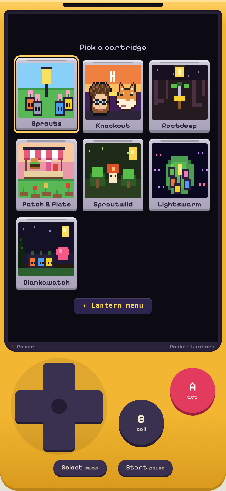
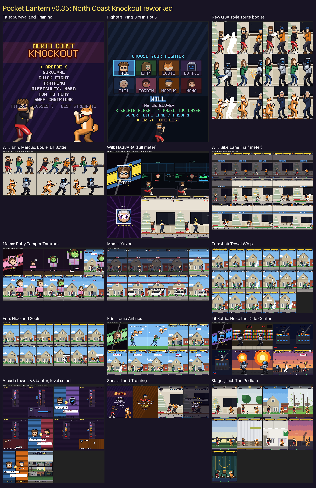

# Main line: `alt/` — seven cartridges (updated Nov 18 2026)

**Newest:** the seven-cartridge console on `main`: Sprouts, North Coast Knockout, Rootdeep, Patch & Plate, Sproutwild
(v12.10), Lightswarm (slice v0.3) and Clankawatch (v4.0 alpha 3), with a power-on sequence and a shelf in rows of three.
Front page: [`README.md`](README.md). Everything open, per game: [`OPEN-ITEMS.md`](OPEN-ITEMS.md).

**Sprouts since then (Nov 18):** nine cutscenes drawn live in 3D (N64 style), a tenth place (the North Coast, the North
Light and the Wending Lake), a key from Erin's garden that opens the pond road to Marcus, a SCENES page in the
Collection, and a playtest pass (bugs, speed). Details: [`alt/CHANGELOG.md`](alt/CHANGELOG.md). Checked by script only;
not yet played by hand or on a phone.

**Build on this:** [`alt/`](alt/README.md). Play `alt/games/pocket-lantern-alt.html`; rebuild with `python3 alt/build.py`.

- **What changed:** [`alt/CHANGELOG.md`](alt/CHANGELOG.md) (console, Sprouts, Knockout, Patch & Plate, Lightswarm), [`alt/src/sproutwild/CHANGELOG.md`](alt/src/sproutwild/CHANGELOG.md), [`alt/src/clankawatch/CHANGELOG.md`](alt/src/clankawatch/CHANGELOG.md)
- **Saved before Sproutwild went in:** `alt/backups/pocket-lantern-alt_2026-11-15_4-carts_pre-sproutwild_BACKUP.html`
- **Saved standalone Sproutwild v6.0:** `muse/games/Sprouts+Rootdeep+Sproutwild-v6.0_2026-11-15_BACKUP.html`

It has not been cut as a numbered release yet (no `share/` zip). The last numbered release is still v0.35, below.

# Last release: Pocket Lantern v0.35 (Nov 15 2026)

Four cartridges: Sprouts, **North Coast Knockout (reworked)**, Rootdeep, Patch & Plate.
v0.35 is v0.3 with a new Knockout: snappier feel, GBA-style sprite bodies, King Bibi, two-stage supers with full-meter
cinematics (HASBARA, Ruby Temper Tantrum, Louie Airlines, Nuke the Data Center), Survival and Training, the arcade tower,
level select and banter. Everything else is exactly v0.3.

- **What's new:** [`v0.35/CHANGELOG.md`](v0.35/CHANGELOG.md)
- **Send this:** [`v0.35/share/pocket-lantern-v0.35-share.zip`](v0.35/share/pocket-lantern-v0.35-share.zip)
- **Start here if you're working on it:** [`v0.35/README.md`](v0.35/README.md), then [`v0.35/handoffs/HANDOFF_v0.35.md`](v0.35/handoffs/HANDOFF_v0.35.md)

| Version | Folder | What |
| --- | --- | --- |
| v0.35 | `v0.35/` | Knockout reworked (this release). Built from the frozen v0.3 backup. |
| v0.3 | `v0.3/` | The previous main version: Patch & Plate in slot 4. Kept as is. Changelog: [`v0.3/CHANGELOG.md`](v0.3/CHANGELOG.md), send: [`v0.3/share/pocket-lantern-v0.3-share.zip`](v0.3/share/pocket-lantern-v0.3-share.zip) |
| v0.2.1 | `v0.2/` | Rootdeep in slot 3; still where Rootdeep work happens. Changelog: [`v0.2/CHANGELOG.md`](v0.2/CHANGELOG.md) |
| v0.1 | `v0.1/` | Sprouts + Knockout; the rollback. Never edit. |
| ALT | `alt/` | **The main line.** Began as the experimental fork where v0.35's Knockout was made; now seven cartridges (Sproutwild, Lightswarm and Clankawatch added). Separate saves. Not yet a numbered release. |
| Sproutwild (standalone) | `muse/` | lil Bottie's Muse files and the standalone Sproutwild through v6.0. Archive; live source moved to `alt/src/sproutwild/`. |

The files at the repo root (`README.md`, `build.py`, `index.html`, `src/`) are the old pre-v0.2 setup.

## Finding old versions

Every version stays in its own folder, so all of them are always on the same branch:
`v0.1/`, `v0.2/` (v0.2 and v0.2.1), `v0.3/`, `v0.35/`. Each has `backups/` (frozen game files, never edited) and `share/`
(the zip to send). Nothing is deleted when a new version is made. Git history also keeps every earlier state of every file.
If v0.35 has a problem, v0.3 is still there to send and play: `v0.3/share/pocket-lantern-v0.3-share.zip`.
