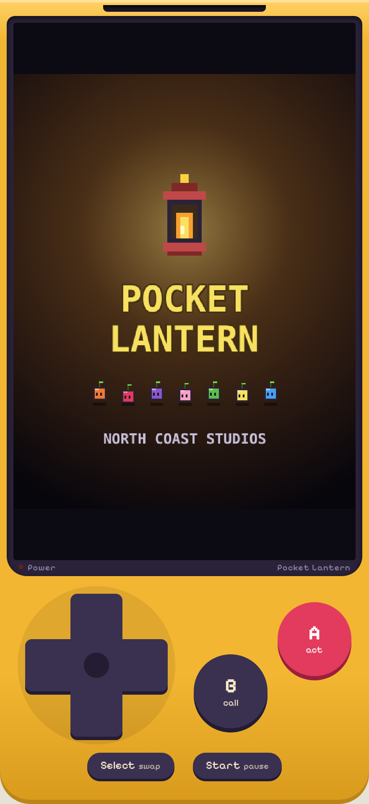

# Pocket Lantern

A pocket game console in one HTML file, by North Coast Studios. Seven game cartridges on one shelf.

**Play the newest build:** [`alt/games/pocket-lantern-alt.html`](alt/games/pocket-lantern-alt.html)
(download it and open it in a browser, or use the shared Claude link Will has).

> **New here?** Read this page, then [`OPEN-ITEMS.md`](OPEN-ITEMS.md): every known bug, untested thing, open question
> and wish for every game, in one place. Everything new is built in the [`alt/`](alt/README.md) folder. The other
> folders are frozen older versions, kept on purpose so nothing is ever lost.

## The seven games (cartridges)

| # | Game | What it is | Status | Changelog |
|---|------|-----------|--------|-----------|
| 1 | **Sprouts** | Pikmin-style garden game. Will throws sprouts, grows the garden and brings home four sun shards to relight the Great Lantern. Louie the dog fetches strays. | Stable; the valley update (Nov 18) | [`alt/CHANGELOG.md`](alt/CHANGELOG.md) (Sprouts sections) |
| 2 | **North Coast Knockout** | 2D fighter with Will, Erin, Marcus, Louie, Lil Bottie, King Bibi, Corbin and Mama. Supers with cut-ins, an arcade tower, Survival, Training, Trials. | Paused between passes | [`alt/CHANGELOG.md`](alt/CHANGELOG.md) (Knockout sections) |
| 3 | **Rootdeep** | Roguelite dungeon crawler under the valley. Short rooms, a new run every time. | Finished (v0.2.1) | [`v0.2/CHANGELOG.md`](v0.2/CHANGELOG.md) |
| 4 | **Patch & Plate** | Erin's farm stand at Sunkeep: plant it, cook it, serve it. Each day is a level of a minute or two. | Stable (v0.7) | [`alt/CHANGELOG.md`](alt/CHANGELOG.md) (Patch & Plate sections) |
| 5 | **Sproutwild** | Creature collector. The Lantern is dark and the buddies have gone wild; show them the light, build Sunkeep, light four Guardians, face Bottie. | In active development (v12.10) | [`alt/src/sproutwild/CHANGELOG.md`](alt/src/sproutwild/CHANGELOG.md) |
| 6 | **Lightswarm** | Survivors-style roguelite. Walk into the dark with a sprout swarm that throws the light by itself, pick one of three upgrades each level, light the Guardian. Ten keepers, two supers each. | Vertical slice v0.3, for evaluation | [`alt/CHANGELOG.md`](alt/CHANGELOG.md) (Lightswarm sections) |
| 7 | **Clankawatch** | Garden tower defense. Plant sprout towers by day and hold the track against Lil Bottie's drone swarms by night. Three gardens, 26 nights. | v4.0 alpha 3 (copied in from its own branch) | [`alt/src/clankawatch/CHANGELOG.md`](alt/src/clankawatch/CHANGELOG.md) |

## Latest updates

- **The console (Nov 18 2026):** a power-on sequence before the shelf, the shelf in rows of three with bigger
  cartridges, Clankawatch folded in as cartridge 7.
- **Lightswarm, cartridge 6 (Nov 18 2026):** a new game, built as a vertical slice and grown to v0.3: ten playable
  keepers, supers with cutscenes, finds, the Keeper's Trail. Source: [`alt/src/lightswarm.js`](alt/src/lightswarm.js).
- **Sprouts (Nov 17 and 18 2026):** the valley update, the prequel pass, new menus and a field guide, the Collection,
  nature's balance, and now **cutscenes in 3D** (N64 style, drawn live) and a tenth place, **the North Coast**.
- **Sproutwild v10 to v12 (Nov 17 2026):** Guardians of the Light, Sunkeep redesigned, expeditions and the Soul Lamp,
  the stretch to the first Sigil confirmed by script.
- **Patch & Plate v0.4 to v0.7 (Nov 17 2026):** the stand moved to Sunkeep, big moments, kitchen buddies, heart scenes.
- **Last numbered release: v0.35 (Nov 15 2026),** four cartridges with the reworked Knockout. See [`LATEST.md`](LATEST.md).

## Where things are

| You want... | Go to |
|---|---|
| The newest playable game | [`alt/games/pocket-lantern-alt.html`](alt/games/pocket-lantern-alt.html) |
| Everything that is open, for every game | [`OPEN-ITEMS.md`](OPEN-ITEMS.md) |
| What changed, game by game | the Changelog column above |
| Fix history | [`KNOWN-ISSUES.md`](KNOWN-ISSUES.md) |
| Will's story decisions | [`alt/STORY-NOTES.md`](alt/STORY-NOTES.md) |
| How the build is put together, and the tests | [`alt/README.md`](alt/README.md) |
| Sproutwild design notes and research | [`alt/src/sproutwild/DESIGN-v7.md`](alt/src/sproutwild/DESIGN-v7.md) |
| Screenshots from the test runs | [`alt/playtest/`](alt/playtest/) |
| The dev board (visual timeline for the team) | [`dev-board/README.md`](dev-board/README.md) |
| Every older version (frozen, never edited) | [`LATEST.md`](LATEST.md) has the table: `v0.1/`, `v0.2/`, `v0.3/`, `v0.35/` |
| The public web copy (GitHub Pages) | [`docs/`](docs/) (still the old four-cartridge build; updated only when Will says so) |

## Branches

`main` holds this seven-cartridge build as of Nov 18 2026. Work in progress happens on working branches and shows here
after it is merged. Clankawatch is still being built on `claude/tender-darwin-0r4toe`; the copy in the console is
refreshed by hand. Other North Coast games (lil Bottie, Starhaven, Sootborn, Underground Syndicate, and the new
[PITBORN 2145](pitborn/README.md) in `pitborn/`) live on their own
branches and are listed at the end of [`OPEN-ITEMS.md`](OPEN-ITEMS.md).

## For developers

- Build: `python3 alt/build.py` (writes `alt/games/pocket-lantern-alt.html`).
- Tests, from the repo root after building: see the table in [`alt/README.md`](alt/README.md).
- Rules: never edit or delete the frozen version folders or `backups/`; every change gets a changelog entry; say
  plainly what was and was not tested.
