# Pocket Lantern ALT changelog

ALT = v0.3 plus the changes below. Names and likenesses are unchanged everywhere. Patch & Plate's code was untouched until v0.4 (Nov 17 2026, below).
Everything here is **invented this pass and not phone-confirmed**; flag anything to Will (he hands out canon).

## Sprouts: meeting Marcus, in 3D (Nov 18 2026)

Will: when you meet Marcus for the first time it should cut to a 3D cutscene of you and Louie walking up to him and
Derek in his van ripping dabs, and then he tells Will about his business idea.

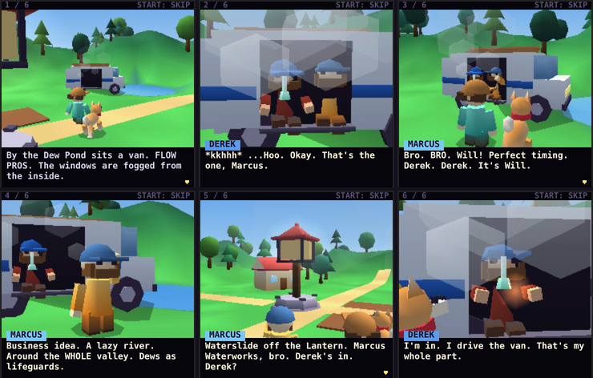

- **A sixth 3D scene, `van`, six shots.** Pressing A on Marcus the first time cuts to it: Will and Louie walk down
  from the Lantern to the Dew Pond, where the Flow Pros van is parked with the side door open. Derek takes the hit
  and the cloud rolls out. Marcus spots Will, hops down, and pitches the lazy river and the waterslide off the
  Lantern. Derek is in ("I drive the van. That's my whole part."). Louie sneezes.
- Then the ordinary talk opens with a new short line and his first ask (find a Dew), so the idea is not told twice.
  Skipping the scene with Start lands in the same place. It plays once per save; a save that has already met Marcus
  never sees it.
- New models: the van (blue stripe, ladder rack, copper pipe), Derek (blue cap, red shirt, beard, from his Sproutwild
  colours), people who can sit, a rig, and see-through puffs of cloud. The 3D valley now has the Dew Pond.
- Derek has a name tag colour in scenes. He is only in this scene; he does not stand in the valley afterwards.

**Tested:** three new checks in `tests/sprouts_coast.js` (41 in all, pass): the first talk cuts to the scene, the talk
that follows gives the Dew ask without the lazy-river line, the second talk is ordinary. All six shots drawn and looked
at. `sprouts_valley.js`, `sprouts_story.js`, `sprouts_soak.js` pass. **Not tested:** by hand, or on a phone.

**For Will:** Sprouts is the prequel, so this puts Derek and the Flow Pros van in the valley before the Night of the
Clank. The story notes say Marcus was on a Flow Pros job with Derek when he was called, which fits, but it is yours to
confirm.

## Sprouts: cutscenes in 3D, and the North Coast (Nov 18 2026)

Will: develop Sprouts more. Lore wise, how do we introduce the next area? Actual cutscenes, 3D rendered occasionally,
N64 era style.

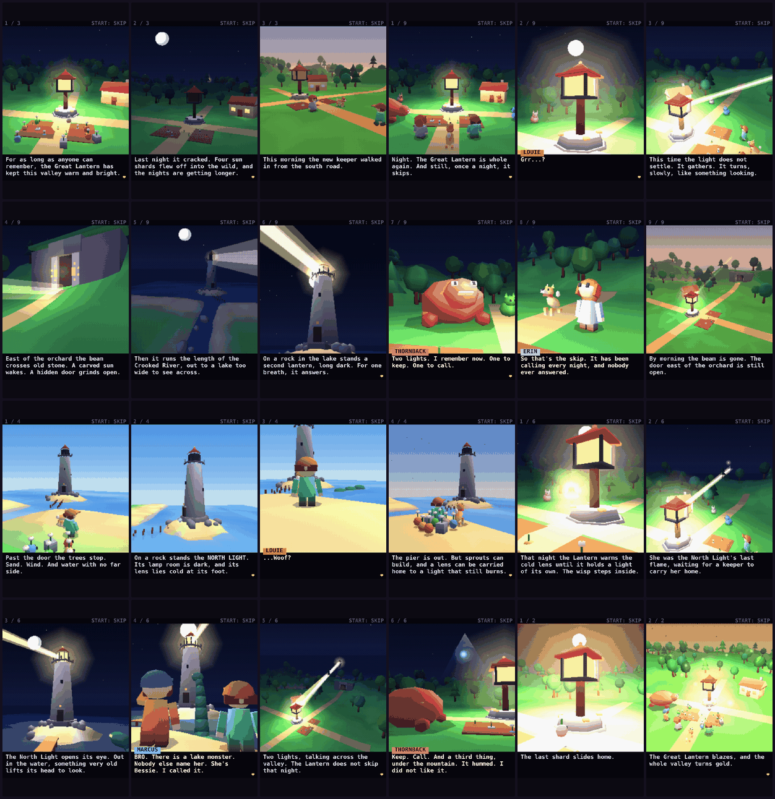

**How the next area is introduced (the short version).** The Lantern has skipped once a night since the prequel pass
and nobody could say why. Now it turns out the skip was a call. Once the Lantern is whole, one night the light gathers
into a beam, opens an old sun door east of the orchard, and points down the Crooked River to a second lantern standing
dark on a lake. Thornback remembers: two lights, one to keep, one to call. The canon this assumes is written up in
[`STORY-NOTES.md`](STORY-NOTES.md) for Will to confirm or change.

**3D cutscenes** (new file `src/sprouts3d.js`):
- Five scenes, 24 shots, used only for the big beats. Everything else stays 2D.
  - `dawn`: a new game opens on the Lantern at night, the crack with four shards flying off, and Will walking in at
    dawn. Erin's 2D scene follows, starting on her hello.
  - `blaze`: the fourth shard, before Erin's ending lines.
  - `call`: the night the Lantern calls (nine shots).
  - `coast`: the first walk onto the North Coast.
  - `relight`: the lens comes home and the North Light burns.
- The look is a 64-bit console's: low-poly models with a colour at each corner, fog, a lamp that lights the ground
  around it, 15-bit colour with dither, drawn at the screen's own 240 pixels and scaled up soft. Will, Erin, Marcus,
  Louie, Thornback, sprouts and buddies are all built as models from their sprite colours (Will wears the cap and coat
  you have equipped). No WebGL, no image or model files; the page grew by about 60 KB with the new area.
- A scene plays itself. A shows the whole caption, then goes to the next shot. Start skips the scene.

**The North Coast** (the tenth place):

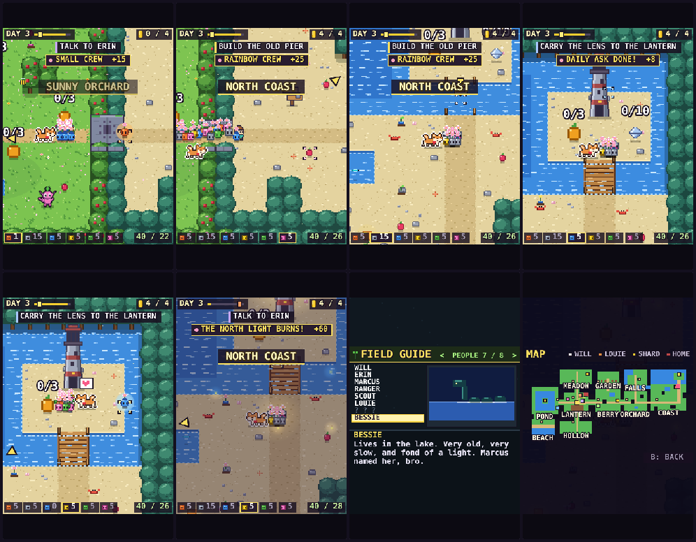

- **The call.** After the fourth shard, the next night (day 2 or later) the `call` scene plays wherever Will is
  outdoors, and the sun door at the east end of the orchard path opens. Sprouts cannot open that door; throwing at it
  says so. The dusk message hints that the Lantern is restless.
- **The place.** Sand, a lake that fills the north, a tide pool, wild Dews, Pebs and Luckies, berries, a nectar
  blossom, crabs, a trail post. The valley map is 22 tiles wider; the map screen is drawn smaller to fit.
- **The pier.** Stakes on the shore; sprouts of any kind build it (it takes longer than the orchard bridge).
- **The lens.** It lies on the rock by the North Light and needs 10 carrying strength. The crew carries it the whole
  way home to the Lantern, the longest haul in the game. Delivering it plays `relight`, pays 60 petals and 2 tickets,
  and lights the tower.
- **Afterwards.** The tower shines and sweeps a beam at night, the Lantern stops skipping, Bessie raises her head in
  the lake after dark, and she goes in the field guide under PEOPLE. The tower can be read with A (it says SUN CALL).
- The objective marker carries the new steps: FOLLOW THE BEAM EAST, BUILD THE OLD PIER, CARRY THE LENS TO THE LANTERN.
  These take over from the mission marker until the light is lit.

**Saves:** old saves load with the door shut and get the call on their next night if the Lantern is already whole.
The door, the pier, the lens and the lit tower are saved.

**Changed on the way:** the pause tile reads "9 / 10 places" (it did not fit with ten). The second bridge reuses the
orchard bridge's code, which had assumed there was only one.

**Tested:** new `tests/sprouts_coast.js`, 38 checks, all pass: every shot of every scene draws a full picture (72
frames, 4 to 5 ms each on average in headless Chromium, 19 ms at worst), every caption fits, the opening, the call, the
door, the pier, the lens carried home by a real crew, the relight, three kinds of save, and the ending.
`sprouts_valley.js`, `sprouts_story.js` and `sprouts_soak.js` pass after being updated for the new opening, ending and
tenth place. Sproutwild lab 124 of 124, Patch & Plate 119 of 119, console shelf and Lightswarm lab pass.
**Not tested:** by hand, or on a phone. Frame time on a real phone is unknown; the scenes are the heaviest drawing in
Sprouts. No sound was listened to. `sprouts_valley.js` failed its field-guide check once in four runs here; that check
waits on a timer and looks to have been flaky before this change.

## Docs: one list of everything open, front pages brought up to date, pushed to main (Nov 18 2026)

Will: push this build to main; one big doc of every known bug, issue, want and wish per project from the latest notes
and changelogs; update the main page and the pages that describe the games.

- New [`OPEN-ITEMS.md`](../OPEN-ITEMS.md) at the repo root: the console, the seven cartridges, the open story
  questions, and the four games on other branches. Each section names the files it was pulled from.
- `README.md` rewritten for seven cartridges. `LATEST.md` and `alt/README.md` describe every game. `KNOWN-ISSUES.md`
  points to the new list and keeps the fix history.
- No game code changed.

## The console: a power-on sequence, a bigger shelf, and Clankawatch as cartridge 7 (Nov 18 2026)

Will: does this have the latest versions of everything; fold Clankawatch in; reorganise the cartridges to fit more of
the screen; a boot sequence when the Lantern starts, before the cartridges, not the same as the games' boot.

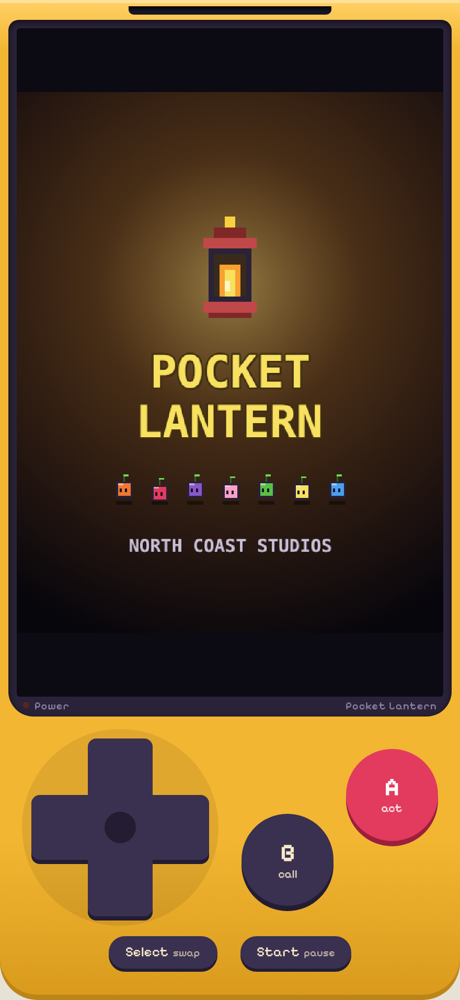

- **Power on.** Opening the page now plays the console's own start-up before the shelf: a match is struck in the
  dark, the lantern takes, the light spreads over POCKET LANTERN, one sprout hops in for each cartridge, NORTH COAST
  STUDIOS, a four-note chime. About 3.6 seconds; any button skips it. The games keep their own boot (the name
  dropping in, LIGHTS ON) when a cartridge goes in. Sound only plays if the page has been touched first (browsers
  block it otherwise). `?noboot` in the address skips it.
- **The shelf is rows of three,** with cartridges about twice the size (117 wide on a phone, was 62) and bigger
  labels, so it fills the screen. The D-pad moves up and down the rows; below the last row is the Lantern menu.
  There is room for two more cartridges before a fourth row.
- **Clankawatch is cartridge 7.** Its source (v4.0 alpha 3, from `claude/tender-darwin-0r4toe`, folder
  `muse/games/thornwatch/`) is copied to `src/clankawatch/` and built into the console's own scope, the way it was
  in its own console. Nothing in it was changed. Its saves keep the `thornwatch` keys (with ALT's `pl-alt:` prefix,
  so saves from its old standalone file do not carry over). No name in it clashed with the other cartridges.
- The page title is "Pocket Lantern".

**Latest versions, checked against every branch on GitHub (Nov 18):** Sprouts, Knockout, Rootdeep, Patch & Plate and
Sproutwild here are the newest there is (the Sprouts valley branch; no other branch has newer code for them).
Clankawatch is its newest. **Not in this console:** lil Bottie v0.4.1 (`claude/modest-ride-rgjg4r`, its own console
fork in `bottie/`), Starhaven, Sootborn and Underground Syndicate (separate games in their own folders).

**Keeping Clankawatch in step:** it is a copy. When the Clankawatch branch moves on, copy its `src/tw-*.js` over
`alt/src/clankawatch/` and rebuild.

**Tested:** new `tests/console_shelf.js` (11 checks: the start-up, skip, shelf layout and D-pad, Clankawatch to its
title, files, menu, story and thirty seconds of a night, no errors). Lightswarm 38, Patch & Plate 119, Sproutwild lab
124, Sprouts story run all pass. Clankawatch's own tests were not run against this build. **Not played on a phone.**

## Lightswarm v0.3: more lore, the radio, finds, second supers, Keeper Rank (Nov 18 2026)

Will: more lore from the latest Sproutwild and Sprouts; pop-up quips and other animations; sprouts were piling up;
keep refining the rewards and level system; multiple abilities or supers; more power-ups, unlockable ones.

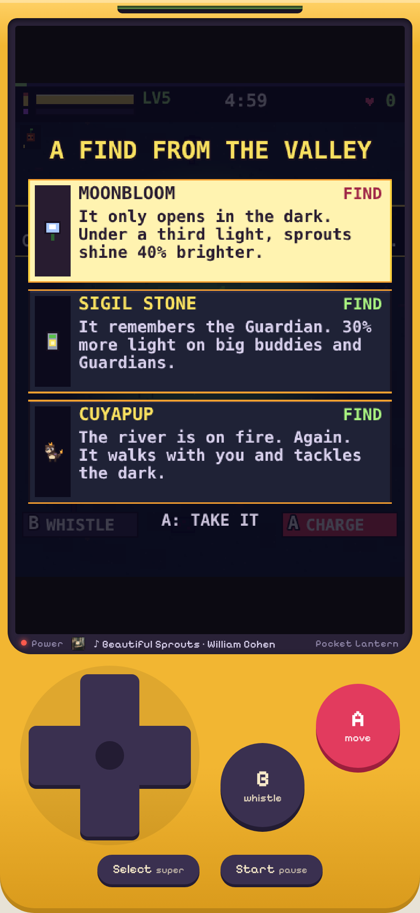

- **Sprouts no longer pile up.** The swarm keeps shoulder room: no two sprouts stand on the same spot, moving or
  still, and none stands on the keeper. The crowd is a little wider. (If the pile you saw was something else, say.)
- **The radio from Sunkeep.** A face and a line slide in above the buttons, from somebody back home and never the
  keeper you are playing: eight timed lines across a run, plus lines when the first big one is calmed, the wisp is
  caught, the Soul Lamp saves you, Marcus's bet lands, and "BRO. YOU'RE J-LIGHTING AGAIN." when Will uses Hasbara.
  Lore used: the dome staying up "temporarily", four Guardians and four Sigils, Pythorn off the circus train in 1944,
  Bottie wanting the light for his feed, "they are not angry, they just cannot see".
- **Each keeper thinks out loud** now and then (two lines each from their story: the wedding plans, the Flow Pros
  job, the lazy river, Thornback, the gatehouse wisp, three thousand years, the big red button).
- **Finds.** Every fifth level offers one of three one-of-a-kind things, on a gold-edged card: SUN SHARD, DATA
  CENTER KEY (four cards a level), GOLD COIN, BLUE FEATHER, the three starters CUYAPUP, BESSLING and GRASSKIN (they
  walk with you), SOUL LAMP (gives your light back once), OLD KEY, STAR CHIP, MOONBLOOM, BESSIE'S SCALE, SIGIL STONE.
  Five are open from the start; eight are opened on the trail.
- **Two more items** in the ordinary cards: NECTAR and ACORN CAP.
- **A second super for every keeper,** at mastery rank 3, chosen with Select on the keeper screen: BIKE LANE,
  SPROUT STAMPEDE, THE FINAL BET (a coin: it can go against him), BURST PIPE, YUKON, 007, WISP LIGHT, TRAIL POST,
  IRON DOME, AIR SUPPORT. Each has the cut-in and a scene. Names are their Knockout supers where they had one.
- **The Keeper's Trail is 22 steps** (was 14): eight new ones open the finds.
- **Keeper Rank,** as in Sprouts: one rank for the whole save from every buddy calmed; each rank pays seeds. It is on
  the title and on the report with a bar.
- **Animations:** a ring and sparks on a level and the swarm hops; cards slide in one after another; "100 HOME",
  "SUPER READY" and bet results pop at the top; the Soul Lamp flash; water, dome, post, bikes, Yukon and drones on
  the field.
- **Balance:** levels come slower late (about 20 to 28 by the Guardian), late hits dim more, the Guardian has 4200,
  seeds per run are lower. The testing unlock (hold Select on the trail) now also lifts every keeper to rank 3.

**Canon to flag to Will:** the SOUL LAMP here gives light back once (its real name and use are open in the story
notes). CUYAPUP, BESSLING and GRASSKIN as things you find. The DATA CENTER KEY is new. Radio lines are new wording of
existing story.

**Tested:** `tests/lightswarm_lab.js`, 38 checks, every keeper's two supers fired and drawn (`23-scene2-*`,
`24-after2-*`). Bots win about one run in three and mostly fall within a minute or so of the Guardian waking. **Not
played by hand or on a phone.**

## Lightswarm v0.2: ten keepers, supers with cutscenes, the Keeper's Trail (Nov 18 2026)

Will: all our favourite characters should be playable (Will, Erin, Marcus, Bottie, Bibi and anyone important or seen
more than once); Louie stays an item; a deeper unlock track; powers from each character's lore; quips; supers with a
cutscene like the dab rig and Hasbara ones.

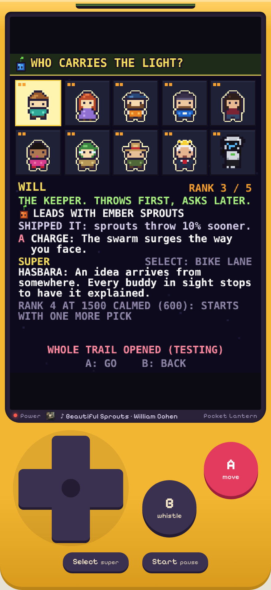

**Ten keepers.** Each leads with one sprout kind, has a passive, their own A move and a SUPER.

| Keeper | Leads with | Passive | A | SUPER |
|---|---|---|---|---|
| WILL | Ember | Sprouts throw 10% sooner | CHARGE | HASBARA: Bibi beams the idea in from the desk; every buddy in sight stops to hear it |
| ERIN | Leaf | Light mends itself, three times the berries | TOWEL WHIP (all round) | LOUIE AIRLINES: Louie the paper plane loops the field |
| MARCUS | Peb | 15% brighter, every gift is two picks | DAB CLOUD (slows) | THE DAB RIG: the whole field goes slow for 8 s |
| DEREK | Zip | 15% faster walk, quick A | PULL UP | DEREK PULLS UP: the Flow Pros truck, three passes |
| MAMA | Dew | Everything ready 15% sooner | MOM VOICE (stops them dead) | RUBY TEMPER TANTRUM: five stomps |
| CORBIN | Lucky | Calmed buddies sometimes leave a heart | KISS (goes through everything) | CAN I GET A KISS?: every small buddy in sight goes home |
| SCOUT | Zip | Sees and reaches further, learns 12% more | BUG NET (sweeps motes) | FIELD NOTES: 10 s of an extra mote per buddy |
| RANGER | Peb | +40 light, slower, wider Pebs | BOULDER | ROCKSLIDE: fourteen boulders |
| KING BIBI | Dew | Iron Dome takes a hit every 14 s | IRON DOME (untouchable for 2.6 s) | THE COALITION: six lit buddies walk with him |
| LIL BOTTIE | Ember | Clanker guns fire by themselves; least light | CLANKERS (fan of seven) | NUKE THE DATA CENTER: resets every small buddy, costs him light |

- **Supers.** A bar under the light fills as buddies are calmed (160, then 70 more each time). When it is full the
  Select button glows; pressing it plays a Knockout-style cut-in (their Knockout head where there is one), a short
  scene of their own, and then it lands on the field. A skips the scene.
- **Quips.** A bubble over the keeper at the start, on a level, when the light runs low, when a big one is calmed,
  when the Guardian wakes, on a super and on a win. One voice at a time, never over a banner. Lines are theirs from
  Knockout, Sprouts and Sproutwild where they had some.
- **The Keeper's Trail** (title menu): 14 things to do, each opening a keeper, a sprout kind or an item. Erin and
  Louie come with the first run home; Bottie needs the Guardian lit by three keepers. Sprout kinds are no longer
  bought with seeds. The pick screen says what a locked keeper needs.
- **Mastery.** Each keeper has five ranks from buddies calmed as them: +10 light, super fills sooner, one more pick
  at the start, a LV 2 lead sprout.
- **For testing:** hold Select for two seconds on the Trail screen and everything opens.
- The Guardian has more light to give (3400) and gets faster the longer it is run from; with it close, the swarm
  goes for it first.
- Louie is still an item, as asked.

**New art:** field sprites for Derek, Mama, Corbin and King Bibi in the Sprouts style; Ruby, the rig, the truck, the
desk. Will, Erin, Marcus, Ranger, Scout and Bottie use the models the other cartridges already have.

**Canon to flag to Will:** Derek has no face in any other cartridge, so his look here (beanie, Flow Pros blue) is new.
Scout and Ranger are placeholder characters per the story notes; they have light kits and no story. Bibi's super is
THE COALITION (his Knockout second super), not his first. Corbin is the Knockout name for "Kiss".

**Tested:** `tests/lightswarm_lab.js`, 28 checks: every keeper's move and super is fired and its scene drawn
(screenshots `20-cutin-*`, `21-scene-*`, `22-after-*`), the trail, the testing unlock, then bot runs. Bots with
supers win roughly half their runs; the numbers swing a lot from run to run. **Not played by hand or on a phone.**

## Lightswarm: cartridge 6, vertical slice v0.1 (Nov 18 2026)

Will: a brand new game in the Sprouts universe, not tower defense, on a copy of the latest build, as a vertical slice
to evaluate; fun, sellable, unique, addicting. (A first idea, a Louie platformer, was turned down before it was built.)
Will picked Lightswarm from four pitches.

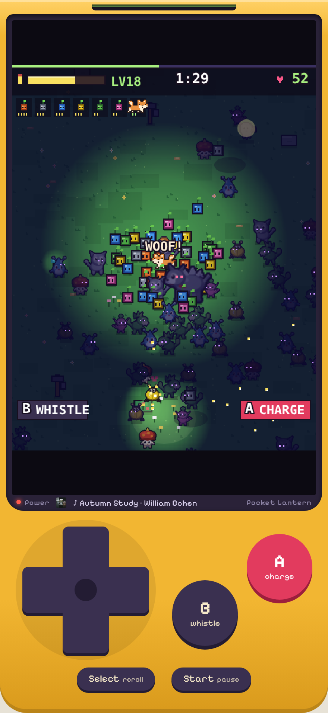

**What it is.** A survivors-style roguelite. Will walks into the dark with a swarm of sprouts and only steers; the
sprouts throw the light by themselves. Dimmed buddies close in from every side. A lit buddy remembers, goes home calm
and leaves a mote. Motes level you up: pick one of three cards. At 5:00 the Guardian of the Light wakes, dim. Light it
and the expedition is won. A run is five to six minutes; dying early takes two or three.

- **You steer, plus two buttons.** A is CHARGE (the swarm surges the way you face, 7 s), B is WHISTLE (calls every
  mote on the field and shoves the dark back, 12 s).
- **Six sprout kinds, six weapons, five levels each:** EMBER TOSS, PEB DROP, DEW RING, ZIP LINE, LEAF PATCH, LUCKY
  STAR. At most four kinds in a swarm, so a build takes shape. The swarm you see grows with every level.
- **Seven things from home:** Louie (he fetches far motes), Lantern Oil, Trail Boots, Tiny Bell, Marcus's Wrench,
  Erin's Tea, Moon Pebble.
- **Your light is your life,** and the lit circle shrinks as it dims. Dim buddies show as eyes in the dark.
- **The dark:** seven kinds of buddy with their own ways of coming at you (Zipwigs weave, Fernfangs wind up and
  charge, Cloverimps come in packs, Drizzlets ring you), two big ones (Boulderhound at 2:00, Bloomboar at 4:00) that
  walk with you once calmed, a Lanternwisp that runs and leaves a gift, and PYTHORN at 5:00 (line charge, thorn
  rings, calls Melonkins).
- **Seeds come home either way** and buy lasting upgrades at Sunkeep (five, three levels each) or unlock PEB, LEAF and
  LUCKY as the kind that leads. Records are kept. A: GO AGAIN on the report starts the next run at once.
- Title, a five-page opening, how-it-works page, pause with your build, expedition report.

**Files.** `src/lightswarm.js` (one file, built in like Patch & Plate), six small hooks in `src/console.js`, a sixth
cartridge and narrower shelf labels in `src/shell.html`, one line in `build.py`. Save key `lightswarm-v1`; it reads and
writes nothing else. Buddy art is Sproutwild's own, dimmed in code. Music is the console's game list.

**Canon this leans on (nothing new invented, flag anything wrong to Will):** expeditions carry the light to far
places; sprouts carry the light that calms buddies; nothing is hurt; Guardians and Sigil stones; Pythorn is Crooked
Hollow's Guardian on a circus trunk. New names only for game things: CHARGE, WHISTLE, the weapon names, SEEDS.

**Tested:** `tests/lightswarm_lab.js`, 23 checks (rules stepped; then a simple bot plays whole expeditions). The bot
with no upgrades wins about one run in three and otherwise falls between 2:00 and 3:30. 60 frames a second with 100
buddies on screen in headless Chromium (2.3 ms a frame). Patch & Plate 119, Sproutwild lab 124 and the Sprouts story
run still pass; the Patch & Plate shelf check now expects six cartridges. **Not played by hand or on a phone.**

## Sprouts: nature's balance (Nov 18 2026)

Will: maybe buddies should eat sprouts. It keeps them alive, like the light in the other game; nature's balance. Not
aggressive: only a sprout left behind that Louie can't get. It can trim the team. If it works cleanly it doesn't have to
be mentioned.

- **A wild buddy will quietly eat a stranded sprout.** All of these must be true: the sprout has stood idle for 30
  seconds (Louie fetches strays he can reach well before that), Will is more than about nine tiles away, a buddy is
  within ten tiles and can walk to it, the crew is 12 or more, and it is not night (they are at the lantern then).
  The buddy ambles over, nibbles for under two seconds, and the sprout is gone in a puff of its colour.
- **Never:** a star sprout, a gardener, a sprout in water, a sprout Louie is on his way to, or anything from a small
  crew. Each buddy eats at most two a day and waits a minute and a half between.
- **If Will comes back in time the buddy backs off** and the sprout is fine.
- **Nothing announces it.** No message, no toast, no count. A fed buddy sparkles for a few seconds, and Scout says
  "THE BUDDIES LOOK WELL FED" once, the next time you pass her. The evening roll call is where you would notice.
- It is rare in busy play: two three-day autopilot runs that whistle often saw none. It is a consequence of leaving
  sprouts behind, not a threat.

**Canon this assumes (flag to Will):** buddies live on the light that sprouts carry, here as in Sproutwild. Nobody in
Sprouts knows that yet, which is why nobody remarks on it.

**Tested:** seven new checks in `sprouts_valley.js` (48 in all, five runs in a row): eaten when stranded; nothing said;
not near Will; not a star; not from a small crew; not one that only just stopped; backs off if Will returns. Story run
and three chaos seeds clean. Not played by hand or on a phone.

## Sprouts: the Collection, what comes after the missions, strays (Nov 18 2026)

Will: keep working on the game.

- **The Collection has a cursor and says something about each thing.** Bugs and treasures are tiles; the line under them
  is the bug's note (ten new ones: "Sits by the pond and judges your throwing.") or the treasure's memory, which until
  now you saw once, on the card when it came home. Uncaught bugs say where to look. Right at the edge turns the page.
- **The marker has somewhere to point after the missions.** With every ask done it now reads BUILD THE ORCHARD BRIDGE,
  then SOMETHING OLD AT WILLOW FALLS until the arch is read, then the valley projects as before. Old saves that had
  finished everything get the same pointers.
- **A full field guide pays out once:** 2 tickets and 30 petals.
- **The evening report counts strays.** Sprouts left idle far from the lantern at nightfall are brought in by Louie
  ("LOUIE BROUGHT 3 STRAYS HOME"), and he earns a little for it. (Since "nature's balance", above, a sprout stranded
  for a long time during the day can be lost to a buddy; whoever is still out there at nightfall comes home.)
- **The garden says how to get your crew back** the first time everyone with you has become a gardener.
- The house desk rows are tiles like the other menus.

**Tested:** `sprouts_valley.js` now 41 checks, six runs in a row; `sprouts_story.js`; `sprouts_soak.js` (chaos clean; the
objective bot got through four asks in four of five runs and two in the other, so its bar is now two); Sproutwild lab
124 of 124. Not played by hand or on a phone.

## Sprouts: menus, the field guide and small talk (Nov 18 2026)

Will: keep refining the gameplay, characters, lore, world building, Pikmin-like stuff and menus; "I love the new menus
in Sproutwild". Built on the combined branch (Sproutwild v12, Patch & Plate v0.7 and the Sprouts valley work).

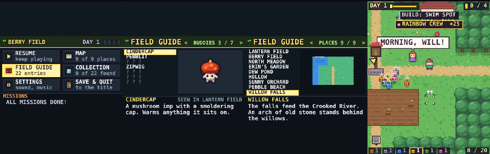

**Menus, in Sproutwild's style** (slate background, a header band with the sprout mark, tiles):
- **Pause is a grid of six tiles with icons:** RESUME, MAP, FIELD GUIDE, COLLECTION, SETTINGS, SAVE & QUIT, each with a
  line under it (places found, entries, things collected). The header shows where you are, the day and the four shards.
  Missions are listed underneath. The Collection can now be opened from pause and comes back to it.
- The title menu and the trail post list are tiles. Rewards, Capsules, Style, Collection, Settings, Home and the valley
  project screen share the same background, header and footer.

**The field guide** (new, from pause). Four pages, filled in as you meet things; left and right change page:
- SPROUTS: the six kinds, each once you have plucked one.
- BUDDIES: the seven wild buddies, each once you have been near it (a note floats up when one goes in). The lines are
  Sproutwild's own descriptions, so the two games agree; the Lanternwisp has a line for this valley.
- PEOPLE: Will, Erin, Marcus, Ranger, Scout, Louie, and Thornback once he is awake. Marcus is the plumbing boss and
  Louie the evolved shiba, as in Knockout.
- PLACES: the nine places with a small live picture and a line of lore each. Two lines change with the story (Sunkeep
  after the arch, the hollow after Thornback).

**Characters:** the four people say a short line in a bubble as you walk past (Erin: "MORNING, WILL!", "THEY WATCH THE
LIGHT." at dusk; Marcus: "FLOW PROS, BABY."; Ranger: "OLD STONES HUM AT NIGHT"; Scout: "EVER SEEN THE WISP?"). One voice
at a time: never over a message, a toast or Louie, and never while they have something to tell you.

**Pikmin feel:**
- Carriers that are too few strain: they wobble, sweat, and the count turns orange until enough arrive.
- Idle sprouts glow softly in their own colour so you can find the ones you left behind.
- Numbers float up: "+3 SEEDS" at the lantern, petals at a harvested bed.

**Fixed:** Thornback's shard was dropped a fixed step to his left, which could be inside a wall, where nothing could ever
carry it (the last shard, so the game could not be finished). It now only shifts onto ground with a way home, and any
carried thing that ends up on a tile with no way home is walked to the nearest tile that has one.

**Tested:** `sprouts_valley.js` now 36 checks (pause grid, guide pages and text fit, small talk, the stuck shard), six
runs in a row; `sprouts_story.js` (two races in the test itself fixed); `sprouts_soak.js` two seeds of two days; Sproutwild
lab 124 of 124; Patch & Plate 119 of 119. Three of my new function names clashed with Sproutwild's (`drawGuide`,
`guideUpdate`, `pauseUpdate`); caught on the screenshots and renamed. **Not tested:** by hand, or on a phone.

## Sprouts: the story run (Nov 17 2026)

Will: one more pass, then push. No game code changed in this one; it is a check of the whole arc.

- New `tests/sprouts_story.js` (17 checks) plays the story by script: the berry field and meadow shards carried home, the
  island shard swum home by Dews only (aiming at water picks Dews by itself), a crowd waking Old Thornback with his new
  guardian lines, the last shard and the ending, then five sprouts and three star sprouts moving into the house, Pebs sent
  to the Waterworks, the evening report, and the next morning. All pass, three runs in a row.
- Looked at on screen: the first-shard scene, Thornback's guardian line, both ending frames, the house inside, the desk
  menu, and the Lantern skipping at night. Nothing wrong found.
- Seen but left alone: after a big day the morning can queue eight toasts, about 25 seconds of them (that is how the
  toasts have always worked).

## Sprouts: the checking pass (Nov 17 2026)

Will: another pass refining the new Pikmin mechanics and making sure the game does what it means to.

How it was checked: two autopilots that play through the real controls (`tests/sprouts_soak.js`). One follows the
objective marker from a fresh save. The other wanders a mid-game valley throwing at everything, whistling, travelling and
opening menus. Every second they check that no sprout is in a wall or in water, every worker is on the thing it thinks it
is working on, nothing carried takes 90 s to arrive, and nothing throws an error.

**Bugs they found, now fixed:**
- **Sprouts left standing in the pond.** Louie swims home with strays on his back and set them down as soon as he was near
  Will, even mid-pond. Sprouts that cannot swim then stood in the water, and with Louie under level 4 nothing could fetch
  them. This was in the game before the valley update. Louie now only sets riders down on dry land, and any non-swimmer
  that ends up in water hops back to Will.
- **"PLUCK 3 BLOOMED" pointed at the middle of the soil**, not at a bloomed sprout. It now points at a bloomed sprout in
  the lantern soil when there is one.
- **A in a crowded soil patch took the nearest sprout** even with a bloomed one beside it. It now takes the most grown
  sprout in reach, then the nearest.
- **On the map, WILLOW FALLS was written over GARDEN.** It is FALLS now. The map also says SUNKEEP once the arch is read.

**Tuned:** digging a treasure takes 14 sprout-seconds (was 8; a full crew finished before you saw it).

**Looked at and found right:** Erin's garden beds through a real harvest (the autopilot filled her first flower ask),
the valley project screen, Ranger's bridge ask and its text, the trail post list with nine places.

**Tested:** `tests/sprouts_soak.js`: Erin's day plus three chaos seeds of two days each, all clean.
`tests/sprouts_valley.js` 25 checks, 10 runs in a row (two of its checks had timing flakes in the test itself; fixed).
Sproutwild lab 124 of 124. **Not tested:** by hand, or on a phone. `tests/sprouts_tour.js` is superseded by the soak test.

## Sprouts: the prequel pass (Nov 17 2026)

Will: Sprouts can be a prequel to Sproutwild. Bottie blows up the Data Center later; everyone is called to the Lantern and
forgets what came before. In Sprouts we can find what Sunkeep was before it was Sunkeep. Buddies exist here but are not a
focus. Maybe this place has a guardian of the light. Nobody yet understands why the light matters. Keep Corbin and Pip out.

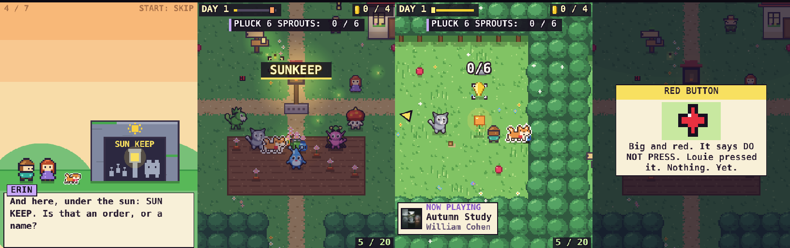

**The canon this assumes (new, flag to Will):**
- Sprouts happens before the Night of the Clank. The crack in this game is a small, earlier one (Thornback's squeeze).
  Nothing here mentions Bottie, the King, the dome, alphas or Sigils.
- The Lantern Field is the place that Sproutwild calls Sunkeep. The name comes from an old carving, "SUN KEEP", which
  Erin starts using. Who carved it is not said (the first keeper stays unknown).
- Old Thornback is this valley's guardian of the light. He has forgotten who set him to it, and why.
- The river north of the orchard is the Crooked River (Sproutwild's name for it).

**What is in the game:**
- **Seven wild buddies** (Cindercap, Pebblit, Drizzlet, Zipwig, Fernfang, Cloverimp, and a Lanternwisp at Willow Falls
  after dusk), in Sproutwild's art. They wander, back away from Will and the crew, and cannot be thrown at, caught or
  fought. From dusk, the ones who can reach it walk to the Great Lantern and sit at the edge of its light.
- **The old arch** at Willow Falls (top right, behind the willows). Press A at it for a seven-line scene: a carving of a
  lantern, sprouts and buddies, the worn words "...promised to sprouts and buddies. Keep the...", and SUN KEEP.
  Afterwards the Lantern Field shows as SUNKEEP on its banner and at the trail posts.
- **Thornback** has two new lines when he wakes (guardian, forgotten), Ranger calls him the guardian of the light, and the
  ending says nobody remembers who lit the Lantern first.
- **Each of the 12 treasures has a memory line** on its card: a key stamped with a sun, a coin with a crowned face nobody
  knows, a marble with a tiny valley inside, a big red DO NOT PRESS button, a shiny chip that fell from the sky.
- **The Lantern skips once a night** from day 2 (a half-second picture jump, Louie growls). Nobody explains it.
- Erin has a new line about the buddies watching the Lantern.

**Fixed on the way:** the last line of Thornback's den scene was five rows in a four-row box and lost its ending. A check
now measures every scene line.

**Tested:** `tests/sprouts_valley.js`, now 25 checks, three runs in a row; Sproutwild lab 124 of 124. Stepped, not played
by hand; not on the phone.

## Sprouts: the valley update (Nov 17 2026)

Cartridge 1, `src/console.js`. Checked in headless Chromium only; not played on the phone yet.

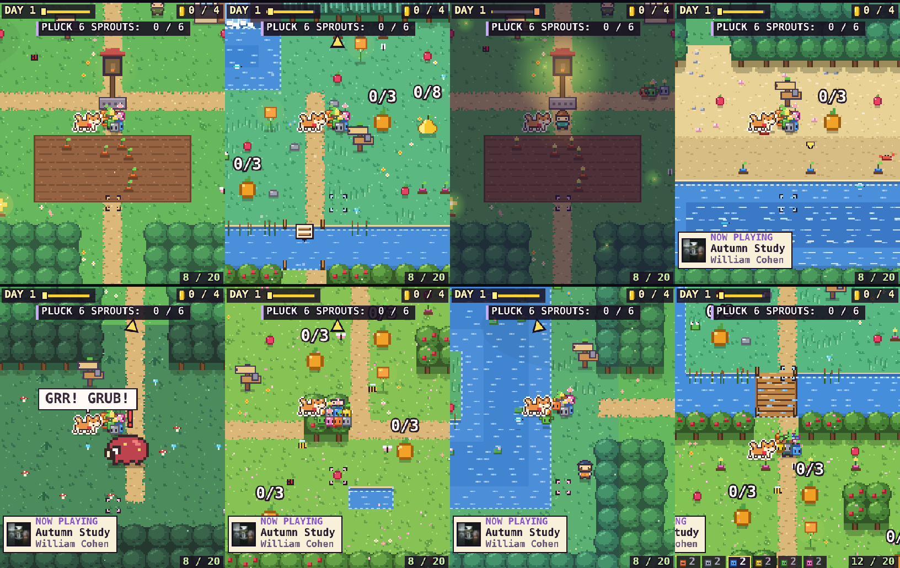

### Fixed: three things Sproutwild had broken in Sprouts

Sproutwild shares the console's scope and declared three functions with the same names as Sprouts', so its versions
replaced them. Since Sproutwild went in (v7.0 for the garden), in Sprouts:
- **Erin's garden beds** drew Sproutwild's "GARDEN PLOT" menu over the screen instead of the bed.
- **Louie's speech bubbles** (WOOF!, BERRY!, FOUND ONE!, GRR! GRUB!) never appeared.
- **The valley project screen** (Waterworks, greenhouse and the rest) showed Sproutwild's BUILD menu.

Sprouts' own are now `spSay`, `drawBed` and `drawPjBuild`. Sproutwild is untouched.

### More like Pikmin
- **Build a bridge.** A river now cuts off the north of the Sunny Orchard. Throw sprouts at the stakes (any kind) and they
  lay it plank by plank. Ranger asks for it after the west crystal (new mission, `r5`).
- **Willow Falls**, the new place across the bridge: a waterfall and pool, wild Dews and Luckies, berries, bugs, a trail
  post, and a **golden pear** that needs 8 carrying strength and pays 4 seeds and 10 petals.
- **Nectar blossoms.** Six in the valley, fresh every morning. Throw one sprout at it and up to 12 nearby sprouts bloom at once.
- **Buried treasure is dug up and carried home.** The morning sparkle is no longer picked up by walking over it: sprouts
  dig it out, then haul it to the lantern (2 to 4 strength), where it is filed in the Collection for 20 petals.
- **The lantern throws its seeds.** Each new seed arcs out of the lantern and plants itself in the soil.
- **Faster throwing** the longer A is held (5 a second up to 11).
- Carriers hop when they bring something home. The evening report has a roll call by sprout kind.

### A nicer world
- The whole valley is repainted: each place has its own ground and trees (sand on the beach, moss and mushrooms in the
  hollow, fruit trees and fallen petals in the orchard, tall grass and wildflowers in the meadow, a striped lawn in the
  garden), grass frays into the paths, ponds have banks, foam, lily pads and reeds, and trees are round crowns with trunks
  that you walk behind at the bottom edge of a field.
- Flowers, reeds, water and the waterfall move.
- Night is properly dark, with pools of light at the lantern, the house windows, the trail-post lamps, glowing mushrooms
  and fireflies. Mornings start warm.
- Drifting pollen, petals, spores and mist by place, fireflies at dusk, cloud shadows, chimney smoke, birdsong by day and
  crickets in the evening.

### How it is built
- The ground is painted once into two animation frames plus a layer drawn over the characters, and repainted when the map
  changes (68 ms in the test browser). A frame costs about 1.5 ms by day and 2 ms at night there.
- Saves: old saves load. The bridge starts unbuilt, new blossoms and fruit appear the next morning, and an old sparkle
  becomes a dig spot. Wild sprouts at the falls only exist in new games.
- Test: `tests/sprouts_valley.js` (17 checks). Sproutwild's `field-lab.js` still passes 124 of 124.
## v12.10: a save that stopped the game from starting
- **Serious, now fixed.** Reopening the game with a file-1 save that held a Buddy Barn or a crop plot crashed at start-up, before the title: the load code checked each building against a list that is only filled in later. The Barn case is old (it is on main too). The crop plot case was new in v12.0, and the tutorial tells every player to build one, so every file-1 player would have been locked out the next time they opened the game.
- Found by loading saves made with main's build. New test, `alt/tests/sproutwild/old-saves-from-main.js`: makes three v9.9 saves (mid-tutorial, home with crops, one Sigil with a Barn) and continues each in this build. All three load now.
- New checkpoint, `reload`: a save from this build with a crop plot, a tender, a Buddy Barn, an expedition out and a Sigil home is closed and reopened. Everything is still there.
- New checkpoint, `walkend`: the end of Erin's walk from a saved point (12 checks). From the end of the battle, Erin's talk starts 19 seconds later and King Bibi's beam 21.
- During the catch lesson only the lesson buddy is out in the Meadow (others could wander in from further away).
- An old save that is mid-tutorial showed the goal "Follow Erin: your first battle" at the wrong lesson. It says "Follow Erin" until the battle step.

Checked: field lab; checkpoints castle, barn, plot, walkend, reload; the three old saves.

## v12.9: a fair warning before the first Guardian
- Fought the stone Guardian for real, every turn, with each starter at the level the game asks for (Lv6) and a Lv3-4 second buddy:
  - BESSLING (water): wins with 28 of 68 health left. With timed taps: wins.
  - GRASSKIN (leaf): wins with 29 of 70 left.
  - CUYAPUP (fire): loses. Both buddies down, the Guardian still at 28 of 88. Fire does 0.625x to stone, water and leaf do 1.6x.
- The game never told a fire-starter player any of that. Now:
  - The goal line says "Stone GUARDIAN: lead with DRIZZLET (START, BUDDIES). CUYAPUP is weak to stone", or to catch a DEW or LEAF buddy if you have none.
  - At the Guardian, the first A press with a weak lead gets Louie: "CUYAPUP barely scratches this one. DEW or LEAF kinds wear it down." and who to lead with. The second press fights anyway.
- The numbers themselves are unchanged. Whether the fire starter should be able to win at Lv6 is Will's call.

Checked: field lab; the castle checkpoint (18 of 18); the warning and the second press with a fire lead.

## v12.8: the Sigil stones come home
Will: "when we bring them light the sigil stones go to the lantern".
- Four sockets are set in the Lantern's steps, two each side of its level plate. Each Sigil you win sits in one, lit in its own colour.
- The first time you come home with a new Sigil, a short scene sets it in place: "You set the STONE SIGIL into the Lantern's steps. It fits. The Lantern burns a shade brighter." Erin counts what is left.
- A on the steps reads them: how many are home, how many Guardians are still dark.
- The plaque moved a little left to make room.

Checked: field lab; the scene and the sockets on screen with one Sigil.

## v12.7: checks from saved points, and the stretch to the first Sigil confirmed
Will: stop the 20-minute runs; make saves at certain points.
- New test, `alt/tests/sproutwild/checkpoint.js`. It starts from a saved point and plays one stretch in real time, in under two minutes:
  - `castle`: Squire's entrance with a Buddy Barn. Travel scene, the reveal, bridge, thorns, pluck the PEB, boulder, the Guardian fight, the Sigil, the Hollow road opening. 18 checks, all pass. This stretch had never been confirmed before.
  - `barn`: home with no Barn. The goal, the Barn's price, Marcus at the castle reveal, Marcus stopping the fight.
  - `plot`: home with a cottage and no wood. The free first plot through the menus, then setting a buddy to tend it.
- Found by `barn`: at home the goal line said "Have 3 buddies" and never mentioned the Buddy Barn. It now says "Build a BUDDY BARN (START, BUILD): 8 stone, 6 wood" until it is built.
- The lamp pair by the notice board is gone: one lamp stood on top of the board. Pairs remain at Field Lane and Gate Lane.
- The home status line "carries a load to the Lantern" is "carries a load home" (it was cut off).
- The long-run autopilot had its castle steps filed under the Meadow, so they never ran. Fixed, though the checkpoint test replaces it for this stretch.

Checked: field lab; all three checkpoints.

## v12.6: followers stop walking through things
- Louie and your buddies used to walk straight through trees, rocks, walls and shut gates (only water stopped them, since v10.1). They now go round, and hop to your side if they are stuck and left behind. Sent to a job past an obstacle, they hop to the job.
- Measured in the Meadow, walking a loop through the trees for 15 seconds: nobody was inside anything solid in 73 of 73 samples. In 7 of the 73 one of them was more than 90 pixels behind, catching up.

Checked: field lab; the loop above; Sunkeep at night with the lamps lit.

## v12.5: a free first crop plot, and a tidier build list
- Your first CROP PLOT is free (the next ones cost 2 wood). The cottage takes 8 wood and the game asks for a plot straight after; a fresh-save run stalled there, one log short. A real player could too.
- The build list starts with the three things you build first: COTTAGE, CROP PLOT, BUDDY BARN.
- Gate Lane is shorter: its east end ran into the pond.
- The waystone at the gate is redrawn as a milestone with an arrow south. It looked like a gravestone.

Checked: field lab; building a plot with 1 wood in hand through the menus.

## v12.4: you choose who tends each crop plot
- The crop plot's menu has a new row, TENDED BY. A steps through your home buddies (and back to nobody). One buddy, one plot.
- A tended plot grows faster: +50% for each level of WATERING or PLANTING that buddy has, +25% for any other buddy. A plot with nobody grows at the plain rate.
- This replaces v12.0's rule, where the single best waterer sped up every plot at once.
- The plot's label says who: "BERRIES · 40% · DRIZZLET tends it", or "nobody tends it".
- Field Lane is shorter at both ends: two of Sunkeep's trees stood in it.
- Test scripts: the autopilot now goes home for the Buddy Barn (gathers stone and wood at Sunkeep, builds it) and knows the castle's three steps, so fresh-save runs can reach the first Guardian.

Checked: field lab; assigning, swapping and clearing a tender on screen, and the growth difference between two plots over 5 seconds.

## v12.3: things found by reading a fresh-save run
- Text that hung on screen. Speech bubbles, messages and banners only counted down while the world was running, so a scene or a menu froze them in place. One run had a bubble up for 41 seconds and "CROP PLOT dug" for 30, still showing in the Meadow. Each now also expires by the clock, and a message is dropped when a scene starts. Same run after the fix: longest bubble 10 seconds, longest message 6.5.
- A pile of wild buddies after the first catch. If a message was on screen when Erin began the battle lesson, the game added a new wild buddy every frame until the message cleared: dozens, stacked on one spot. (My bug, from v10.1.) Now exactly one.
- Erin's "Sunkeep has a roof and a garden" is now "a roof and a crop growing".
- The new opening-story page is shorter, so it no longer covers Will and Erin in the picture.
- More "garden" wording changed to "the Lantern's soil".
- Checked the Buddy Barn's price by the numbers: a rock takes 5 swings by hand and gives 3 stone, so 8 stone is 3 rocks; 6 wood is 2 trees. It is reachable without a mining buddy.

Checked: field lab; the pile-up reproduced and fixed; a real-time fresh-save run to the crop plot with no errors.

## v12.2: the walkthrough ends on the catch and the battle (Will, Nov 17)
Will: the Bibi scene never came after the first SELECT battle, Erin's lines about it came far too late, some text stayed up too long, and the new Sunkeep items were in the wrong places.

Erin's walk, new order
1. Sprout kinds (pluck a PEB), the boulder wall, the bridge.
2. Wood (send a buddy at a tree, sprouts carry the logs), then the ladybug.
3. LAST: your first catch, then your first battle.
- Right after that battle Erin says why the buddy is gone, King Bibi's beam plays, and Will says his lines. Then Erin sends you home for the cottage.
- No wild buddies show in the Meadow until the catch lesson.
- From a fresh save, real time: battle at 6:15, Erin's talk at 6:41, the beam at 6:59, "head home" at 7:21, home at 7:41.
- If that first battle does not end with the buddy gone, the talk and the beam still come later, on their own, out in the field (the beam 15 seconds after the talk, not 60).

Text
- On-screen messages are shorter-lived: reading time is cut by about a quarter and nothing stays past 5.5 seconds.
- "The garden" is "the Lantern's soil" in the opening lines and goals.

Sunkeep items
- Lamp posts stand in matched pairs at the three street corners, not staggered along the avenue.
- The plaque sits on the plaza by the Lantern's steps. The founders' stone is by the fire and benches. The soil sign is at the stepping stones. The waystone is inside the south gate, to the west. Nothing stands in a street.

Checked: field lab; a real-time fresh-save run through the whole new order to the crop plot, no errors; Sunkeep seen top to bottom.

## v12.1: Guardians of the Light, and why they are at Sunkeep (Will, Nov 17)
- Every "alpha" the player can read is now a GUARDIAN. In story terms they are the Guardians of the Light: every place has one, they went dim when the Lantern did, and a dim Guardian spells peril for the kingdom. (The code still calls them `alpha` inside.)
- When you bring one the light, its Sigil stone goes home to the Lantern. The Sigil scene, the Elder, Marcus, the guide page and the opening story all say so.
- The opening story has one new page: three people were called to Sunkeep and none of them knows why. Marcus left a Flow Pros job with Derek. Erin and Will left their wedding plans on the table. Erin: "You got here last, Will, so we will fill you in."
- Two early lines at Sunkeep from Marcus and Erin about being called, and four new idle lines.
- New file `alt/STORY-NOTES.md`: Will's story decisions in one place, with what is still open (why Sunkeep exists, who called them, the lamp's name).
- Also in this build: a street-following fix. Workers walking to a building site restarted their route every frame and never arrived, so a cottage placed away from the avenue was never built. Found by the fresh-save run.

Checked: field lab; the castle label and prompt on screen. The fresh-save run on this build is still going.

## v12.0: Sunkeep, redesigned (Will, Nov 17)
Will: cluttered, hard to build at, characters ignore the paths, weird plots; grow sprouts in one big bed like Sprouts, then placeable plots, buddies working them, level-gated recipes; keep the furniture; more lore; clean it up.

Layout
- One avenue from the Lantern to the south gate, and three streets off it: Lantern Row, Field Lane, Gate Lane. The old web of lanes is gone.
- The land between the streets is open for building.

Building
- The build screen tints every free spot green, and the cursor starts on the nearest free spot to you.
- Streets and furniture can't be built on.

People
- Erin, Marcus and the home workers walk along the avenue and the streets and step off only at the end. Measured: Erin was on a road in 36 of 38 samples while crossing the whole base.

The Lantern's soil
- One big bed with a stone edge and stepping stones where the avenue crosses it. Sprouts come up in it as before (6 spots, 8 with the cottage, 12 at Sunkeep Lv2). No stakes or little frames.
- It grows sprouts only now. Old saves: any crop set on a soil plot is cleared.

Crop plots
- CROP PLOT is a new thing to build (2 wood, needs the cottage). You place it where you like. It starts with BERRIES; A on it changes the crop or harvests.
- FIBER REEDS need Sunkeep Lv2.
- 2 plots at Sunkeep Lv1, 4 at Lv2, 6 at Lv3.
- The best home waterer or planter tends them, and the plot's label names who ("BERRIES · 40% · DRIZZLET tends it"). Picking a buddy per plot by hand is not built yet.
- The tutorial step "grow berries on a garden plot" is now "build a CROP PLOT". Erin's garden talk and the hints say so.

Recipes
- Gated by Sunkeep's level: TONIC and ROPE at Lv1, SEED POUCH and LANTERN OIL at Lv2, LUCKY CHARM at Lv3. First guesses.

Lore to read (A)
- The Lantern plaque, the founders' stone, the sign at the soil, the waystone at the gate. Two lines each.

Pacing (found by the v11 fresh-save run): Erin's "why" talk fired at home while the cottage was going up. It now only plays out in the field.

Checked: field lab (plot checks rewritten for the new rules); real-time at 430x932: the whole base, placing a plot through the menus, growth, a buddy's harvest, the fiber gate, a plaque.

## v11.0: Will's notes after playing to the Bibi scene (Nov 17)
Pacing
- Erin's "why" talk now waits until her tutorial is over. It used to land in the middle of it, right after the battle lesson.
- The King Bibi beam waits for a quiet minute out in the field after that talk. It no longer fires at home, on top of "build the cottage".
- The lamp scene with Marcus still waits for the cottage and its party.

Kiss
- He does not appear until the tutorial is done, and he has moved from the Meadow's north gate to the south road, by the way to the castle. His tip is now about LEAF sprouts and the thorn gate.

Travel
- Going from one area to another plays a short side-on scene (under 3 seconds, A skips): the place you are going, its name, and the keeper walking in with up to four of your sprouts. No buddies in it, on purpose.
- Landmarks so far: the Lantern tree (Sunkeep), houses (Lantern Town), the castle (Squire's Woods), crooked trees (the Hollow), the pond and tall grass (the Meadow). Other areas get plain trees for now.

Rooms
- The three houses in Lantern Town open: the baker's, the gym goer's, the sprout lover's. Walk in, look at things with A, leave by the mat or B. They do nothing else yet. This replaces the "KNOCK" one-liners.

Sunkeep
- The well, notice board, benches, flower beds and pond are solid. You used to walk straight through all of them.
- The road from the Lantern to the south gate is wider with a paved middle, lamp posts that light at dusk, and stone gate posts where it leaves for the Meadow.

Checked: field lab; real-time at 430x932: five travel scenes, all three rooms, Kiss's new spot, Sunkeep top to bottom.
Not checked yet: the new pacing from a fresh save (a run is going), and old saves.

## v10.6: King Bibi beams it in (Will, Nov 17)
The soul story is now two beats, spaced apart, so it no longer lands on top of "build the cottage".
- Beat 1, right after your first kill and Erin's "why": a cut-in in the style of the HASBARA super in Knockout. Here it is KING BIBI at the desk inside the Iron Dome, and the target on his screen is the keeper. "The little keeper is asking why. Give him an answer. Make it feel like his own." A beam crosses the night into the keeper's head: AN IDEA! Then the keeper: "What if their light isn't lost? What if somebody could keep it?" Erin: "Where did that come from?" "My own head. Obviously." About 7 seconds; START skips it.
- Beat 2, at home after the cottage is built and its party is over (plus a short quiet gap): the keeper finds the lamp while unpacking and tells Marcus the idea. "Bro. You're J-lighting again. Making up a story and calling it yours. You're way too beholden to King Bibi." "It is MY idea." Erin says keep it. You get the SOUL LAMP.
- The keeper now speaks these lines under their own name (WILL by default).
- The v10.5 version (one long scene on your first return home) is gone.

Checked: field lab; both beats played in real time at 430x932, frames looked at.

## v10.5: expeditions and the Soul Lamp (Will's ideas, Nov 17)
Expeditions
- New EXPEDITION tile in the pause menu (the grid is now five shorter rows). Open after the cottage.
- Send a party of 3 sprouts of one kind. They are gone about 3 minutes of play and come home on their own with what their kind finds (PEB stone, LEAF wood, DEW berries, EMBER ore, ZIP fiber, LUCKY petals) and one gratitude heart for the light they carried.
- One party at a time; a Buddy Barn lets you send two.
- If you own more sprouts than your pouch holds, one of the party stays out there "to carry the light on". That is the gentle trim on a crowd.
- All numbers are first guesses, not tuned.

The Soul Lamp
- After your first defeat and Erin's talk, the next time you are home a word drifts through the keeper's head ("Hasbara"), then an idea that feels like the keeper's own. The game does not say it is King Bibi.
- The keeper finds a lamp holding the lights of the lost. Erin tells Marcus. Marcus: "Bro. You're J-lighting again. Making up a story and calling it yours. You're way too beholden to King Bibi."
- From then on a defeat adds "Its light drifts into your SOUL LAMP", and the pause menu shows SOULS next to LIGHT.
- "SOUL LAMP" is a placeholder name. What the lamp does later is Will's call; this only sets it up and keeps count.

Also: Erin's "castle time" line tells you to build the Buddy Barn first if you have none.

Checked: field lab; real-time at 430x932: the whole soul scene, the menu, sending a party, the second-party refusal, and the return with one sprout staying out.

## v10.4: quieter screen, clearer battle menu
- Battle menu: the left box now says what the highlighted choice does (FIGHT, SWARM, KEEPER, BUDDY, RUN), not "What will X do?".
- A plain pickup like "+2 WOOD" is a small float over your head now, not a message box across the screen.
- Louie barks "SNIFF! A BUDDY!" once per wild buddy, not every 22 seconds while one is near.

Checked: field lab passes, no page errors; battle menu seen at 430x932.

## v10.3: a freeze at the Meadow's Lantern post
- Old bug, found by the fresh-save run: if any message was on screen when a trainer (Kiss) walked up to you, his dialogue never opened and he spotted you again, forever. Nothing near you worked, the Lantern post included. It hit hardest when your buddy was hurt, because the "rest at a Lantern post" hint is exactly such a message. The challenge now clears the message and always opens.

Checked: reproduced the freeze on the old build, and the same steps pass on this one. Field lab not rerun for this one-line change.

## v10.2: fixes from the first fresh-save run
- Bug from v10.1: Erin's battle lesson only counted a battle you started with SELECT. A wild that broke free and attacked did not count, so she kept asking. Any wild battle counts now.
- The Meadow's west lane (the "weird path on the left"): it was two tiles wide going down, one wide going east, and stopped one tile short of the main road. It is two wide all the way and joins the road.
- Test scripts: the autopilot knows the battle lesson and walks home by the north road (it still used a pre-v9.8 route).

Checked: field lab passes, no page errors. A real-time fresh-save autopilot run plays the whole of Erin's walk, the new battle step included.

## v10.1: the slice refinements (Will's list, Nov 17)
Tutorial
- Erin's walk now has a real battle step. After your first catch she points at a second wild one and waits until you press SELECT on it. Before, she told you about SELECT and the game blocked it.
- After your first defeat Erin explains it: a buddy you can't show the light stays dark, so a battle is sometimes the only way. No blame, no penalty.
- Defeat wording changed to "The dark breaks. X is gone." (Will: a defeat kills the buddy.) The game quietly counts these for the soul story later.

Castle
- The castle is a three-step puzzle: sprouts build a bridge over a moat, LEAF clears the thorn gate, PEB cracks a boulder wall inside. A PEB grows in the courtyard so nobody is stuck.
- Louie's castle reveal names the three steps. If you have no Buddy Barn, Marcus says his line there too.
- **The Buddy Barn now costs 8 stone and 6 wood, not 2 ingots.** Ingots needed a kiln, ore and smelting time, which is too long a chain in front of the first alpha. Will: say if you want ingots back.

Battles
- The timed strike is easier to read: a white band shows the window, the closing ring turns green inside it, and a slide bar under it shows the same timing.
- A miss now says TOO EARLY or TOO LATE, with a low sound.

Field and base
- Louie and your buddies no longer walk on water. Blocked by a pond, they hop to your side.
- The bottom bar shows your buddies: face, health line, and a gold dot while one is off working.
- Pop-ups are calmer: the same pickup merges into one count, they fade out, and at most four show at once.
- At Sunkeep one line under the goal says what each worker is doing, one at a time.

Buddies
- Two grades on the Buddies screen: BATTLE (the level) and WORK (from jobs done), with what's left to the next of each.
- You can release a boxed buddy: START, then START again. The word "release" is a placeholder until Will picks one.

Checked: field lab passes with no page errors. Real-time at 430x932: tutorial fight step, castle puzzle start to end, battle ring, water, party and box screens, crew line.
Not checked: a full fresh-save playthrough by hand; old-save test could not run (its old builds are not in this checkout).

## v10.0: Buddy Barn before the first alpha
- Pressing A on the castle alpha with no Buddy Barn and no sigil now stops the fight. Marcus says: "Bro, are you kidding? We need to go see one, send one, and get you a box made. Because we have lots of purifying to do." He then names the cost: 8 stone, 2 ingots, at Sunkeep.
- The goal line says to build the Buddy Barn first until it's built. After that it's back to "Light the castle ALPHA".
- Checked in the lab at 430x932: the gate stops the fight without a barn and the battle starts with one, with no page errors. Not yet played by hand from a fresh save.
## Patch & Plate v0.7: played in real time, scenes spaced out (Nov 17 2026)

Will: one more pass, then I'll try it. Cooking game only (`src/patchplate.js`, `tests/`).

- **Played in real time from a new save** (`tests/pp_realtime.js`, new): the real game loop at real speed, a bot on the
  buttons, every scene watched to the end, four days, about 7 minutes. No page errors. Seen firing by themselves in play:
  the opening, taste scenes, sprout scenes, PERFECT DAY!, THE YEAR OF DARK, FIVE IN A ROW! (day 2), CUYAPUP MOVES IN!
  (6 stars, after day 2), DEREK PULLS UP! (day 4), heart scenes for Marcus and Will, the nights. The bot went 3 stars with
  no misses on all four days, so nothing about a bad day was seen.
- **What that run showed, and the fixes:**
  - PERFECT DAY! played on three of the four days. It now plays for the first perfect day ever, then only on days 7 and
    later (once each).
  - A day that already had a streak cut-in does not also get PERFECT DAY!.
  - After a story chapter, a waiting heart scene keeps for the next day instead of playing straight after it.
- **Tested:** `tests/pp_test.js` 119/119 on the final build. The real-time run was on the build just before the PERFECT
  DAY! change; that change was checked by the stepped test only. Screenshots from the real-time run: `playtest/pp-v0.7/`.
- **Not tested:** days 5 to 13 in real time; BOTTIE IS IN LINE!, EIGHT IN A ROW! and THE VALLEY IS FED! firing in real
  play; a phone; a person's hands.

## Patch & Plate v0.6: the story so far, a favourite each, heart scenes for everyone (Nov 17 2026)

Will: only the cooking game from here; leave the other games alone. More lore, the characters, their personalities and
stories. **Only `src/patchplate.js` and `tests/pp_test.js` changed this round** (no other game's file, not `console.js`).

- **The story so far: six short chapters.** The first time a chapter's day is cleared, it plays on the way out of the
  results screen, with a title card. Start skips it. Each plays once per file.
  1. THE YEAR OF DARK (after day 1): why lettuce goes first
  2. MARCUS WATERWORKS (day 4): Marcus's lazy river, Derek's van
  3. THE ROBOT (day 7): Bottie offers one follow for the Great Lantern
  4. THE KING'S ORDER (day 10): King Bibi wants a combo meal, to go
  5. THE FIRST HARVEST (day 12): the Elder, Will, "same job, different apron"
  6. ONE TABLE (day 13): sprouts, buddies and people eating together
- **Heart scenes for everyone.** Scout, Ranger, the Elder, Pip, Derek and Bottie each get four (24 new scenes), so all
  nine characters have a full set. Scout takes field notes; the Ranger still walks the shut roads; the Elder kept one
  lamp lit through the dark; Pip wants a bug stand next door; Derek's truck needs a part that needs a truck.
- **Bottie's arc.** His hearts are kept off the FRIENDS page. He admits it was "a very red button", then that nobody feeds
  him up on the Peak. At four hearts he leaves his first tip, and tips from then on.
- **A favourite each.** Will: big salad. Marcus: burger. Scout: salad. Ranger: combo. Elder: bread. Pip: smoothie. Derek
  and Bottie: fries. Serve someone their favourite and they say so on the card, FAVORITE! pops up, and the friendship
  grows faster (+2). Once found, the FRIENDS page shows "LOVES FRIES".
- **The rarer faces grow hearts three times as fast** (Elder, Pip, Derek, Bottie), since they come by less often.
- New save fields `story` and `fav`, with defaults.

**Tested:** `tests/pp_test.js` 119/119, two runs in a row (12 new checks: every new line measured against its box, a text
audit of all six chapters, a chapter plays once and only once, Derek's favourite, Bottie's tip at four hearts, the friends
page). Screenshots looked at: `playtest/pp-v0.6/` (four).
**Not tested:** other games' suites were not run this round (none of their files changed). The 24 new heart scenes were
checked for fit, not each put on screen. Nothing played by a person in real time or on a phone.
**All new, flag to Will:** every line and every favourite. King Bibi is mentioned by name once (chapter 4).

## Patch & Plate v0.5: big moments, kitchen buddies, Bottie and Derek (Nov 17 2026)

Will: make sure Will, Marcus, Bottie and Derek all make more appearances; if something really cool happens, trigger scenes
like in Sproutwild and the fighter; as you level up, up to 3 buddies in your kitchen over time.

- **Big moments.** A cut-in in the fighter's style (slanted band in the speaker's colour, speed lines, the face sliding in,
  the words slammed on with a flash), then a line or two. A skips a line, Start skips it all. Each plays once per file:
  - FIVE IN A ROW! (Marcus) and EIGHT IN A ROW! (Will), during the day, the first time you get that streak
  - PERFECT DAY! (Will or Marcus), after a 3-star day with nobody missed, once per day number
  - BOTTIE IS IN LINE! and DEREK PULLS UP!, the first time each walks up
  - <BUDDY> MOVES IN!, when a kitchen buddy arrives
  - THE VALLEY IS FED! (the Elder, Marcus), the first time LANTERN NIGHT is cleared
  Scenes earned by a day play before the results screen, one after another.
- **Kitchen buddies.** The stand's level is its total stars. CUYAPUP moves in at 6 stars (stoves 15% faster), BESSLING at
  15 (crops grow 15% faster), GRASSKIN at 27 (customers wait 8 longer). Three at most. They are Sproutwild's three
  starters, drawn with Sproutwild's art, sitting on the counters between the stoves. The stand hub says when the next
  one comes ("KITCHEN BUDDY 2 OF 3: 15 STARS"). A file that already has the stars gets them after its next finished day.
- **Bottie and Derek are customers.** DEREK (Flow Pros truck) from BURGER TIME on, BOTTIE from FRY DAY on. Bottie eats and
  never tips. Derek is on the FRIENDS page. Derek's sprite is new (Marcus's build, Sproutwild's Derek colours).
- **Will and Marcus come by most**: three in thirteen customers each on a late day (Scout and Ranger two each).
  More of their lines in the quips, plus four new night scenes with Bottie, Derek, Marcus and Will.
- New save fields `buds` and `big`, both with defaults; old saves load as before.

**Files:** `src/patchplate.js`, `src/console.js` (Patch & Plate is also handed Sproutwild's buddy sprites, read-only),
`tests/pp_test.js`.
**Tested:** `tests/pp_test.js` 107/107 (14 new checks: who joins the line and when, buddy thresholds on a wiped file, a
text audit of all eight big moments, three buddies in the kitchen with Bottie and Derek at the windows, Bottie's tip is 0,
the friends page with Derek). Sproutwild lab 124/124. Screenshots looked at: `playtest/pp-v0.5/` (seven).
**Not tested:** the big moments were put on screen by the test, and the bot's days ran through them, but nobody has watched
one fire in real time from a real streak. Whether a scene in the middle of a rush feels good or gets in the way is for a
person to say. Buddy numbers (6/15/27 stars, 15%, +8) are guesses. Not played on a phone.
**All new, flag to Will:** every line, the buddy perks, and Bottie being allowed to queue for lunch.

## Patch & Plate v0.4: the Sunkeep update (Nov 17 2026)

Will: the cooking game needs an update and testing; bring in the lore from the newest Sproutwild so the games connect.
Will, during the work: no save link between them. They are separate games in the same universe.

**The canon this assumes (new, flag to Will):** Erin's stand is at Sunkeep, beside the Great Lantern, in Sproutwild's valley.
Her garden is the "one good patch of soil left" that Sproutwild's opening mentions. The stand feeds the valley while the
keeper is out bringing the light back ("a fed valley is a calm valley"). It is flavour in the lines only; there is still no
story to remember, and **neither game reads or writes the other's save.**

- **The Great Lantern is on screen.** On the title (with "AT SUNKEEP, UNDER THE GREAT LANTERN") and behind the stand in every
  scene, drawn the way Sproutwild draws it.
- **Two customers from Lantern Town.** The ELDER walks down from BREAD DAY on, PIP (the bug buyer) from BERRY GOOD on, about
  one customer in ten each. They use their Sproutwild sprites, have their own hellos, thanks and hurry-ups, and sit on the
  FRIENDS page.
- **Day 13, LANTERN NIGHT.** A feast under the Lantern at dusk: every recipe, 11 customers, the Elder gives the briefing.
  A save that had finished all 12 days finds day 13 open.
- **Valley talk.** New lines in the hellos, thanks, quips and day cards about the Lantern, the Iron Dome, Bottie, the Sigils
  and calm buddies. Eight new night scenes about the valley; about 4 nights in 10 play one instead of a star night.
  The opening scene says where you are. MARKET DAY and HARVEST FEST name Lantern Town and "the first since the dark".
- **A LANTERN awning** in the wardrobe (90 coins).
- **Sproutwild's side** (`src/sproutwild/`): the Sunkeep notice board has a note for Erin's farm stand, and Erin, Marcus and
  Will each have a new idle line about it. See v9.10 in `src/sproutwild/CHANGELOG.md`.

**Fixed while testing (both were in v0.3 too):**
- Long quips were squeezed narrow to fit one row ("I'VE GOT A GUY. THE GUY IS ME. THE GUY IS HUNGRY.", Louie's "wants"
  lines). A long quip now takes a second row. This is what made the text audit fail at random in earlier runs.
- Two thank-yous on the order card lost their last words ("TEN OUT OF TEN. LIKE ME." showed two of three rows; "FOR SCIENCE.
  YUM." the same). Reworded to fit: "TEN OF TEN. LIKE ME.", "YUM. FOR SCIENCE."

**Files:** `src/patchplate.js`; `src/console.js` (one word: Patch & Plate is handed Sproutwild's character sprites);
`tests/pp_test.js` (17 new checks).

**Tested:** `tests/pp_test.js` 93/93, two runs in a row, at 440x956 in headless Chromium. New checks: every hello, hurry,
quip, order-card, scene and day-card line is measured against the box it is drawn in; the Elder and Pip only appear once
their day is open; the bot plays day 13 to the results screen through the real controls; text audits on the day 13 card,
day 13 with the Elder and Pip at the windows, all eight valley nights, the title, the friends page and a two-row quip.
Sproutwild `tests/sproutwild/field-lab.js` 124/124, no page errors. Screenshots looked at: `playtest/pp-v0.4/` (six).
**Not tested:** Knockout and Rootdeep suites were not re-run (their code is untouched). Not played on a phone. The days
were played by the test bot with the clock stepped by hand, not by a person in real time.
**Size:** 14.6 MB of the 16 MB limit.

## Cartridge 5: Sproutwild fused in (Nov 15 2026)

ALT is now the main line of the game, with five cartridges: Sprouts, Knockout, Rootdeep, Patch & Plate, **Sproutwild**.

- **What was added.** `src/sproutwild/` (eleven files, about 330 KB) holds Sproutwild v6.0, moved in from `muse/sproutwild/`.
  `build.py` splices it into `console.js` after Rootdeep. Its own history is in `src/sproutwild/CHANGELOG.md`.
- **What changed in the console to make room** (`src/console.js`, `src/shell.html`):
  - a fifth shelf slot; shelf labels are a point smaller so five fit
  - boot, update and draw hand `g4...` states to Sproutwild, the same way `g3...` goes to Rootdeep
  - button labels for slot 5: act / call / kind / menu
  - the console's `tw`, `text` and `ctext` keep their bodies under the names `tw0`, `text0`, `ctext0`. Sproutwild's
    `sw-text.js` owns the public names and passes straight through to them unless a Sproutwild screen is showing, where it
    draws its own pixel font. The other four cartridges draw exactly as before.
  - the console's screen-width variable `SW` is renamed `SCW` (seven uses), because Sproutwild's save object is `SW`
  - `window.__g` gains `SW` and `SWF` for tests
- **Nothing was removed.** Knockout, Rootdeep, Patch & Plate and Sprouts source files are otherwise untouched.
- **Frozen before the fusion:** `backups/pocket-lantern-alt_2026-11-15_4-carts_pre-sproutwild_BACKUP.html` (the four-cartridge
  build exactly as it was) and `muse/games/Sprouts+Rootdeep+Sproutwild-v6.0_2026-11-15_BACKUP.html` (standalone Sproutwild).
- **Tests on the fused build:** Sproutwild `tests/sproutwild/field-lab.js` 76/76; Knockout `tests/fable_lab.js` all pass;
  Patch & Plate `tests/pp_test.js` 76/76 on the final build, three runs in a row (its shelf check now expects five
  cartridges). Two earlier runs during the work each failed one check with a random outcome (a text-squeeze audit on day 12,
  and Louie changing his craving "within a few days"). The one run on the build from before the fusion was clean, so whether
  those two are flaky from before is not established. Console and Rootdeep `tests/v02/` suites report no errors.
- **Size:** 14.4 MB. The claude.ai page limit is 16 MB, so there is room for about 1.5 MB more before songs have to move out.
- **Not done:** `docs/index.html` (the public GitHub Pages copy) still holds the four-cartridge build. It was not updated
  because that publishes Sproutwild publicly; that is Will's call.

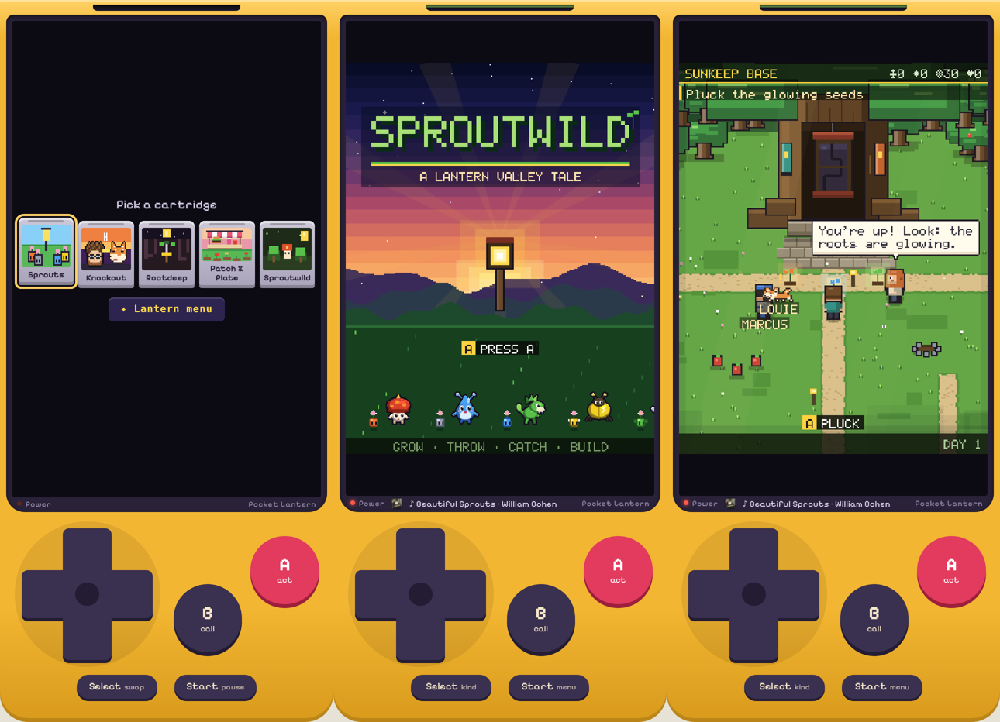

## Safety

- **Separate saves.** Every `localStorage` key is stored as `pl-alt:<key>` (`src/shell.html`, top script). ALT can't
  read or overwrite the real game's saves, even in the same browser or from a downloaded copy.
- **Page title** is "Pocket Lantern ALT", so the two are easy to tell apart in tabs.

## North Coast Knockout (`src/knockout.js`)

### Feel: less floaty

Measured with `tests/ko_lab.js` at 60 fps, before → after:

| | v0.3 | ALT |
| --- | --- | --- |
| Neutral jump | 34 frames, 55 px high | 26 frames, 49 px high |
| Strike pose reached | eased in over ~6 frames (never fully lands inside a 9-frame jab) | snaps in 1 frame after the windup |
| Hit flash on the victim | 6 frames white | 2 (light) / 4 (heavy) frames |
| Knockdown → standing | 0.83 s | 0.64 s |
| Round intro | 1.75 s | 1.5 s |

- Gravity 1250 → 2100, jump speed 380 → 470, a lighter fall multiplier (1.3 → 1.15), wider jump arcs (forward 1.35x → 1.6x walk speed).
- Launches keep their shape but play faster (launch speed scaled 1.22x to the new gravity; bounce and dizzy-fall speeds scaled too).
- **Poses snap like sprite frames** for attacks, hits, blocks, dashes, specials, throws, supers. Idle and walk cycles step at 8 frames
  per cycle instead of tweening every frame. Only jumps and crouches still blend (fast).
- A 4-frame landing squat after every jump.
- **Launcher chase (new):** down+A that connects can be cancelled into a jump by holding Up, so launcher → jump → air attack is a real
  juggle (the v0.3 launcher's recovery outlasted the victim's air time, so the follow-up never connected at any timing).
  The CPU uses it too (25% / 60% / 90% by difficulty). HOW TO PLAY says `DOWN + A  LAUNCHER (+UP: CHASE)`.

### Graphics: GBA direction

- **Pixel font.** A 5x7 bitmap font (outline + drop shadow, bold at size 2) replaces the phone's system monospace in every Knockout
  screen. Character widths match the old font, so no layout moved. (`PFC`/`PFB` glyph table; `text()`, `tw()`.)
- **Motion smears** on the active frames: a tapered white streak from the windup spot to the fist or foot (gold on heavy hits).
- **Hit bursts:** an 8-ray starburst with a shrinking white core (bigger on heavy hits) replaces the small plus-shaped spark.
- **Closer camera:** fighters fill more of the tall phone screen (zoom up to 1.75x, was 1.5x; tighter framing at mid range).
- **Stage grade:** stepped dark bands at the top of each stage and a darker floor band, so fighters read against the background.
  (A canvas colour filter was tried and removed: it made each frame many times slower.)

### New modes (title menu)

- **SURVIVAL:** one-round fights against random opponents, back to back. Your health carries over (+30 after each win). The CPU
  steps up a difficulty level every 4 wins. Best streak is saved (`SV.surv` in `ncko-v1`) and shown on the title and results screens.
- **TRAINING:** pick a fighter and a dummy. No clock; health refills when you leave the dummy alone; your meter refills; nobody
  goes below 1 HP. Combo damage shows under the hit counter. Pause has **DUMMY: STAND / BLOCK / CPU** (Block holds a standing guard,
  so lows and overheads still get through).
- The title menu now acts on labels, not positions. The pause menu is built from a list (`pauseItems()`).

### Test hooks

- `KO._.tb` records text boxes (the hook existed but nothing switched it on), `KO._.nextSurv`, and a `dummy` flag on fighters
  (a dummy takes no input).

## Sprouts (`src/console.js`)

- **The berry marker points at a berry you can reach.** "BRING HOME 3 BERRIES" used to aim at the nearest berry even when it was
  behind a gate that's still shut (12 of the 30 berries on a fresh day 1), which is where a test run stalled for the rest of the
  day. Now walkable tiles are flood-filled from the player about once a second and the marker prefers a berry within 2 tiles of
  them (sprouts are thrown). If none is reachable it falls back to the old choice. Checked: with only a far reachable berry left
  (609 px) and a gated one at 217 px, v0.3 points at the gated one, ALT at the reachable one.

## The Lantern menu (in `src/rootdeep.js`)

Open item 2 of the v0.3 handoff ("the Lantern menu still counts 3 cartridges"), plus links to the new Knockout modes:

- **CARTRIDGES PLAYED** counts four.
- **TRIPLE THREAT** is now "play three cartridges"; new **FULL SHELF**: play all four (+2 tickets).
- New **STILL STANDING**: win 5 in a row in Knockout Survival (+2). New **FARM TO TABLE**: bring home 50 berries in Sprouts and
  reach day 6 at Patch & Plate (+2). LANTERN KEEPER still needs every other achievement.
- **Tickets:** Knockout Survival pays 1 for every 5 of your best streak (counted when you're back at the shelf, like the 10-win tickets).
- **STATS** gets a fifth page, **PATCH & PLATE** (read-only from its saves, best of the three files): days open, stars /36,
  dishes served, coins earned, sprout crew /6, friend hearts /20. The Knockout page adds BEST SURVIVAL STREAK.
- **HOW TO GET TICKETS** (capsule machine) lists Patch & Plate's "first 3 stars on a day" and Survival streaks.

## Pass 2: HASBARA, King Bibi, likenesses (from Will's photos and notes)

All names, lines and move names below are **invented this pass** unless Will gave them; flag anything to change.

### Will's supers are two-tier
- **Half meter: BIKE LANE** (Select at 50+). A green bike lane paints itself along the floor and Will rides through it,
  pedals turning, Louie in a front basket. 14 damage, costs 50. (It used to be a riderless bike with Louie on the back.)
  The meter has a half-way tick for Will and shows `BIKE LANE (SELECT)` at half.
- **Full meter: HASBARA** (Will's idea; the cinematic is my staging of it). A ZZZ-style super, about 3.8 s, clock stopped:
  1. **Cut-in:** S-rank badge, Will's portrait on yellow and blue diagonal bands, halftone dots, light sweep, `HASBARA` slams in.
  2. **The desk:** Will in a headset at the keyboard; monitors read `IDF / HASBARA / DESK`, the opponent's face under a target
     ring, and a feed that fills (`THREAD`, `TALKING PTS`, `POSTING...`, `SHIFTING`) until `SENT!`.
  3. **The mind flip:** the opponent's face fills the screen, eyes turn to spirals: `WAIT...`, `WHO IS THE BAD GUY?`,
     `MIND: RECALIBRATED`.
  4. **Self-hits:** back on the stage, the opponent punches themselves four times (4.5 each) and once more for 12, launching
     themselves away: `SELF OWN!`. 30 total, can't be blocked. Will tweets through it on his phone.
- The move list shows `SEL 1/2  BIKE LANE` and `SEL FULL  HASBARA`; the select screen shows both.
- The CPU Will uses Bike Lane at half meter now and then, and HASBARA at full.

### King Bibi replaces Gas Guy (slot 5)
- Caricature: silver hair, navy suit, white shirt, blue tie. Tag `PRIME MINISTER. AGAIN.` Slower and hits a bit harder.
- **X: RED LINE** holds up the diagram, then a red line sweeps along the floor (a low: block crouching).
- **Y: IRON DOME** brief invulnerability, a dome that destroys incoming projectiles, and a shove.
- **Super: COALITION** five suited partners run across the stage (5 each).
- **Finisher: FILIBUSTER-ALITY** the speech runs so long the opponent falls asleep.
- Normals: TALKING POINTS, PODIUM KICK, POLL BUMP, SWEEPING REFORM, COALITION DEAL, COMEBACK TOUR.
- Win quotes: I ALWAYS COME BACK. / NEXT QUESTION. / THE COALITION HOLDS.
- **New stage, THE PODIUM:** a green-and-gold assembly hall, a rostrum with a lectern and mic, spotlights, delegate desks.
- Gas Guy's code (thumbs, wind) is gone from the roster.

### Likenesses (from the photos)
- **Will:** new 16x16 head: wild curls with lighter tips, round dark glasses with blue eyes, ginger-brown beard.
- **Louie:** red buffalo-check collar with a gold tag.
- **Lil Bottie:** chrome helmet with a dot texture, LED face with `^ ^` eyes and a smile, headphones, longer dreads,
  quilted silver puffer, silver chain with a cloud pendant.
- **Erin:** blue-grey eyes (hair and outfit unchanged).
- Waiting on more photos of Will, Erin, Bottie and Louie for the next pass.

## Pass 3: character rigs, Mama's supers, dialogue, arcade tower, level select, music slot

Invented this pass unless Will gave it: move names, lines, scenes. Flag anything to change.

### Character rigs (rig v2)
- **Heads redrawn in 3/4 view** (18x18, turned toward the opponent, shaded) for all eight fighters, and each head now sits on a
  **neck** at its jaw (an anchor point per head) instead of floating on the shoulder by its centre.
- **Bodies have builds** (`RG` in `knockout.js`): a tapered torso with real shoulders, shaded on the back side, and per-fighter
  proportions. Will is tall with a slouch; Marcus is broad and stocky; Erin is slighter with hair that sways in locks; Louie is low
  and long with a wagging tail; Lil Bottie is a blocky robot with joint plates at elbows and knees. Others share a default build.
- **Own stances and walks** (`PSO`): Will's loose guard, Marcus's wide chest-out swagger, Erin's boxer guard, Louie's crouch,
  Bottie's stiff right-angle arms. Their jabs and specials keep the same names and effects.
- **Own frame data and a forward+B for each of the five** (`MVO`): Erin is quickest, Marcus slow and heavy, Louie short and fast,
  Bottie slow with long reach.
  - Will: **FORCE PUSH** (`GIT PUSH --FORCE`), a lunging shoulder charge. 10.
  - Erin: **TRELLIS SPIN**, a high spinning kick. 9.
  - Louie: **ZOOMIE TACKLE**, a low diving tackle that knocks down. 9.
  - Lil Bottie: **ROCKET FIST** (`ROCKET_FIST.EXE`), the fist flies out on a chain. 12.
  - Marcus: **DAP UP**, a step-in handshake that can't be blocked. 12.
- Specials, supers and finishers are unchanged.

### Mama: two supers
- **Half meter: YUKON.** A big white Yukon reverses in, reverse beeper going, Mama at the wheel yelling (I DID NOT SEE YOU!!,
  WHO PARKS LIKE THAT?!, MOVE!!! MOVE!!!...) and MOTHERFUCKER!!! on impact. 15.
- **Full meter: RUBY TEMPER TANTRUM** (Will's idea), a cinematic like HASBARA: S-rank cut-in with Ruby; Ruby says NO. and grows
  into a giant, flickering Hulk-green (`RUBY SMASH!!`); on the stage she stomps twice (NO NAP!, MINE!), throws a red toy car,
  and lets out a WAAAAAAH! shockwave: 5 + 5 + 6 + 14 = 30, can't be blocked. Then she shrinks back: `hehe.`
  Ruby is drawn from Will's photos: curls, pigtails with green bows, pink hoodie, black leggings, white sneakers.

### Dialogue
- **VS screen banter:** each fighter gets a bubble before the fight. Set exchanges for Marcus/Will (he calls Will a J), Will/Bottie
  (the handoff), Marcus/Bottie, Marcus/Louie, Will/Louie, Will/King Bibi, Bottie/King Bibi, Marcus/King Bibi, Will/Mama. Otherwise
  each fighter's intro lines (Will, Marcus, Bottie, Mama have their own; others use their win quotes).
- **More win quotes** for Will, Marcus and Bottie; the results screen now cycles through all of them.
- **Barks:** Will, Marcus and Bottie call out on a 4-hit combo, and once when they drop low.
- Marcus's lines follow his canon voice from Sprouts and Rootdeep (bro, see one send one, dap me up, I've got a guy).

### Arcade tower and level select
- **Arcade tower** (Mortal Kombat style) before every arcade fight: a brick tower of the ladder with the boss on top, beaten
  opponents crossed out, torches, and your portrait climbing to the next fight. Then a short scene for the opponent
  (Louie's ball, Marcus's spinning wrench, Erin's flowers, Bottie's loading bar, King Bibi's podium with camera flashes, Corbin's
  hearts, Mama's Yukon driving past, Will's commit log) with a line. A skips.
- **Level select:** Quick Fight's stage screen is now a 3x3 grid of stage thumbnails over the live preview (left/right, up/down).

### Music slot for Bottie's songs
- Songs in `alt/music/` listed in `alt/music/tracks.json` are embedded by `build.py` (see `alt/music/README.md`).
- Tag a song `ko-bottie` and it plays in fights with Lil Bottie (and on his VS screen and tower). `ko-<fighter>` and
  `ko-stage-<n>` work the same way; `ko` replaces the default chiptune everywhere. Opponent first, then you, then the stage.
- The build warns past 16 MB (the claude.ai page limit). There's about 2 MB of room now: roughly one song.

## Pass 3 rollback (Will: the new heads were ugly and the fighting lost its snap)

Rolled back to pass 2: the 3/4 heads, the rig v2 bodies and builds, the per-fighter stances, the frame-data changes and the
forward+B moves. Knockout's fighting now matches pass 2 exactly: the same scripted inputs (walk, jab chain, forward+B, jump,
launcher combo; Will, Erin, Marcus, Bottie) give identical positions, states and damage on all 1,088 frames compared, and the
rig, move and physics code is the same as pass 2.

Kept from pass 3 (none of it touches how fights play): Mama's YUKON and RUBY TEMPER TANTRUM supers, the VS banter, win quotes and
barks, the arcade tower, the level select, and the music slot. The VS screen is longer to fit the banter (A skips after half a
second), and arcade fights now start with the tower (A skips).

What the measurements said about "slower": not the frame rate (2.1 vs 2.3 ms a frame, either way far under the 16 ms budget).
It was the moves: holding forward and pressing B fired the new forward+B moves (slower to come out than the heavy kick), Marcus and
Bottie's jabs got slower, and the bodies got bigger.

## Character models and head fix (Will: heads clip into bodies; the five need their own rigs)

Visual only: same skeleton, poses, timing and hitboxes. The pass-2 trace (scripted inputs for Will, Erin, Marcus, Bottie)
still matches on all 1,088 frames, and frame cost is unchanged (about 2.5 ms of a 16 ms frame).

- **Heads no longer clip.** Torsos were a thick line whose square ends poked about 6 px above the shoulders, while heads were
  pinned at a fixed height (Will's taller head sank the most). Now a torso is a shape that ends at the shoulders and every head
  sits on a short neck, placed by its real height. All eight fighters. Heads are the pass-2 ones.
- **Own models** (`MODEL` in `knockout.js`) on the shared skeleton:
  - **Will:** black tee with a little belly, collar and logo, short sleeves, red basketball shorts with a white stripe, socks, sneakers.
  - **Erin:** fitted green top with a waist and hem, jeans, long wavy hair down her back (three locks that sway, lighter ends) and a lock over her shoulder.
  - **Marcus:** bulky orange hoodie (hood bunched behind his neck, drawstrings, kangaroo pocket, ribbed hem and cuffs), dark joggers with cuffs, boots.
  - **Louie:** a dog body: furry barrel chest with a cream belly, fur tufts, thick legs, paws instead of shoes and hands, a big curled tail that wags, the plaid collar.
  - **Lil Bottie:** quilted silver puffer with a zip and the black hoodie under it, chain and cloud pendant, robot elbow and knee plates, dreads, headphones.
- King Bibi, Corbin and Mama keep their pass-2 bodies, with the head fix.

## Erin pass (and Bottie's full super)

Normals, timing and hitboxes for everyone are unchanged (the pass-2 trace still matches on all 1,088 frames). Names marked
(invented) are placeholders for Will to rename.

- **Erin's hair** no longer clips: one hair mass falls from the back of her head to her shoulder blades, behind her body, with
  a little sway and lighter ends (the separate locks and the lock over her shoulder are gone).
- **X: TOWEL WHIP** is a four-hit string now, moving in and out: step in with a horizontal lash, step back and raise the towel,
  crack it overhead (an overhead: block standing), step in with a low snap along the floor (a low: block crouching), then a final
  big crack that launches (`SNAP!`). 5 + 6 + 5 + 10, about 19 after combo scaling (was a single 8). The towel is drawn per pattern.
- **Y: HIDE AND SEEK** replaces Leash Lasso. Erin ducks into a bush and vanishes (can't be hit), `1... 2... 3...` counts over the
  opponent, then she pops out behind them (`FOUND YOU!`) with a tag that can't be blocked: 11 and a launch.
- **Erin's supers:** half meter **SPROUT STAMPEDE** (the old super); full meter **LOUIE AIRLINES** (invented name), a cinematic:
  S-rank cut-in; `PREPARE FOR TAKEOFF`, Louie folded into a paper airplane with his ears as the wings; Erin throws him
  (`WHEEEEE!`); he loops the opponent trailing hearts, three passes and a dive (`ZOOM!`, `ZOOM ZOOM!`, `BORK!!`): 5+5+5+15 = 30;
  then he sits by them: `GOOD BOY.`
- **Lil Bottie's supers:** half meter **AIR SUPPORT** (the old super); full meter **NUKE THE DATA CENTER**, staged from Will's
  three images: the bodega with his cup and the TV reading `I MIGHT JUST HIT MY RATE LIMIT`, then `RATE LIMIT REACHED`, his face
  goes red and angry (`...OKAY.`); the data center on fire at night, him waving on the roof in a spotlight, fire truck below
  (`DELETING...`, `rm -rf /data`); him walking away from the exploding tower without looking back; then the blast wave and debris
  hit the opponent on the stage: 5+5+20 = 30 (`DELETED.`).
- All full supers (HASBARA, RUBY TEMPER TANTRUM, LOUIE AIRLINES, NUKE THE DATA CENTER) now share one cut-in and hit system (`CN`).

## Rig v3: GBA-style sprite renderer (Will: the models look goofy and clippy next to real GBA fighters)

What was wrong, seen in close-ups of real fights next to Supersonic Warriors / Tekken Advance: limbs were one-width "pipes"
with stair-step edges and kinked elbows and knees; every stroke had its own black outline, so arms crossing bodies stacked
outlines into blocks (the clipping look); hands and feet were tiny squares and bricks; shading was flat bands.

Now (`rig` in `knockout.js`, "rig v3"):
- Every part is a shaped piece: tapered limbs with rounded joints (thick at the shoulder and thigh), a torso with chest and
  shoulders, round fists, shaped shoes, three tones lit from the front and above.
- Each figure is drawn at 1x into three layers (back arm and leg / body / front arm), snapped to whole pixels, and each layer
  gets one outline around its silhouette, the way a sprite artist draws it. Overlaps read as one limb in front of another.
- Outfits per fighter on the same figure (Will's tee and shorts, Erin's top, jeans and hair, Marcus's hoodie and boots, Louie's
  fur, belly, paws and tail, Bottie's puffer, robot joints and dreads, King Bibi's suit and tie, Corbin's cape, Mama's hair).
- The guard is up at the chin in idle and walk (visual only).
- Finished sprites are cached by pose: frame cost stays about 2.1 ms (of 16).
- Same skeleton, poses and timing: the pass-2 trace still matches on all 1,088 frames. Heads are unchanged.

## Fable pass 1: parry, wall bounce, Last Lantern, K.O. impact frame, stances, house rules, Trials (Nov 15)

Knockout only, plus three small Lantern-menu hooks. **All names here are invented this pass and nothing is phone-confirmed.**
Unlike the earlier passes, this one changes how fights play on purpose (Will: put your own touches on it). The basic numbers
did not move: `ko_lab.js` metrics are identical to before (jump 26 frames / 49 px, jab 4-frame startup / 22 stun / 8 px slide,
launcher, juggle at every delay, walk 87, every special and super damage figure). What is new sits on top of them.
Each new system has one switch or constant in `src/knockout.js`, named below, so any of them can be turned off alone.

### New in a fight
- **PARRY.** Tap back just before a hit lands (inside 0.13 s) and any blockable hit is turned away: no damage, no chip, no
  pushback, +12 meter, a blue burst and `PARRY!`. An attacker who is up close is left stunned for 0.44 s (a free punish);
  projectiles are just swatted. Holding back early is still an ordinary block; unblockables (throws, Hide and Seek, Judgement,
  the full-meter cinematics) can't be parried. The CPU parries now and then: never on Easy, 10% of its blocks on Normal,
  25% on Hard. HOW TO PLAY has a line for it. (In `tryHit`; delete the `FABLE: PARRY` block to remove.)
- **WALL BOUNCE.** A hard launch (throws, the big specials, supers) that carries someone into the edge of the stage bounces
  them back off it, once per combo, still juggle-able under the same 3-hit juggle limit. `WALL!`. (In `sim`.)
- **LAST LANTERN.** Under 25 health a fighter's lantern flares: embers rise off them, their hits do 15% more, and their meter
  creeps up (6 a second). Announced once a round. Off in Training and Sudden Death. (`LAST=0` switches it off.)
- **K.O. impact frame.** On the final hit the stage is replaced for half a second by speed lines in the winner's colour,
  bursting from the loser, with a longer freeze and `K.O.` slamming in. (`koLines`, `G.koF`.)
- **Combo callouts:** NICE! at 3 hits, SWEET! at 5, SAVAGE! at 7, UNREAL!! at 9, under the hit counter (`RK`).
- **Afterimages** trail behind dashes and every dashing special (Louie's zooms, Corbin's Sneaky Kiss, Double or Nothing).

### Each fighter stands their own way (visual only)
Idle and walk only; attacks, timing, reach and hitboxes are shared and unchanged (`STN` table; `STANCES=0` puts everyone
back in the shared stance). Will is loose with his hands low; Erin is an upright boxer, light on her feet; Louie is low and
coiled; Lil Bottie is stiff with level forearms and barely moves; King Bibi keeps one hand behind his back; Corbin leans in
with an arm reaching; Marcus is chest-out on a wide base with his fists low; Mama has a hand on her hip.
Note for Will: per-fighter stances were part of the pass he rolled back. That rollback was about the heads and the slower
moves; these touch neither. Sheet: `playtest/fable/stances.png`.

### RULES (title menu; applies to Quick Fight and Training only)
NORMAL, TURBO (1.3x speed), MOON GRAVITY, BIG HEADS, GLASS CANNON (double damage), METER MADNESS (meter fills by itself),
SUDDEN DEATH (everyone on 1 health), CHAOS (turbo + moon + big heads + meter). Saved as `SV.rule`. Arcade and Survival always
play NORMAL, so clears and streaks stay comparable.

### TRIALS (new mode on the title menu)
Sixteen one-round fights with a goal, each with a set fighter, opponent, difficulty and sometimes a rule. Winning with the
goal met earns a star; GOLD (a second star) is finishing on 70+ health, or the trial's own rule. The goal and a live tally
show under the health bars; pause has RESTART TRIAL. Stars save in `SV.tr`.

| # | Trial | You vs | Goal |
| --- | --- | --- | --- |
| 1 | FIRST COMMIT | Will vs Louie, Easy | win the round |
| 2 | COMBO CLASS | Erin vs Corbin, Easy | land a 4-hit combo |
| 3 | PARRY SCHOOL | Will vs Lil Bottie, Easy | parry 2 hits |
| 4 | ALL BITE | Louie vs Marcus, Easy | win using only B attacks |
| 5 | WALL STREET | Marcus vs King Bibi, Easy | bounce them off the wall |
| 6 | HUG IT OUT | Erin vs Mama, Normal | land 3 throws |
| 7 | SPEED RUN | Louie vs Corbin, Normal | win with 40 on the clock |
| 8 | UNTOUCHABLE | Lil Bottie vs Will, Normal | win on 80+ health |
| 9 | FULL SEND | Mama vs Marcus, Normal, meter madness | land a full-meter super |
| 10 | MOON LANDING | Will vs Lil Bottie, Normal, moon gravity | land 3 air attacks |
| 11 | HEAD GAMES | King Bibi vs Corbin, Normal, big heads + turbo | win |
| 12 | JUGGLER | Marcus vs Louie, Normal | land a 6-hit combo |
| 13 | GLASS JAW | Corbin vs King Bibi, Hard, glass cannon | win |
| 14 | SUDDEN DEATH | Mama vs Marcus, Hard, sudden death | first hit wins (gold: 52 on the clock) |
| 15 | PARRY MASTER | Erin vs Lil Bottie, Hard | parry 5 hits |
| 16 | FINAL EXAM | Will vs Louie, Hard, turbo | win |

Not checked: whether each trial is the right difficulty for a person. The tests prove each one can be started, cleared,
failed and saved; none has been played by hand.

### The Lantern menu (`src/rootdeep.js`)
- **Tickets:** Knockout Trials pay 1 capsule ticket for every 4 stars (up to 8), counted when you're back at the shelf.
- **STATS**, Knockout page: adds TRIAL STARS n / 32.
- **HOW TO GET TICKETS** lists it (the Knockout capsule page, and the all-games page as `SURVIVAL x5, TRIAL STARS x4`).
- No new Lantern achievement: a seventeenth row runs into the footer on the achievements page.

### Title screen
Nine items now (TRIALS and RULES are new), so the list is one pixel tighter per row and the win/loss line moved down
between the two fighters, with STREAK and STARS under it.

### Saves
`ncko-v1` gains `rule` (number) and `tr` (stars per trial). Old saves load unchanged; both default when missing.

## Fable graphics pass 1: new sprite renderer, stage colour treatment, new HUD, closer camera (Nov 15)

Will: a total graphics overhaul of the fighter, still GBA style, keeping the cutscenes. This is the first slice of that: the
parts that change every fight at once. **Visual only**: `ko_lab.js` metrics and every damage figure are unchanged, and the
cinematics, tower, VS screen and finishers are the same scenes. One switch, `GFX` at the top of `src/knockout.js`: `GFX=0`
draws everything the way it was. Nothing is phone-confirmed.

- **Sprites (all eight fighters, through the shared `rig`):** chunkier builds (thicker arms and legs, a broader torso, bigger
  fists, bigger shoes with a highlight), hard cel shading in place of the soft rim, cool-tinted shadows and warm highlights
  (`dk` / `lt` now shift hue, they don't just darken), and a rim light: the top edge of every sprite layer is lit and the
  underside is darkened when the sprite is baked (`spBake`). Heads are unchanged (still Will's approved ones, still facing
  the camera). Same skeleton, poses and hitboxes.
- **Stages (all nine, through `stageLayer`):** each stage is drawn into its own layer and given a GBA colour treatment: more
  contrast and saturation, a 15-bit palette with a 4x4 ordered dither, and depth shading (the wall or sky darkens and cools
  the higher it is above the fighters' heads, and the floor strip is dimmed) so the fighters stand out. The stage select
  thumbnails and preview use it too. The stage drawings themselves are not repainted yet.
- **HUD:** slanted health bars with a gradient, quarter marks and a red damage trail; framed portraits; a gold timer plate;
  diamond round marks; a segmented super meter; a framed special-cooldown light. Same positions, so no text moved.
- **Camera:** zooms in to 2.05x when the fighters are close (was 1.75x).
- **Shadows under fighters** are a rounded, darker shape.
- **Fix:** floating callouts (LAST LANTERN!, PARRY!, WALL!) no longer show through the K.O. impact frame.

Cost: about 3.1 to 3.5 ms a frame in headless Chromium on a desktop (was about 2.1), of a 16 ms budget. The stage treatment
is the extra; it has not been timed on a phone.

**Not done yet (the rest of the overhaul):** repainting the nine stage drawings (they are the same sparse compositions,
now graded), heads that face the opponent, the menus and select screen, hit sparks and projectiles.

## Fable pass 2: Erin's hair, THE FINAL BET, King Bibi's face, IRON DOME as a counter, WAR CRIMINAL (Nov 15)

From Will's notes after the graphics pass. The ideas are his; the staging and every line except TIME TO REMOVE THE J are
invented and flagged for him. Nothing is phone-confirmed.

- **Erin's hair no longer clips.** Her head sprite carried long hair that hung below her chin and was drawn on top of her
  shoulders, arms and back in every pose. The head's hair now stops at the jaw (13 rows, was 16), and the long hair is the
  mass behind her body, moved back so it falls down behind her shoulder blades where it can be seen and never crosses her
  arms or torso. Mama's hair moves with it (same code).
- **Marcus is two-stage now.** Half meter: **HYDRO JET** (the old super). Full meter: **THE FINAL BET**, a cinematic.
  S-rank cut-in; Marcus on his phone with a 12-leg UFC parlay, stake THE RENT, pays $4,800,000, the legs ticking over to HIT
  one at a time; leg 12 in the octagon, COME ON. COME ON., then a one-punch KNOCKOUT!!; PARLAY HITS! with the number
  rolling up and cash raining, CASHED OUT, BRO.; then the winnings land on the opponent: CHA- / CHING! / PAID., 5 + 5 + 20 = 30,
  can't be blocked. **Against Will he says TIME TO REMOVE THE J.** Against anyone else, one of: I DON'T GAMBLE, BRO. I INVEST. /
  TWELVE LEGS. I'VE GOT A GUY FOR EACH. / THE HOUSE ALWAYS WINS. I'M THE HOUSE. / BRO. YOUR WHOLE CAREER IS THE UNDER. (`BETQ`).
- **King Bibi looks more like him.** New 16x16 head: swept silver hair, a high forehead, heavy dark brows, a long nose with
  the lines beside it, jowls, a flat wide mouth. It is still drawn from memory, not from a photo; send one if it's off.
- **IRON DOME (Y) is a counter.** It used to make him briefly untouchable and shove. Now, while the dome is up (0.1 to 0.56 s
  of the cast), any blockable hit that touches him is INTERCEPTED!: no damage, +10 meter, and an attacker within reach is hit
  back for 8 and launched. It still eats projectiles. Whiff it and he is open for the rest of the move. Unblockables go through.
  It counts as a parry in Trials.
- **King Bibi is two-stage now.** Half meter: **COALITION** (the old super). Full meter: **WAR CRIMINAL**, a cinematic.
  S-rank cut-in; THE SECRET DATA CENTER, where his SUPER SOLDIER LIL BOTTIE stands in a tube, the racks go red and it comes
  ONLINE.; HE BECOMES FENTANYAHU, growing; THE WHOLE ENTIRE CITY: a skyline at dusk coming down building by building while
  Bottie flies over it firing and Fentanyahu walks through it (buildings only, no people); then the blast and a red beam
  reach the stage: NO COMMENT., 5 + 5 + 20 = 30, can't be blocked. I read "Fentanyahu" as the name of his powered-up form;
  say if it should be a separate character.
- **More cinematic:** while a full super plays over the stage, the health bars give way to letterbox bars. New cinematics get
  an optional `init(C)` (used to pick Marcus's line).
- Move lists, the select screen and the half-way tick on the meter pick up both new two-stage supers on their own. The CPU
  uses them the same way it uses the others.

Still single-stage: Louie (Judgement) and Corbin (007).

### Pass 2 follow-up: Fentanyahu is his own character, Ben Gvir celebrates (Nov 15)

- **FENTANYAHU** is now a separate character in WAR CRIMINAL, not Bibi's powered-up form (Will's correction). After the data
  center, Bibi points and he pops up from below: green, eyes shut, folded over at the waist with his arms hanging, swaying,
  snoring Zs (`FENTY`, `foldP`). In the city scene he is the giant shuffling through the skyline.
  What I could find about the name: almost nothing. One user-made character page spells it "Fentenyahu" and describes a
  parody name joining fentanyl and Netanyahu; there is no Know Your Meme entry or news coverage. So his look is built from
  the pun (the bent-over "fold"), not from a reference. If Will has an image in mind, send it.
- **BEN GVIR and DONALD TRUMP** celebrate in the city scene, in the foreground next to Bibi under confetti: Ben Gvir jumping
  with his arms up (`GVIR`: white kippah, glasses, short beard, white shirt), Trump beside him pumping a fist (`TRUMP`: blond
  swoop, navy suit, long red tie). No name tags (Will's note). Each has a speech bubble, one after the other.
  Ben Gvir says things he has really said, in English as reported (`GVIRQ`, one picked each time): "WE'RE THE LANDLORDS
  HERE. REMEMBER THAT." (Sheikh Jarrah, October 2022) or "WE ARE IN CHARGE HERE." (a Temple Mount visit). English wordings of
  the first vary a little between reports. Trump says "BEAUTIFUL. WE'LL BUILD A RESORT." (invented; Will likes it).
  Both are drawn from memory, not from photos.
- The city scene is 0.8 s longer so the lines can be read; the whole super is now 5.5 s (was 4.7). Damage is still 30.
- All three are scene extras drawn with the shared rig (`mkX`, `drawX`), not fighters.
- **Open:** Will says Fentanyahu is "still super off" and I don't know in what way. Needs his description or a picture.

## Fable pass 3: Marcus in Flow Pros, DEREK PULLS UP, the opening movie (Nov 15)

From Will's notes. Invented unless he gave it; nothing is phone-confirmed.

### Marcus
- **All Flow Pros, and thinner.** His hoodie and cap are Flow Pros blue with a white drop logo on the chest, over navy work
  pants; his build is slimmer (no extra bulk, a narrower torso). **The colours and logo are a placeholder**: I searched for
  Flow Pros in Cleveland and could not find the company's site, logo or truck (the Ohio results were other businesses in
  Canton). One table, `FP` in `src/knockout.js`, sets the colours for his clothes and the truck; a photo from Will fixes it.
- **Half meter is now DEREK PULLS UP** (replaces Hydro Jet in that slot). Marcus says DEREK. PULL UP., a horn sounds, and
  Derek drives the Flow Pros truck through whoever is in front of him: 15, launches, ON TIME. EVERY TIME. Beer cans, a
  lighter, a dab pen, a glass piece spill out of the back the whole way across. Derek is a driver in a cap and shades; I
  don't know what he looks like. Hydro Jet's code is still there (`SUP.marcus`) but nothing fires it; it is still his super
  in Rootdeep.
- **His kit as it stands:** A, A, A Bro Jab; B Pipe Wrench; down+A Plunger Pop; down+B Snake the Drain; X Dab Cloud (rips
  the pen, the cloud dazes); Y Double or Nothing; half meter Derek Pulls Up; full meter The Final Bet.
- **The J line.** It did fire in every test (as the player and as the CPU), so my best explanation for Will not seeing it is
  that the super went off at half meter, which was Hydro Jet, or that the CPU spent its meter early. Changed so it is hard
  to miss: the line is in the bubble on the parlay screen, again in big text when the parlay hits, and Marcus says it once
  more in a bubble on the stage while the cash lands. And the CPU now saves for the full-meter super far more often
  (it fired the half-meter one 20% of the times it could; now 7%), so every fighter's cinematic shows up more.

### The opening movie
Plays when the Knockout cartridge boots, to the menu song; A, B or Start skips it. About 24 seconds:
1. **NORTH COAST STUDIOS PRESENTS**, with a lantern.
2. **Roll call:** each of the eight fighters gets a card in their colour: their face slides in, they throw a punch, and their
   name, tag line and two specials are shown.
3. **Four clips of real fights**, played by the engine itself (two CPUs on Hard) with moves fired on cue: Will's Mazel Tov
   Laser and Louie's Zoom Zoom Zoom; Erin's Towel Whip and Bottie's Clanker Guns; Bibi's Red Line and Marcus's Derek Pulls Up;
   Corbin's kiss and Mama's Yukon. Letterboxed, no health bars. Because they are real fights, they play out a little
   differently each time.
4. **The finale:** the eight faces rush together, a flash, and NORTH COAST KNOCKOUT slams in over the whole cast lined up
   and cheering. Then the title menu.
Nothing in it is saved or counted. (`opUpd`, `opDraw`, `OPC` is the clip list.)

### Pass 3 follow-up: cyborg Fentanyahu, the longer opening movie (Nov 15)

- **FENTANYAHU is a cyborg Bibi now** (Will: he's based on his own meme, in the same family as the android memes). Half his
  face is a metal plate with a red eye and a grille, there is a green reactor in his chest, his hands and shins are metal, and
  he stands bolt upright and marches. In WAR CRIMINAL he pops up, sweeps a red scan beam (FENT REACTOR: ONLINE), and in the
  city he is the giant firing his eye at the skyline. The green, folded-over version is gone.
  I still could not find a picture of the meme itself (searched four times; only a chatbot page with no image), so this is
  the android family's look applied to Bibi. A screenshot from Will would let me match the real one.
- **The opening movie is the whole roster now, about 41 seconds** (was 24):
  - Roll-call cards are a little longer, each fighter throws a punch and a kick, and the list of specials is replaced by a
    short **bio** (`OPBIO`, invented for Will to rewrite): Will BUILT THIS GAME. STILL LOSES AT IT. / Erin GROWS THE FOOD.
    RUNS THE STAND. ENDS THE FIGHT. / Louie EVOLVED SHIBA, EST 2018. GOOD BOY. BAD NEWS. / Lil Bottie RAPPER. ROBOT. ONE BAD
    DAY FROM A DATA CENTER. / Marcus OWNS FLOW PROS. HAS A GUY. THE GUY IS HIM. / King Bibi PRIME MINISTER. AGAIN. AND AGAIN. /
    Corbin ONE QUESTION. EVERY SINGLE TIME. / Mama UP SINCE 4. DRIVES A YUKON. FEAR HER.
  - After the four fight clips, **a cut from every fighter's ultimate**, with its name on a bar: HASBARA, LOUIE AIRLINES,
    JUDGEMENT, NUKE THE DATA CENTER, THE FINAL BET, WAR CRIMINAL (the city, with the lines), 007, RUBY TEMPER TANTRUM.
    They are the real supers started part-way in, not recordings.

## Not changed

- Patch & Plate (`src/patchplate.js` is v0.3's file as built). Its 76 checks pass on the ALT build.
- Rootdeep gameplay. Its loop, keeper moves, saves and Lantern tests pass on the ALT build.
- Names, faces, lines, music.
