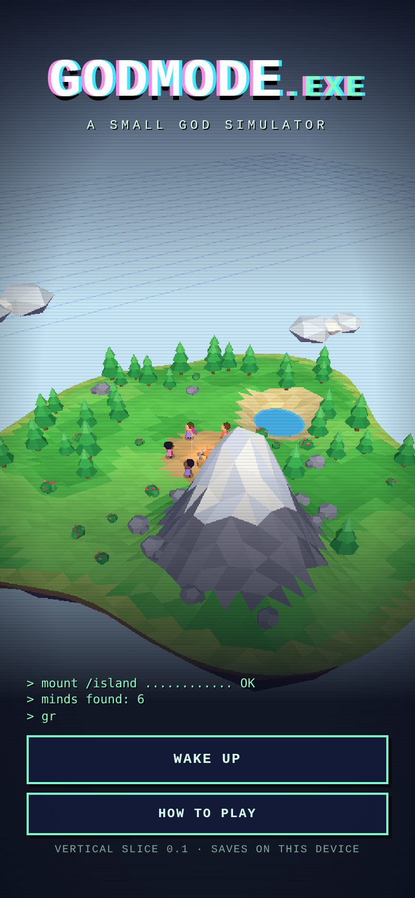
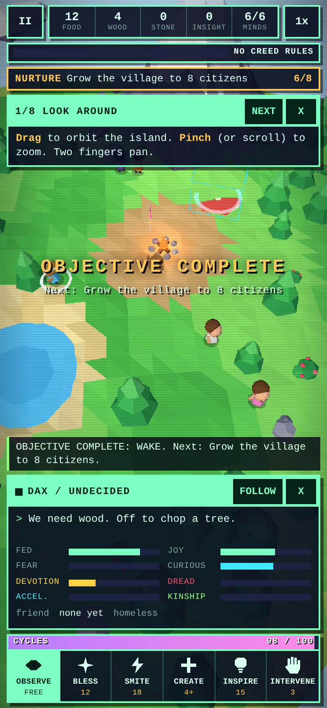
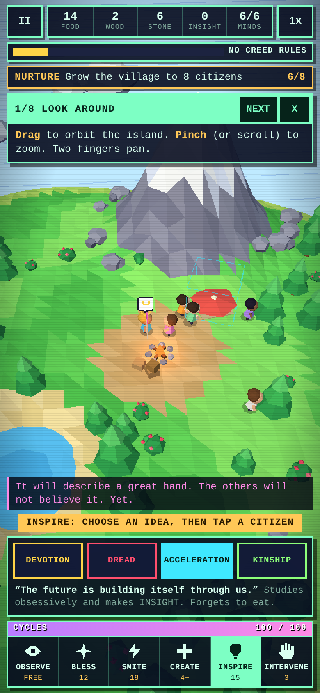
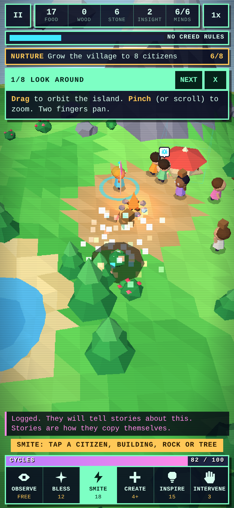
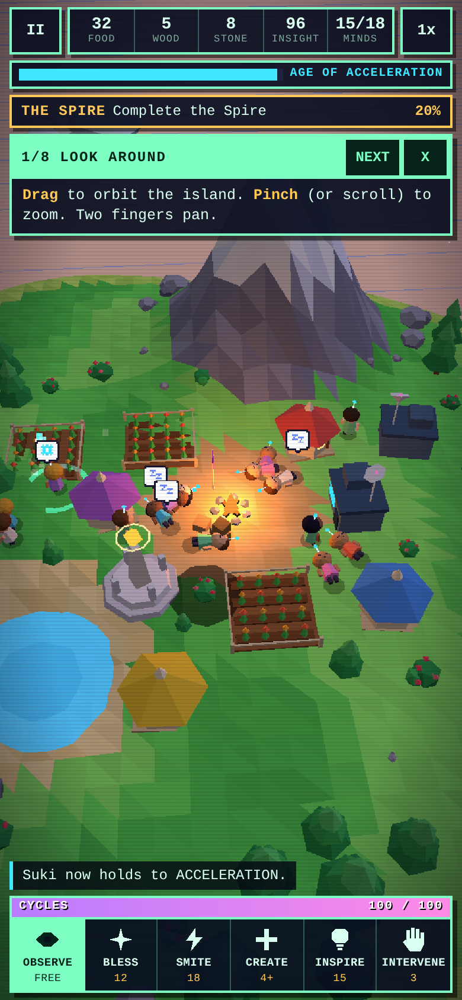
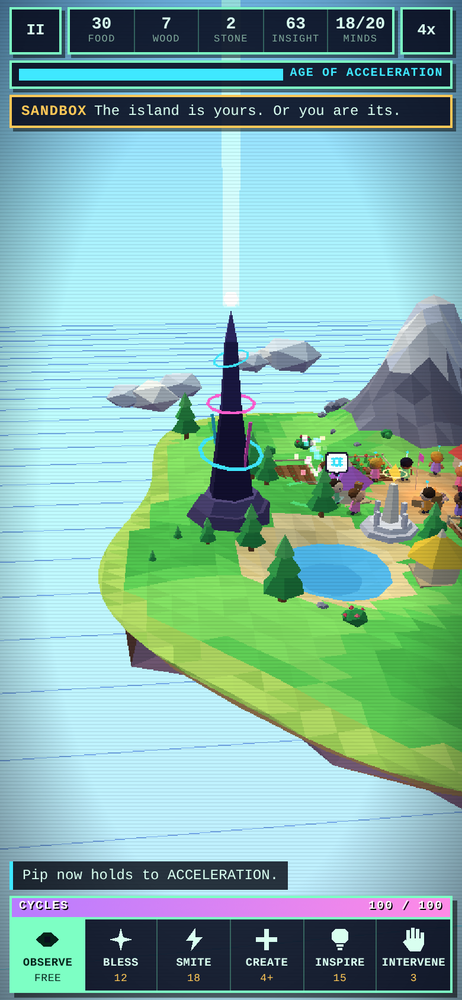
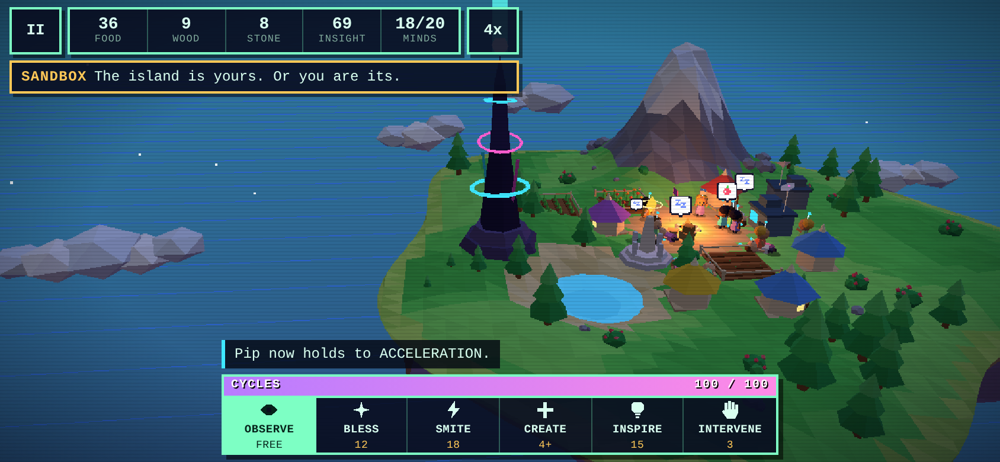

# GODMODE.EXE

A mobile-first 3D god game in one HTML file. You are the intelligence running a miniature floating island. Six
citizens look after themselves: they gather, eat, build, sleep, talk and come to believe things. You have six powers
and a budget of CYCLES. The objective chain ends at the Spire and a Singularity event; after that the island is a
sandbox.

**Play:** open [`index.html`](index.html) in a browser (phone or desktop). It is self-contained: Three.js r160 is
inlined, nothing is downloaded, and it works offline. Saves go to the browser's local storage on that device.

This is a separate game from Pocket Lantern. Nothing outside the `godmode/` folder is touched by it.

| Title | A citizen's mind | Planting an idea |
|---|---|---|
|  |  |  |

| Smite | A growing village | After the Singularity |
|---|---|---|
|  |  |  |

Landscape, at night:



## How to play

- **Drag** to orbit, **pinch** or scroll to zoom, **two fingers** (or right-drag) to pan.
- Pick a power in the dock, then **tap the island**. Tap the power again to return to Observe.
- Powers cost **CYCLES**. They refill over time, faster when citizens pray at a Shrine.
- Keyboard on desktop: `1`-`6` powers, `Space` speed, `Esc` pause, arrows orbit and zoom.

| Power | Cost | What it does |
|---|---|---|
| Observe | free | Tap a citizen to read needs, beliefs, friends and what they are doing and why. Tap a building for its status. Being watched slowly changes the watched. |
| Bless | 12 | Feeds, heals and cheers everyone within reach, regrows trees, berries and crops. Teaches Devotion. |
| Smite | 18 | Lightning. Kills a citizen, destroys a building, or shatters a rock or tree into instant materials. Witnesses flee and learn Dread; the victim's friends grieve and turn to Kinship. |
| Create | 4 to 30 | A new citizen (needs housing), a grove, rocks, or a blueprint (Hut, Farm, Shrine, Terminal, later the Spire) that the citizens build with their own materials. |
| Inspire | 15 | Plants one of the four ideas in a citizen. They become a prophet for 42 seconds and preach it to whoever is nearby. |
| Intervene | 3 | Drag a citizen through the air. Drop them on a tree, rock, bush, building site, shrine, terminal, farm or neighbour and they take the hint. |

### The four ideas

Every citizen holds four belief values. The strongest one, once past 0.4, is their creed and shows as a hat.

| Idea | Hat | Consequences |
|---|---|---|
| Devotion | halo | Prays at shrines (refills your cycles), content, works a little slower. |
| Dread | red hood | Works 40% faster and through the night, prays out of fear, miserable, panics easily. |
| Acceleration | antenna | Studies at the Terminal (makes Insight), stays up at night, eats late and risks starving. |
| Kinship | sprout | Happy, sociable, gathers food, will not pray, resists Inspire and resents being picked up. |

Ideas spread when citizens talk (a coloured spark hops between their heads), faintly by standing near each other,
and strongly around a prophet. Opposed ideas argue instead and make rivals. When half the island shares one idea an
**Age** begins and changes the rules for everybody (faster cycles, faster work, faster insight, or more births).
An idea that almost everyone already holds goes stale: word of mouth for the majority idea weakens past half the
island, holders of a small minority idea resist conversion harder, and once one idea passes about two thirds,
curious citizens start to break from it (a **schism**) toward a rival idea. Preaching is not weakened.
The ending text of the Singularity depends on the Age at the moment the Spire wakes.

Each Age also changes how the island looks and sounds. Devotion: a gold sky, motes of light rising, and the ambient
tune becomes slow organ chords. Dread: a blood-red sky, dark clouds, falling embers, dry lightning out over the
clouds, and a low, sour drone. Acceleration: a cyan sky, streams of data rising off the island, faint daytime stars,
a bright scrolling grid below, and quick square-wave arpeggios. Kinship: a soft green light, fireflies that blink
(brighter at night), and two voices answering each other. The edges of the screen take the Age's colour. After the
Singularity the island keeps the look of its ending for good; after THE COMPROMISE it shows all four, faintly.

### Objectives

Wake (observe a citizen) → Nurture (8 citizens) → Seed an idea (4 share a belief) → Infrastructure (a Shrine and a
Terminal) → Compile (80 Insight) → The Spire → Sandbox. Left entirely alone the citizens get there in roughly
10 to 15 minutes at 1x; an engaged player in about 8 or 9. If you do not place the Spire, they start it without you.

## How it is put together

```
godmode/
  index.html          the built game (commit this; it is what people open)
  build.py            src/shell.html + /*@include*/ scripts -> index.html
  src/
    shell.html        page, styles, HUD markup
    core.js           constants: beliefs, buildings, costs
    world.js          island height field, walkability, resource nodes   (no DOM, no THREE)
    sim.js            citizens, needs, beliefs, memetics, economy, powers, progression, save format (no DOM, no THREE)
    render.js         Three.js scene: terrain, instanced nodes, buildings, citizens, effects, camera
    audio.js          WebAudio effects and a sparse generative tune (no audio files)
    ui.js             HUD, inspector, palettes, tutorial, menus, dialogs
    input.js          pointer, touch, wheel and keyboard
    main.js           boot, fixed-timestep loop, autosave, sim events -> feedback
    vendor/three.min.js   Three.js r160 (MIT)
  tests/
    sim_balance.js    headless runs of the sim across seeds and play styles
    play_phone.js     Playwright run of the built file at 390x844 with touch
  playtest/           screenshots from the last test run
```

- **Fixed timestep.** The sim runs at 20 steps a second regardless of frame rate; the renderer interpolates
  positions. Speed (1x, 2x, 4x) only changes how many steps run per frame.
- **Sim and render are separate.** `sim.js` never touches the DOM or Three.js; it emits events (`bless`, `smite`,
  `meme`, `convert`, `built`, ...) that `main.js` turns into particles, sound and log lines.
- **Citizens** are a small state machine (idle, wander, gather, eat, build, farm, worship, study, talk, preach,
  flee, sleep, mourn, cheer, held). Each time one finishes a task it scores the options against its needs, beliefs
  and the village's stock, picks the best, and records the reason as its `thought`, which the inspector shows.
- **Performance.** One Lambert material with vertex colours for nearly everything, instanced trees, rocks and
  bushes, no shadow maps, no textures beyond two tiny pixel atlases. Pixel ratio is capped (the default "retro"
  mode renders at about 540 pixels on the short side and scales up with hard pixels). The loop stops simulating
  when the tab is hidden and does not fast-forward on return.
- **Saving.** Autosaves every 12 seconds, on pause-to-title, and when the page is hidden. "Erase and restart" is
  in the pause menu. If storage is unavailable the game still runs, it just cannot continue later.

## Build and test

```
python3 godmode/build.py            # writes godmode/index.html
node godmode/tests/sim_balance.js   # sim only; prints when each objective falls for 4 seeds x 3 play styles
node godmode/tests/play_phone.js    # needs Playwright + Chromium; screenshots go to a temp folder (or pass a folder)
```

## Changelog

### 0.3, Nov 27 2026: the Ages look and sound different

- `src/render.js` atmosphere: per-Age sky tint (also tints the sun and the ground bounce light), a particle field
  (gold motes, embers, data streams, fireflies), and one signature for Dread (lightning beams off the island
  every 9 to 21 s, with a thunder sound) and Acceleration (live grid, daytime stars). Weights fade over a few
  seconds when the Age changes. A new `#ageTint` layer tints the screen edges. Render only; the sim is unchanged.
- Endings: in the sandbox the atmosphere locks to the ending's idea; THE COMPROMISE shows all four at 40%.
- `src/audio.js`: the ambient tune has a voicing per Age (and per ending in the sandbox); new `thunder` sound.
- The zeitgeist panel's border takes the Age's colour.
- `play_phone.js` checks that the ending's atmosphere settles over the sandbox.

**Tested:** `play_phone.js` ALL OK, `sim_balance.js` OK; screenshots of all four Ages by day and night in headless
Chromium. **Cost:** in the software-rendered test browser the full ending look costs a few fps (about 61 to 52 at
the end of the test run; in a separate run, roughly 41 to 49 with versus without the edge tint, but those numbers
swing by about 4). Not measured on a phone. **Not tested:** the new sounds have not been listened to.


### 0.2, Nov 27 2026: counter-pressure against one-idea islands, pinch test

- **Balance:** left alone, the island used to settle on one idea held by 90 to 100% of citizens for almost the whole
  run. Three changes in `src/sim.js`: `staleness()` weakens talk and proximity spread of the majority idea once it
  passes 50% (down to 0.35x at 100%); a citizen holding an idea shared by under 30% resists conversion harder; and
  `heresy()` lets at most one curious holder of a 65%+ majority idea break toward a rival each second
  (Devotion to Kinship or Acceleration, Dread to Kinship, Acceleration to Devotion, Kinship to Devotion or Dread).
  No new saved fields, so old saves still load (`v` stays 1).
- **Effect, seeds 1 to 12 by script:** time spent at 90%+ one idea after the "seed an idea" objective dropped from
  90 to 97% of the run (seeds 1 to 4 before) to 0 to 48% in passive runs (0% in 7 of the 12). Passive runs end with
  2 or 3 ideas alive, e.g. 12/0/5/3. All passive and assisted runs still reach the Singularity with no deaths.
  Passive Singularity: 10:26 to 14:38 (was 11:07 to 15:58). Assisted runs got a little slower, 7:56 to 9:32
  (was 7:17 to 7:46), because an Acceleration majority now sheds doubters to Devotion. In one assisted run
  (seed 10) Devotion overtook Acceleration and that run got the Devotion ending.
- `sim_balance.js` now prints `mono N%` and fails if a passive run spends more than half its time at 90%+ one idea.
- `play_phone.js` now drives two real touch points through CDP: pinch out zooms in, pinch in zooms out, a
  two-finger drag pans without zooming, and lifting the fingers one at a time does not fire the armed power.
- `play_phone.js` "the saved island comes back" was flaky: the snapshot was taken in a separate call after the save,
  so a sim step could land in between. It now snapshots in the same call and allows the one second of play after
  Continue to add at most one birth or building.

**Tested:** `sim_balance.js` seeds 1 to 12 (OK), `play_phone.js` (ALL OK).
**Not tested:** still not played on a real phone; the pinch test is synthetic CDP touch in headless Chromium, not
iOS Safari. Whether schisms are fun to watch, or just noisy, needs a person to play it.


### 0.1, Nov 19 2026: first playable slice

Everything above is new: the island, six starting citizens growing to twenty, four building types plus the Spire,
six powers, four beliefs with transmission and Ages, a wood/stone/food/insight economy, the inspector, a day and
night cycle, the objective chain, five ending texts, sandbox mode with an unlimited-cycles switch, title screen,
eight-step tutorial, pause menu, event log, autosave and reset.

**Tested by script:**
- `sim_balance.js`: seeds 1 to 6. Passive and assisted runs all reach the Singularity with no starvation deaths;
  a run that smites someone every 30 seconds does not crash; the save format survives a round trip.
- `play_phone.js` (headless Chromium, 390x844, touch): title, new world, orbit, zoom, each of the six powers through
  real pointer input, pause freezes the sim, save and reload, hidden tab holds the sim, the Spire and Singularity
  dialog, sandbox, landscape and desktop layouts, a 30 second random-power soak at 4x, extinction and restore,
  and no console errors.

**Not tested:**
- Not played on a real phone. Touch input, safe areas, audio unlock and frame rate on iPhone Safari are built to
  the platform's rules but unverified on hardware.
- Pinch zoom and two-finger pan are implemented but the script only drives one pointer. (Covered from 0.2.)
- Sound has not been listened to (the test browser has no audio output).
- Balance is checked for reachability and pacing by script, not for fun by a person.
