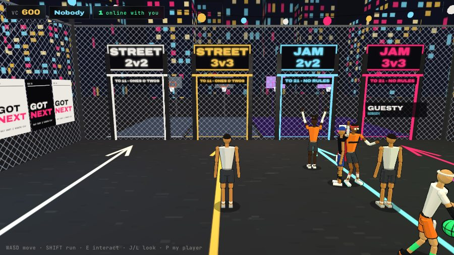

# GOT NEXT

*Half court. Winners stay.*

A park-basketball career game in one HTML file. Phone first, plays on a computer, two players with a controller.
You build a player, walk The Block, take games in The Pit, and spend what you earn on your player, your drip and your
crib. A North Coast Studios game. **Version 0.3: two players online, a tighter Block, The Pit as a cage.** It is a standalone game, not a Pocket Lantern cartridge.

**Play:** open [`index.html`](index.html) in a browser. That one file is the whole game; send it to a friend and they
have it too.


The brand, its rules and the names reserved for later are in [`docs/BRAND.md`](docs/BRAND.md).

| The Block (hub) | The Pit (a cage) | A friend online | On a phone |
|---|---|---|---|
|  |  |  |  |

## What is in it

- **The builder.** Six playstyles, six origins, height / weight / wingspan sliders that move the caps of 19 attributes
  live. See [`docs/DESIGN.md`](docs/DESIGN.md) for how the numbers work.
- **Online, two players (v0.3).** Open the shared link at the same time and you see each other walking The Block and
  The Pit, each with the player they built. Either of you can keep doing your own thing, or call the other from any
  game door to run on the same team or against each other. Details and limits are under *Online* below.
- **The Block.** One tight street corner; The Pit is a floodlit chain-link cage across the north side. Third-person hub: The Pit, The Plug (drip), The Lab (attributes and badges), the Tape Deck (moves), your crib, the Money Rack
  shootout, the old head, and six build fiends who need VC for their Basketball 2146 builds on PS88.
- **The Pit.** Four doors: Street 2v2, Street 3v3, JAM 2v2, JAM 3v3. A side kiosk (Last Call) for one-game boosts and
  The Link for build codes. Four court tiers, opened by Respect.
- **The basketball.** Half court, camera on your player. Street: 1s and 2s to 11, take it back past the arc, 14-second
  clock. JAM: 2s and 3s to 21, shoving is legal, dunks from the logo, three makes in a row sets you on fire.
- **Two-stick control,** on a phone too: left stick moves, right stick is the skill stick (shoot, drive, side move,
  stepback, spin; hands up and steal on defense).
- **16 badges** in four tiers, earned with badge XP from real games. **Bravado** meter: big plays fill it, a full bar is
  +8 to everything for 20 seconds.
- **Unlocks:** 74 pieces of drip in ten slots (some carry small buffs), 22 animations (dribble moves, jumpshots, dunk
  packages, celebrations), 8 crib upgrade lines with passive buffs, 29 trophies, 8 Respect ranks.
- **Friends.** Export your build as a code; a friend imports it and your player is in their park as a teammate or the
  rival. On a computer a second player joins with a controller, co-op or versus.

## Controls

| | Phone | Keyboard | Controller |
|---|---|---|---|
| Move (full push = sprint on a phone) | left thumb | WASD, Shift to sprint | left stick, RT |
| Skill stick | right thumb | I J K L | right stick |
| Pass / steal / call for ball / interact | PASS button | E | A |
| Shoot / jump (hold, release in the green) | SHOOT button | Space | X |
| Pause / My Player | ☰ | P | Start |

Skill stick with the ball: **↓ hold** shoot, **↑** drive (layup or dunk), **← →** side move, **↙ ↘** stepback,
**↖ ↗** spin. Without it: **↑** hands up, **↓** steal (JAM: shove).

## Build

Source is in `src/`. After editing, run:

```
python3 build.py        # writes index.html
```

| File | What it holds |
|---|---|
| `src/data.js` | Every table: attributes, playstyles, origins, badges, moves, drip, crib, boosts, modes, trophies, all the writing |
| `src/core.js` | Save, build codes, input (touch sticks, keyboard, gamepads), synthesised sound and music |
| `src/gfx.js` | Renderer, cel shading and ink lines, the player rig and its drip, poses, courts, signs |
| `src/ball.js` | The basketball: rules, shooting, finishing, dribble moves, steals, blocks, rebounds, AI, camera |
| `src/hub.js` | The Block, The Pit, My Crib, walking and talking |
| `src/ui.js` | HUD and every menu |
| `src/net.js` | Online: who is here, invites, the shared game, your player saved to your account |
| `src/main.js` | Boot, the loop, rewards, ranks, trophies |
| `src/shell.html` | Page and CSS |
| `vendor/three.min.js` | three.js r160 (MIT), inlined by the build so the game stays one file |
| `vendor/archivo.woff2`, `vendor/jbmono.woff2` | The two brand typefaces, Archivo and JetBrains Mono (both SIL Open Font License), embedded by the build |

## Tests

Scripted Chromium runs (Node and Playwright; set `PLAYWRIGHT` to the module path if it is not found):

```
node tests/smoke.mjs              # title → builder → hub → a game → results → shops, crib, menus (PORTRAIT=1 for a phone, MODE=j2 for JAM)
node tests/input.mjs              # real touch events on both sticks; a fake second controller
tests/sim.sh                      # an all-AI game in each mode, printed as box scores
node tests/online.mjs             # two pages in one simulated live room: meet, invite, play a shared game, both get paid
```

## Online

It runs on the claude.ai artifact's live room, so it only works from the published link, not from the file on disk.

- **Who can connect:** people signed in to Claude that the link has been shared with. A public link does not connect.
- **Being there:** everyone with the game open shows up on The Block and in The Pit with a name tag. The top-left chip
  says how many are online with you.
- **Playing together:** walk to a game door in The Pit. Under ONLINE, pick SAME TEAM or VERSUS next to their name. They
  get a call wherever they are and choose Run it or Nah. Each of you earns your own VC, Respect and badge XP.
- **Your player travels:** each person plays with the player they built, on every screen. When the game is opened from
  the link, the save is also kept on your account, so the same player is there on your phone and your computer.
- **How it works:** the caller's device runs the game and the other one sends its sticks and draws what it is told.
  Rosters are rebuilt from a shared seed, so only the two human builds cross the wire. The caller must keep the game on
  screen; if either side drops, the other is told and the AI takes over or the game ends.
- **Limits today:** two people per game. The joining player's crib bonuses and Last Call boosts do not apply in a shared
  game. Their moves feel a little late (their own shot timing does not: the meter is judged on their device).

## What was and was not tested

- **Online, checked by script only, in a simulated room:** two pages see each other, invite, play one shared Street 2v2
  to a finish, the joining player's movement and shot reach the host, and both get paid. **It has not been run on the
  real platform by two real people.** The account save has not been exercised at all outside the code.
- **Checked by script:** the whole loop above with no page errors, landscape and portrait; all four modes play to a
  finish with AI on both sides (about four minutes a game, no stalls, no shot-clock stalls); touch sticks walk, shoot
  and do a move; a simulated controller drives player 2; build codes export and import.
- **Not checked:** nothing has been played by a person, on a phone or anywhere else. Feel, difficulty and the economy
  are first guesses. A real controller has not been plugged in. Sound has not been heard.

## Known gaps

- Animation is procedural poses, not keyframed. It reads, but it is stiff.
- No fouls, no out of bounds (the cage keeps the ball in), no alley-oops, no screens.
- Two players share one camera, so they can drift apart on screen.
- Court tiers change opponents and pay, not the look of the court.
- The rebrand in v0.2 covers the name, the mark, type, colour, every menu, the HUD, signs, shop names, ranks and rarity names. Still in the old joke voice: badge names, attribute blurbs, origins, trophies, the announcer calls. The 3D world got brick, concrete and posters but not a full art pass.
