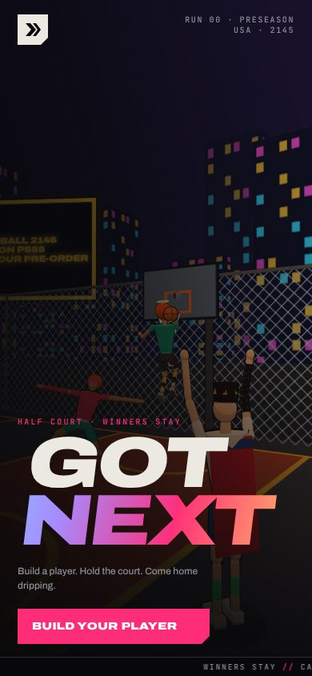
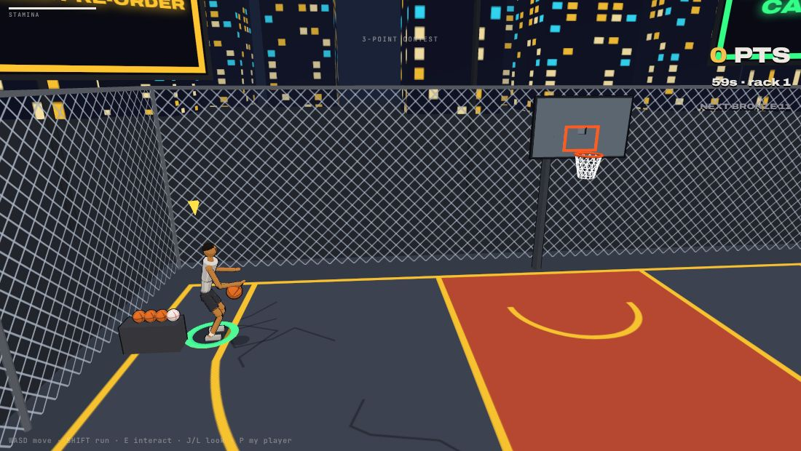
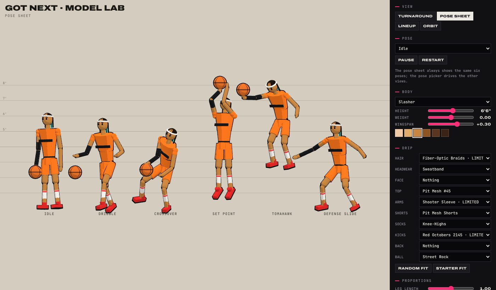
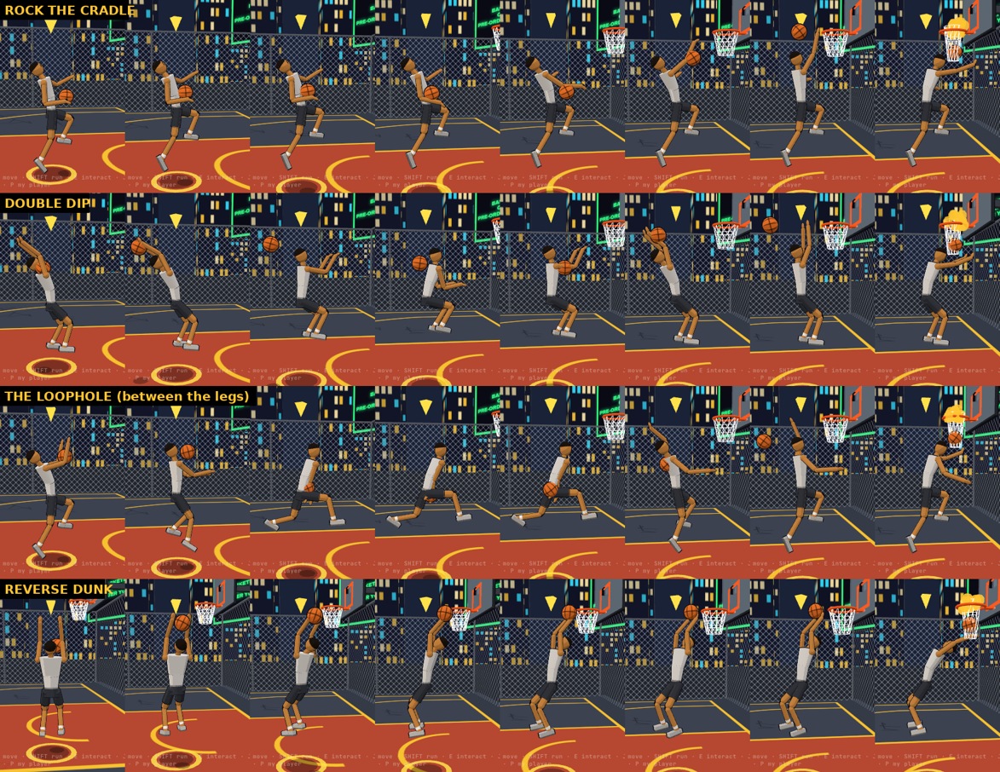
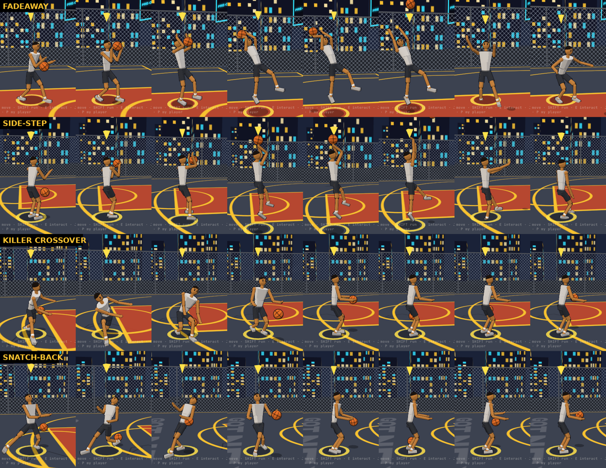

# GOT NEXT

*Half court. Winners stay.*

A park-basketball career game in one HTML file. Phone first, plays on a computer, two players with a controller.
You build a player, walk The Block, take games in The Cages, and spend what you earn on your player, your drip and your
crib. A North Coast Studios game. **Version 0.7.1: contested finishes: real contact in the air, and the better the finisher, the smarter the finish (measured: 38% → 74% made against the same rim protector); three more dunks and the Posterizer.** v0.7: more finishes (four new dunks, five layups, hop steps), fadeaways and side-steps, three new dribble moves, and a Dev Room with a maxed-out player.** v0.6 added the grind: nine drills that pay, H-O-R-S-E, a 1v1 ladder, daily contracts and events. Details and measurements: [`docs/ANIMATION.md`](docs/ANIMATION.md).

**Where it stands, bugs, and everything asked so far:** [`docs/STATUS.md`](docs/STATUS.md). It is a standalone game, not a Pocket Lantern cartridge.

**Play:** open [`index.html`](index.html) in a browser. That one file is the whole game; send it to a friend and they
have it too.


The brand, its rules and the names reserved for later are in [`docs/BRAND.md`](docs/BRAND.md).

| The Block (hub) | The Cages | A crew online | On a phone |
|---|---|---|---|
|  |  |  |  |

## What is in it

- **The builder.** Six playstyles, six origins, height / weight / wingspan sliders that move the caps of 19 attributes
  live. See [`docs/DESIGN.md`](docs/DESIGN.md) for how the numbers work.
- **Online, crews of up to six (v0.4).** Open the shared link at the same time and you see each other walking The
  Block and The Cages, each with the player they built. Call people into your crew: they pull up next to you and
  follow you around, and at any cage gate you put each of them on your team or the other and run it, 2v2 or 3v3.
  Details and limits are under *Online* below.
- **Your friends' players, solo.** Everyone you meet online is kept as a homie, and homies fill your squad by default,
  so a 3v3 with your friends' builds works with nobody else online.
- **The Block.** One tight street corner; The Cages is a floodlit chain-link cage across the north side. Third-person hub: The Cages, The Plug (drip), The Lab (attributes and badges), the Tape Deck (moves), your crib, the Money Rack
  shootout, the old head, and six build fiends who need VC for their Basketball 2146 builds on PS88.
- **The Cages.** Four doors: Street 2v2, Street 3v3, JAM 2v2, JAM 3v3. A side kiosk (Last Call) for one-game boosts and
  The Link for build codes. Four court tiers, opened by Respect.
- **The basketball.** Half court, camera on your player. Street: 1s and 2s to 11, take it back past the arc, 14-second
  clock. JAM: 2s and 3s to 21, shoving is legal, dunks from the logo, three makes in a row sets you on fire.
- **Two-stick control,** on a phone too: left stick moves, right stick is the skill stick (shoot, drive, side move,
  stepback, spin; hands up and steal on defense).
- **16 badges** in four tiers, earned with badge XP from real games. **Bravado** meter: big plays fill it, a full bar is
  +8 to everything for 20 seconds.
- **Unlocks:** 74 pieces of drip in ten slots (some carry small buffs), 22 animations (dribble moves, jumpshots, dunk
  packages, celebrations), 8 crib upgrade lines with passive buffs, 29 trophies, 8 Respect ranks.
- **Friends.** Export your build as a code; a friend imports it and your player is in their park as a teammate or the
  rival. On a computer a second player joins with a controller or on a split keyboard, co-op or versus.

## The grind (v0.6)

Ways to earn VC and Respect away from the gates.

- **Drills.** Coach Overtime's board on The Block, or DRILLS at your crib:

  | Drill | Badge XP |
  |---|---|
  | Layup Lines, Mikan Drill | Finishing |
  | Free Throws, Spot Shooting, Around the World, 3-Point Contest (money balls), Catch & Shoot (quick-release bonus) | Shooting |
  | Cone Weave (style points for moves at the cones) | Playmaking |
  | Defensive Slides (sprinting does not count) | Defense |

  Each drill keeps a personal best and has bronze, silver and gold scores. The first time to each medal pays a bonus
  (100 / 250 / 600 VC). The same drill pays less after three runs in a day.
- **H-O-R-S-E with Sharpie.** 50 VC to play, 250 if you spell him out. He shoots too, and you match his makes from his
  spot.
- **The Money Rack.** Unchanged: 40 seconds of deep balls, 5 VC a point.
- **The ladder.** Six people in The Cages play you one on one to 7, in order:
  1. Lil Kickstand
  2. Two-Ply
  3. Deacon Gains
  4. Mini Mortgage
  5. Static
  6. The Commissioner

  A first win pays 160–960 VC and Respect, and they become a homie who can run on your squad. Rematches pay 30%.
- **Daily contracts.** The old head has three a day, drawn from a pool of 14 (win games, assists, greens, finish
  drills, beat Sharpie, climb the ladder, help a fiend and so on). Progress counts from the start of the day.
- **The daily event.** One a day, the same for everyone:
  - Grind Day: drills +50%
  - Green Day: greens double in drills
  - Ladder Night: ladder pays double
  - Horse Derby: H-O-R-S-E pays double
  - Bucket Bonanza: games +25%
  - Fiend Appreciation Day: helping a fiend earns 10 Respect

  It shows in the corner of the screen and on the boards.
- **Trophies:** Clocked In, Gym Rat (25 drills), Gold Standard (gold in all nine), Spelling Bee, On the Ladder,
  Top Rung.

| Coach's board | 3-Point Contest | The ladder in The Cages |
|---|---|---|
|  |  |  |

## Model lab

[`lab.html`](lab.html) is the game's own player model on a model sheet, for designing bodies and drip. It has:
- views: a turnaround (front, ¾, side, back), a six-pose sheet, lineups (playstyles at their usual heights,
  5'9" to 7'3", weight and wingspan) and an orbit view
- every pose in the game, playing or paused
- every drip slot, a skeleton overlay and height lines in feet
- **proportion sliders** for leg length, thigh/shin split, torso, arms, shoulders, hips, head, neck, limb thickness,
  hands and feet

**Copy proportions** gives numbers that go into `PROP` in `src/gfx.js`. **Copy build code** brings a look into the
game through The Link. Built by `python3 build.py` alongside the game; source in `src/lab.html` and `src/lab.js`.



## Controls

| | Phone | Keyboard | Controller |
|---|---|---|---|
| Move (full push = sprint on a phone) | left thumb | WASD, Shift to sprint | left stick, RT |
| Skill stick | right thumb | I J K L | right stick |
| Pass / steal / call for ball / interact | PASS button | E | A |
| Shoot / jump (hold, release in the green) | SHOOT button | Space | X |
| Pause / My Player | ☰ | P | Start |

Skill stick with the ball: **↓ hold** shoot, **↑** drive (layup or dunk), **← →** side move, **↙ ↘** stepback,
**↖ ↗** spin. Without it: **↑** hands up, **↓** steal (JAM: shove).

The **move stick** (left) picks the finish or the jumper as you go up:

| Move stick as you go up | Near the rim (↑ or shoot) | Jumper (shoot) |
|---|---|---|
| Toward the rim | lay-in, finger roll at full speed, scoop or power layup when someone is on you, or your dunk | pull-up |
| Sideways | euro step | side-step (from a stand) |
| Away from the rim | reverse layup / reverse dunk | fadeaway |
| Let go, at speed | hop step, then up strong | — |

**↑** from mid-range (outside floater range) is a hop-step jumper with automatic timing.

## Dev Room (v0.7)

From the title screen, the OPTIONS tab of My Player, or **F2** on The Block.

- **Profile:** MAX ME OUT (every attribute 99, every badge iced out, everything owned, top rank, 250,000 VC), RESTORE MY
  PLAYER (the real one is kept inside the save the moment the Dev Room first changes anything), build codes in and out.
- **Build:** any style, height, weight and wingspan, every attribute 25–99 (caps ignored, the style's cap is shown), every
  badge tier, and one-tap archetypes (each style capped out).
- **Moves:** equip anything, owned or not, and preview the pose.
- **Play:** shoot-around, 1v1 to 11, Street 3v3, JAM 2v2 and 3v3, against maxed-out players of any style or a chosen OVR.
  Nothing played here pays VC or Respect.
- **Reel:** plays every dunk, layup, jumper variation and dribble move with your build, on a court, through the same code
  as a game.





## Build

Source is in `src/`. After editing, run:

```
python3 build.py        # writes index.html
```

| File | What it holds |
|---|---|
| `src/data.js` | Every table: attributes, playstyles, origins, badges, moves, drip, crib, boosts, modes, trophies, all the writing |
| `src/core.js` | Save, build codes, input (touch sticks, keyboard, gamepads), synthesised sound and music |
| `src/gfx.js` | Renderer, cel shading and ink lines, the player rig and its drip, poses, courts, signs |
| `src/ball.js` | The basketball: rules, shooting, finishing, dribble moves, steals, blocks, rebounds, AI, camera |
| `src/hub.js` | The Block, The Cages, My Crib, walking and talking |
| `src/ui.js` | HUD and every menu |
| `src/gfx.js` (end) | Locomotion layer: planted feet, stepping, two-bone leg IK |
| `src/net.js` | Online: who is here, invites, the shared game, your player saved to your account |
| `src/main.js` | Boot, the loop, rewards, ranks, trophies |
| `src/shell.html` | Page and CSS |
| `vendor/three.min.js` | three.js r160 (MIT), inlined by the build so the game stays one file |
| `vendor/archivo.woff2`, `vendor/jbmono.woff2` | The two brand typefaces, Archivo and JetBrains Mono (both SIL Open Font License), embedded by the build |

## Tests

Scripted Chromium runs (Node and Playwright; set `PLAYWRIGHT` to the module path if it is not found):

```
node tests/smoke.mjs              # title → builder → hub → a game → results → shops, crib, menus (PORTRAIT=1 for a phone, MODE=j2 for JAM)
node tests/input.mjs              # real touch events on both sticks; a fake second controller
tests/sim.sh                      # an all-AI game in each mode, printed as box scores
node tests/online.mjs             # two pages in one simulated live room: meet, invite, play a shared game, both get paid
node tests/crew.mjs               # three pages: form a crew, follow the leader, run a 3v3 with a member on each side
node tests/poses.mjs              # renders every pose to tests/shots/pose-NN.png
node tests/grind.mjs              # every drill, H-O-R-S-E, a ladder match and a contract, played by a bot; each must pay
node tests/accept.mjs             # the eight animation/control acceptance scenarios, with numbers
node tests/feel.mjs [file.html]   # movement metrics for any build (reversal time, foot slip, ball in hand, FPS drift)
node tests/strip.mjs run|drib|shot|def [file.html]   # side-on filmstrips of real gameplay
node tests/reel.mjs dunks|layups|jumpers|handles      # films every move in a Dev Room reel and lists what each one did
node tests/gestures.mjs           # each finish and jumper variation from real key presses; Dev Room max and restore
node tests/devroom.mjs            # clicks through every Dev Room tab, a reel and a 1v1 against a maxed player
node tests/contest.mjs [N]        # N drives per finisher quality at a rim protector: made %, blocked %, finishes picked
```

## Online

It runs on the claude.ai artifact's live room, so it only works from the published link, not from the file on disk.

- **Who can connect:** people signed in to Claude that the link has been shared with. A public link does not connect.
- **Being there:** everyone with the game open shows up on The Block and in The Cages with a name tag. The top-left chip
  says how many are online with you.
- **Crews:** My Player → CREW, or any cage gate: press + CREW next to someone. They choose Pull up or Nah. A crew is
  up to six; members follow the leader between The Block and The Cages.
- **Playing together:** at a gate the leader sets each crew member to MY TEAM or THEIR TEAM and presses RUN IT WITH THE
  CREW; AI fills the empty spots. Without a crew, SAME TEAM or VERSUS next to a name calls a one-off game. Each of you
  earns your own VC, Respect and badge XP.
- **Your player travels:** each person plays with the player they built, on every screen. When the game is opened from
  the link, the save is also kept on your account, so the same player is there on your phone and your computer.
- **How it works:** the caller's device runs the game and the other one sends its sticks and draws what it is told.
  Rosters are rebuilt from a shared seed, so only the two human builds cross the wire. The caller must keep the game on
  screen; if either side drops, the other is told and the AI takes over or the game ends.
- **Limits today:** up to the mode's size per team (3v3 = six people). The joining player's crib bonuses and Last Call boosts do not apply in a shared
  game. Their moves feel a little late (their own shot timing does not: the meter is judged on their device).

## What was and was not tested

- **Online, checked by script only, in a simulated room:** three pages form a crew and play a 3v3 with a member on each
  side; two pages see each other, invite, play one shared Street 2v2
  to a finish, the joining player's movement and shot reach the host, and both get paid. **It has not been run on the
  real platform by two real people.** The account save has not been exercised at all outside the code.
- **Checked by script:** the whole loop above with no page errors, landscape and portrait; all four modes play to a
  finish with AI on both sides (about four minutes a game, no stalls, no shot-clock stalls); touch sticks walk, shoot
  and do a move; a simulated controller drives player 2; build codes export and import.
- **Not checked:** nothing has been played by a person, on a phone or anywhere else. Feel, difficulty and the economy
  are first guesses. A real controller has not been plugged in. Sound has not been heard.

## Known gaps

- Animation is procedural poses, not keyframed. It reads, but it is stiff.
- No fouls, no out of bounds (the cage keeps the ball in), no alley-oops, no screens.
- Two players share one camera, so they can drift apart on screen.
- Court tiers change opponents and pay, not the look of the court.
- The rebrand in v0.2 covers the name, the mark, type, colour, every menu, the HUD, signs, shop names, ranks and rarity names. Still in the old joke voice: badge names, attribute blurbs, origins, trophies, the announcer calls. The 3D world got brick, concrete and posters but not a full art pass.
