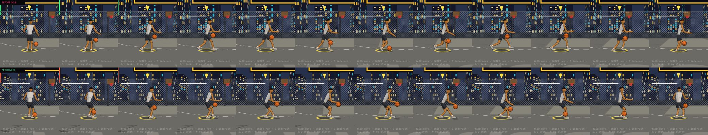
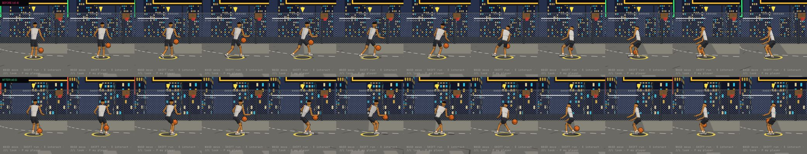

# GOT NEXT — animation and control overhaul (v0.5)

What was wrong, what was changed, and the measured difference. Every number below comes from the real game loop
driven frame by frame with real key presses (`tests/feel.mjs`, `tests/accept.mjs`), on the v0.4 build and on this one.




Filmed from a fixed side camera on both builds with the same input (`node tests/strip.mjs run|drib [file]`).

---

## 1. Audit of v0.4: what was wrong and why

| Problem | Cause in the code |
|---|---|
| Feet skated: the "planted" foot moved over the court at about **twice the body's speed** | Legs played a sine-wave cycle whose speed was only loosely tied to running speed. Nothing knew where a foot was on the court. |
| The body turned like a block | One facing angle for the whole body, eased toward a target. Hips, chest and head never moved apart. |
| The ball was not in the hand: **0%** of dribble frames | The ball was placed by a formula next to the player and bounced on its own timer; the hand pose ran on a separate one. Ball jumps between frames reached **20.6 m/s**. |
| Dribble moves locked control | A move set the velocity for its whole length (0.28–0.46 s), could not be steered and could not be cancelled. A cooldown longer than the move blocked chaining. |
| Reversing was slow: **283 ms** to start moving the other way, **517 ms** to get back to speed | One acceleration value for speeding up and slowing down. |
| Behaviour depended on frame rate | The simulation stepped by the frame time (up to 50 ms). The same input ended **3 cm** apart at 30 and 120 FPS. |
| Button presses could be lost | Presses counted only on the exact frame they happened. Nothing was buffered while an action was playing. |
| A held ball could get stuck mid-air after a check (found during this work) | When the ball was more than 2.5 m from the holder, the dribble restarted every frame. |

What the models allow: the rig already had 17 joints in a proper hierarchy (hips → lower spine → chest → neck →
head; shoulder → elbow → wrist; hip → knee → ankle), so leg IK, a hand-driven dribble and torso/hip separation were
all possible without new models. Limits are listed in section 5.

## 2. What changed: four layers

```
input (latched, buffered)  →  gameplay (fixed 60 Hz: movement, actions, rules)  →  presentation, per frame:
   1. pose layer        state machine picks a pose (~32 of them) and eases every joint toward it
   2. locomotion layer  feet planted on the court in world space; legs solved with two-bone IK
   3. ball layer        dribble state machine: hand → down → bounce → up → hand, synced to the hand pose
   4. reaction layer    look-at, lean into acceleration, hip/torso twist, bumps, contest fade, catch arms
```

Gameplay never waits for animation; animation follows what gameplay actually did (positions and velocities), which
is why the same code works on an online guest that only receives positions.

### Input and responsiveness
- **Fixed 60 Hz simulation** with an accumulator. Same input, same result at 30, 60 or 144 FPS.
- **Latched presses:** a press is held until a simulation step uses it, so a tap is never lost between steps.
- **Action buffer:** an action pressed during another one is held for 0.3 s and fires as soon as it can.
- **Cancel windows:** dribble moves chain from halfway, fakes and passes recover after 0.12 s, a landed jumper is
  done, failed steals recover after 0.26 s.
- **Braking:** slowing down or reversing uses 2.4× the acceleration.
- **Steering during dribble moves:** the held direction adds up to 2.4 m/s of steer.
- **Controller:** round deadzones (17% move, 22% skill stick) scaled so small pushes give small, precise movement;
  stick magnitude sets speed.

### Locomotion (feet and legs)
- Each foot has a **world position on the court**. It stays there until the body has moved far enough (more at speed,
  less in a wide stance), then **steps**: a swing of 0.13–0.3 s with lift and toe-off, landing where the body will be.
- Only one foot swings at a time, unless the body has outrun both. A foot the leg can no longer reach steps at once.
- **Two-bone IK, exact for the rig's rotation order**, bends each leg to its foot. The ankle keeps the foot flat
  when planted.
- **The hips drop** when a foot would be out of reach, and **soak up landings**.
- **Defense:** a wide stance takes short, quick shuffle steps.
- The **arms swing in time with the feet** that are actually stepping.
- The same layer runs on The Block and for online players walking around.

### Ball handling
- Explicit states: **hand** (receive, then push down), **down** (to a floor point), **up** (back to the receiving
  hand), **carry** (spins), **gather** (shots, passes, fakes, finishes).
- Floor points by situation: beside the foot (ordinary), out front (at speed), across the front (crossover), between
  the feet (through the legs), behind (behind the back), far side (Shell Company), low and wide (protecting from a
  close defender), and pulled back (stepbacks and the moonwalk).
- Hand-changing moves send the ball where the move needs it and switch hands on the bounce. The bounce point uses the
  move's own direction, so a crossover against your run stays with you.
- The ball has a top speed (about 11 m/s). After any state change it closes the gap rather than jumping. The catch
  happens when ball and fingertips meet.
- Teleports (checks, resets) put the ball straight in the hand.

### Basketball actions
- **Jumpers:** gather plants the feet (pull-up), dip, rise, release from the actual hand, follow-through, drift in
  the air carrying momentum, landing compression, then a recovery you can cut short by moving.
- **Contested shots** fade back; **moving shots** drift sideways.
- **Passes:** chest, bounce (when the lane is covered), overhead (long), one-handed (on the run) and lob
  (alley-oop). Each has its own pose and ball flight; the ball leaves from wherever it was.
- **Catching:** the hands come up for an incoming pass while running, and the dribble starts on the catch.
- **Rebounding:** players near the rim face it and box out while a shot is in the air.
- **Contact:** collisions give a short upper-body reaction. A failed steal overreaches and recovers.

## 3. Measured, before and after

| | v0.4 | v0.5 |
|---|---|---|
| Sprint then reverse: moving the other way | 283 ms | **117 ms** |
| … back to 90% speed | 517 ms | **350 ms** |
| Planted-foot slip (90th percentile) | ~2× body speed | **0.00 m/s** (sprint and defensive slide) |
| Dribble frames with the ball in the hand | 0% | **32–41%** |
| Dribble frames in the hand or a real bounce | 0% | **97–100%** |
| Largest ball jump between frames | 20.6 m/s | **11 m/s** |
| Steering during a crossover | 0.16 m | **0.47 m** |
| Chained moves that fire (4 flicked back to back) | — | **4 of 4** |
| Longest lock while mashing everything | 433 ms | **283 ms** |
| Same input at 30 / 60 / 120 FPS | 3.1 cm apart | **identical** |

### The eight acceptance scenarios (`node tests/accept.mjs`): all pass
1. Sprint, reverse, sprint again: moving the other way in 117 ms, full speed in 350 ms, planted feet do not slip.
2. Diagonal dribble into a crossover: ball never over 11 m/s, never more than 0.8 m from the body.
3. Catch on the move and dribble: caught at 4.4 m/s, kept 3.8 m/s, first dribble 133 ms after the catch.
4. Pull-up jumper:
   - planted 83 ms after pressing shoot from a sprint
   - off the floor at 283 ms
   - landed at 817 ms
   - running again 117 ms after landing
5. Slide, contest, slide again: defensive slide throughout, hands up while contesting, 14 real steps, feet planted.
6. Chain dribble moves: 4 of 4 fire, ball never lost or teleported.
7. Same behaviour at 30, 60 and 120 FPS: identical positions, shot timing within one step.
8. Mash buttons during transitions: no lock, no stuck state, back to ready.

## 4. Inspecting it

- **Debug overlay:** press ` (backquote) in a game, or open the game with `?debug`. It shows:
  - frame rate and simulation steps per frame
  - state and its timer, the pose playing, and any buffered action
  - speed and the stick
  - each foot (planted, or swinging and how far through), IK weight, hip drop and step count
  - the ball's dribble phase, hand and progress
  - the time from your last press to the action
- **Filmstrips:** `node tests/strip.mjs run|drib|shot|def [file.html]` writes side-on frames of real gameplay.
- **Numbers:** `node tests/feel.mjs [file.html]` prints the metrics in section 3 for any build.

## 5. Limits of the current models, and the smallest fixes

| Limit | Effect | Smallest fix |
|---|---|---|
| No toe joint (the foot is one box) | Toe-off is a whole-foot tilt | A toe joint at the ball of the foot |
| Hands are spheres, no fingers or palm orientation | The ball sits under the hand; a one-handed catch looks the same as a two-handed one | A flattened palm with a thumb, and a "palm" point on the wrist bone |
| No collarbones | Shoulders cannot shrug or reach; overhead passes and contests look stiff at the top | A clavicle joint between the chest and each shoulder |
| Spins rotate the whole body | A spin reads, but there is no pivot foot | Pin the pivot foot in the locomotion layer during spin moves |
| Poses, not clips | Moves are readable but generic; no anticipation curves per move | Keyframed clips per signature move on the same joints |
| The simulation is 60 Hz and frames are not interpolated | On a 120 Hz screen the body updates every other frame | Interpolate body positions between the last two steps |
| Airborne legs are posed | Dunks and layups do not plant the take-off foot or land on one foot | Extend the foot planner to take-off and one-foot landings |
| No travelling rules | Pivot-foot legality is not enforced | Track a pivot foot when the dribble is picked up |
| People walking on The Block (not players) | Still use the simple leg cycle | Run the locomotion layer for them too (cost: phone performance) |

## 6. Not checked

- **Not seen in motion by a person.** Only scripted runs, frame metrics and filmstrips.
- **Not checked with a real controller.** The controller path uses the same code as the simulated one.
- **Not checked on a phone.** Performance with IK on every player is unmeasured.
