# GOT NEXT — animation and control overhaul (v0.5)

What was wrong, what was changed, and the measured difference. Every number below comes from the real game loop
driven frame by frame with real key presses (`tests/feel.mjs`, `tests/accept.mjs`), on the v0.4 build and on this one.


Filmed from a fixed side camera on both builds with the same input (`node tests/strip.mjs run|drib [file]`).

---

## 1. Audit of v0.4: what was wrong and why

| Problem | Cause in the code |
|---|---|
| Feet skated: the "planted" foot moved over the court at about **twice the body's speed** | Legs played a sine-wave cycle whose speed was only loosely tied to running speed. Nothing knew where a foot was on the court. |
| The body turned like a block | One facing angle for the whole body, eased toward a target. Hips, chest and head never moved apart. |
| The ball was not in the hand: **0%** of dribble frames | The ball was placed by a formula next to the player and bounced on its own timer; the hand pose ran on a separate one. Ball jumps between frames reached **20.6 m/s**. |
| Dribble moves locked control | A move set the velocity for its whole length (0.28–0.46 s), could not be steered and could not be cancelled. A cooldown longer than the move blocked chaining. |
| Reversing was slow: **283 ms** to start moving the other way, **517 ms** to get back to speed | One acceleration value for speeding up and slowing down. |
| Behaviour depended on frame rate | The simulation stepped by the frame time (up to 50 ms). The same input ended **3 cm** apart at 30 and 120 FPS. |
| Button presses could be lost | Presses counted only on the exact frame they happened. Nothing was buffered while an action was playing. |
| A held ball could get stuck mid-air after a check (found during this work) | When the ball was more than 2.5 m from the holder, the dribble restarted every frame. |

What the models allow: the rig already had 17 joints in a proper hierarchy (hips → lower spine → chest → neck →
head; shoulder → elbow → wrist; hip → knee → ankle), so leg IK, a hand-driven dribble and torso/hip separation were
all possible without new models. Limits are listed in section 5.

## 2. What changed: four layers

```
input (latched, buffered)  →  gameplay (fixed 60 Hz: movement, actions, rules)  →  presentation, per frame:
   1. pose layer        state machine picks a pose (~32 of them) and eases every joint toward it
   2. locomotion layer  feet planted on the court in world space; legs solved with two-bone IK
   3. ball layer        dribble state machine: hand → down → bounce → up → hand, synced to the hand pose
   4. reaction layer    look-at, lean into acceleration, hip/torso twist, bumps, contest fade, catch arms
```

Gameplay never waits for animation; animation follows what gameplay actually did (positions and velocities), which
is why the same code works on an online guest that only receives positions.

### Input and responsiveness
- **Fixed 60 Hz simulation** with an accumulator. Same input, same result at 30, 60 or 144 FPS.
- **Latched presses:** a press is held until a simulation step uses it, so a tap is never lost between steps.
- **Action buffer:** an action pressed during another one is held for 0.3 s and fires as soon as it can.
- **Cancel windows:** dribble moves chain from halfway, fakes and passes recover after 0.12 s, a landed jumper is
  done, failed steals recover after 0.26 s.
- **Braking:** slowing down or reversing uses 2.4× the acceleration.
- **Steering during dribble moves:** the held direction adds up to 2.4 m/s of steer.
- **Controller:** round deadzones (17% move, 22% skill stick) scaled so small pushes give small, precise movement;
  stick magnitude sets speed.

### Locomotion (feet and legs)
- Each foot has a **world position on the court**. It stays there until the body has moved far enough (more at speed,
  less in a wide stance), then **steps**: a swing of 0.13–0.3 s with lift and toe-off, landing where the body will be.
- Only one foot swings at a time, unless the body has outrun both. A foot the leg can no longer reach steps at once.
- **Two-bone IK, exact for the rig's rotation order**, bends each leg to its foot. The ankle keeps the foot flat
  when planted.
- **The hips drop** when a foot would be out of reach, and **soak up landings**.
- **Defense:** a wide stance takes short, quick shuffle steps.
- The **arms swing in time with the feet** that are actually stepping.
- The same layer runs on The Block and for online players walking around.

### Ball handling
- Explicit states: **hand** (receive, then push down), **down** (to a floor point), **up** (back to the receiving
  hand), **carry** (spins), **gather** (shots, passes, fakes, finishes).
- Floor points by situation: beside the foot (ordinary), out front (at speed), across the front (crossover), between
  the feet (through the legs), behind (behind the back), far side (Shell Company), low and wide (protecting from a
  close defender), and pulled back (stepbacks and the moonwalk).
- Hand-changing moves send the ball where the move needs it and switch hands on the bounce. The bounce point uses the
  move's own direction, so a crossover against your run stays with you.
- The ball has a top speed (about 11 m/s). After any state change it closes the gap rather than jumping. The catch
  happens when ball and fingertips meet.
- Teleports (checks, resets) put the ball straight in the hand.

### Basketball actions
- **Jumpers:** gather plants the feet (pull-up), dip, rise, release from the actual hand, follow-through, drift in
  the air carrying momentum, landing compression, then a recovery you can cut short by moving.
- **Contested shots** fade back; **moving shots** drift sideways.
- **Passes:** chest, bounce (when the lane is covered), overhead (long), one-handed (on the run) and lob
  (alley-oop). Each has its own pose and ball flight; the ball leaves from wherever it was.
- **Catching:** the hands come up for an incoming pass while running, and the dribble starts on the catch.
- **Rebounding:** players near the rim face it and box out while a shot is in the air.
- **Contact:** collisions give a short upper-body reaction. A failed steal overreaches and recovers.

## 3. Measured, before and after

| | v0.4 | v0.5 |
|---|---|---|
| Sprint then reverse: moving the other way | 283 ms | **117 ms** |
| … back to 90% speed | 517 ms | **350 ms** |
| Planted-foot slip (90th percentile) | ~2× body speed | **0.00 m/s** (sprint and defensive slide) |
| Dribble frames with the ball in the hand | 0% | **32–41%** |
| Dribble frames in the hand or a real bounce | 0% | **97–100%** |
| Largest ball jump between frames | 20.6 m/s | **11 m/s** |
| Steering during a crossover | 0.16 m | **0.47 m** |
| Chained moves that fire (4 flicked back to back) | — | **4 of 4** |
| Longest lock while mashing everything | 433 ms | **283 ms** |
| Same input at 30 / 60 / 120 FPS | 3.1 cm apart | **identical** |

### The eight acceptance scenarios (`node tests/accept.mjs`): all pass
1. Sprint, reverse, sprint again: moving the other way in 117 ms, full speed in 350 ms, planted feet do not slip.
2. Diagonal dribble into a crossover: ball never over 11 m/s, never more than 0.8 m from the body.
3. Catch on the move and dribble: caught at 4.4 m/s, kept 3.8 m/s, first dribble 133 ms after the catch.
4. Pull-up jumper:
   - planted 83 ms after pressing shoot from a sprint
   - off the floor at 283 ms
   - landed at 817 ms
   - running again 117 ms after landing
5. Slide, contest, slide again: defensive slide throughout, hands up while contesting, 14 real steps, feet planted.
6. Chain dribble moves: 4 of 4 fire, ball never lost or teleported.
7. Same behaviour at 30, 60 and 120 FPS: identical positions, shot timing within one step.
8. Mash buttons during transitions: no lock, no stuck state, back to ready.

## 4. Inspecting it

- **Debug overlay:** press ` (backquote) in a game, or open the game with `?debug`. It shows:
  - frame rate and simulation steps per frame
  - state and its timer, the pose playing, and any buffered action
  - speed and the stick
  - each foot (planted, or swinging and how far through), IK weight, hip drop and step count
  - the ball's dribble phase, hand and progress
  - the time from your last press to the action
- **Filmstrips:** `node tests/strip.mjs run|drib|shot|def [file.html]` writes side-on frames of real gameplay.
- **Numbers:** `node tests/feel.mjs [file.html]` prints the metrics in section 3 for any build.

## 5. Limits of the current models, and the smallest fixes

| Limit | Effect | Smallest fix |
|---|---|---|
| No toe joint (the foot is one box) | Toe-off is a whole-foot tilt | A toe joint at the ball of the foot |
| Hands are spheres, no fingers or palm orientation | The ball sits under the hand; a one-handed catch looks the same as a two-handed one | A flattened palm with a thumb, and a "palm" point on the wrist bone |
| No collarbones | Shoulders cannot shrug or reach; overhead passes and contests look stiff at the top | A clavicle joint between the chest and each shoulder |
| Spins rotate the whole body | A spin reads, but there is no pivot foot | Pin the pivot foot in the locomotion layer during spin moves |
| Poses, not clips | Moves are readable but generic; no anticipation curves per move | Keyframed clips per signature move on the same joints |
| The simulation is 60 Hz and frames are not interpolated | On a 120 Hz screen the body updates every other frame | Interpolate body positions between the last two steps |
| Airborne legs are posed | Dunks and layups do not plant the take-off foot or land on one foot | Extend the foot planner to take-off and one-foot landings |
| No travelling rules | Pivot-foot legality is not enforced | Track a pivot foot when the dribble is picked up |
| People walking on The Block (not players) | Still use the simple leg cycle | Run the locomotion layer for them too (cost: phone performance) |

## 6. Walking around The Block (v0.5.1)

Off the court the walk and run looked bad, and filming them showed four causes:
- The park reused the court's sprint pose at walking speed.
- The arms froze whenever both feet were down.
- Steps were far too short and fast: a sprint took about 7 steps a second, with feet aimed further ahead than a leg
  can reach.
- The people walking around had no planted feet at all.

Now off the court there is one motion that blends walk, jog and sprint by real speed (pose `loco`):
- The arm rhythm runs continuously at the measured step rate.
- Strides lengthen with speed, feet land within reach, swings take a real ~0.3 s, and a sprint gets a short flight
  phase. Cadence went from 7.5 to 4–5 steps a second at a sprint, which is about real.
- The default speed on The Block is a jog (3.3 m/s), sprint 6.6.
- Acceleration and braking work as on the court.
- Everyone walking around The Block, and online players, now walk on planted feet.

The court passes all eight acceptance tests with the new stride settings.

## 7. Street walk (v0.6.1)

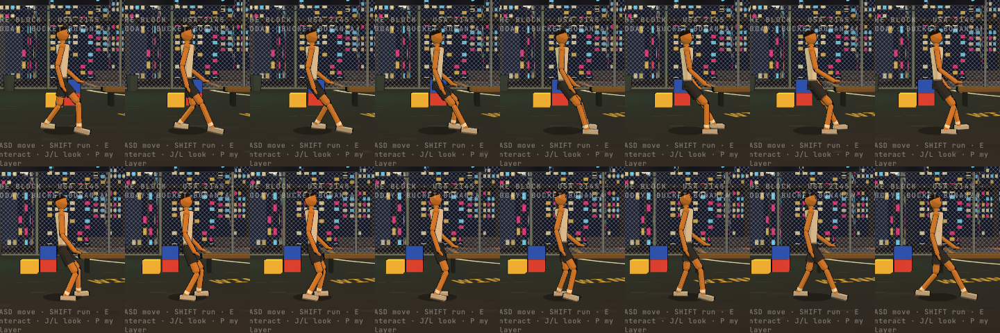

The default walk on The Block was a fast 3.3 m/s jog with high knees, so it read as stomping. Written animation
references (no video was watched) agree on what reads as swagger:
- a backward lean reads as confidence
- a constant tilt to one side reads as cool (an alternating tilt reads as a limp)
- hips lead and shoulders follow
- low bounce, with the hip dropping on the swinging side
- the arms drag: shoulder, then elbow, then wrist

Changes (pose `loco` and the foot planner, only off the court and fading out above a jog):
- Default speed is now a stroll, 1.85 m/s (sprint 6.2). Cadence is about 1.9 steps a second; it was about 3.
- Steps take 30% longer to swing, ease in and out, and lift the foot about half as high.
- The feet sit a little wider, with the toes turned out. Landings sink in softly instead of snapping.
- The body leans back slightly and tilts constantly to one side. The chest rolls against the hips, and the head stays up
  with a small nod on the beat.
- The arms swing unevenly (right +25%, left −40%) and lag at the elbow and wrist.
- People on The Block get a random amount of this (0.4–1.0), so they don't all walk the same.

The court is unchanged: all eight acceptance tests still pass.

## 8. Finishes, jumper variations and the Dev Room (v0.7)

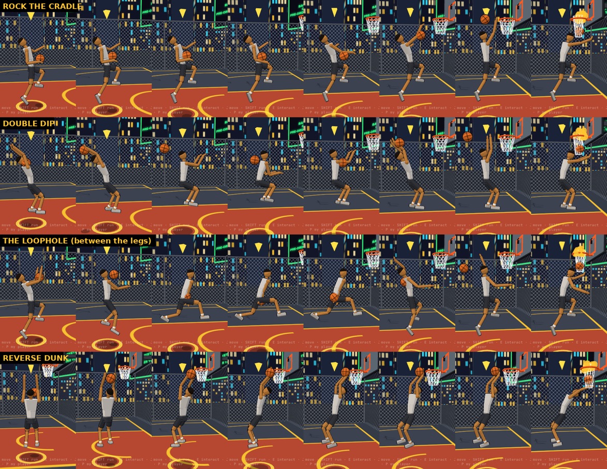
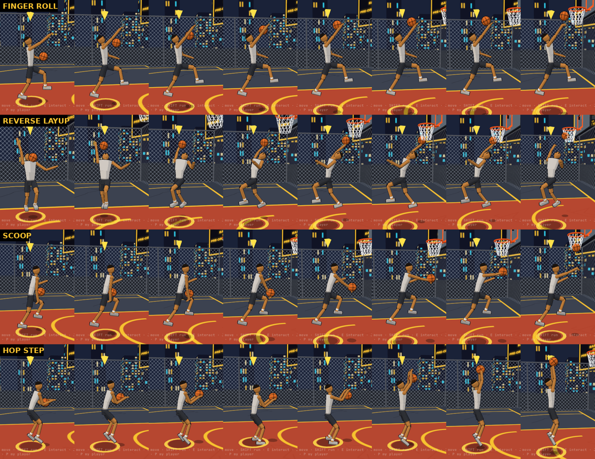
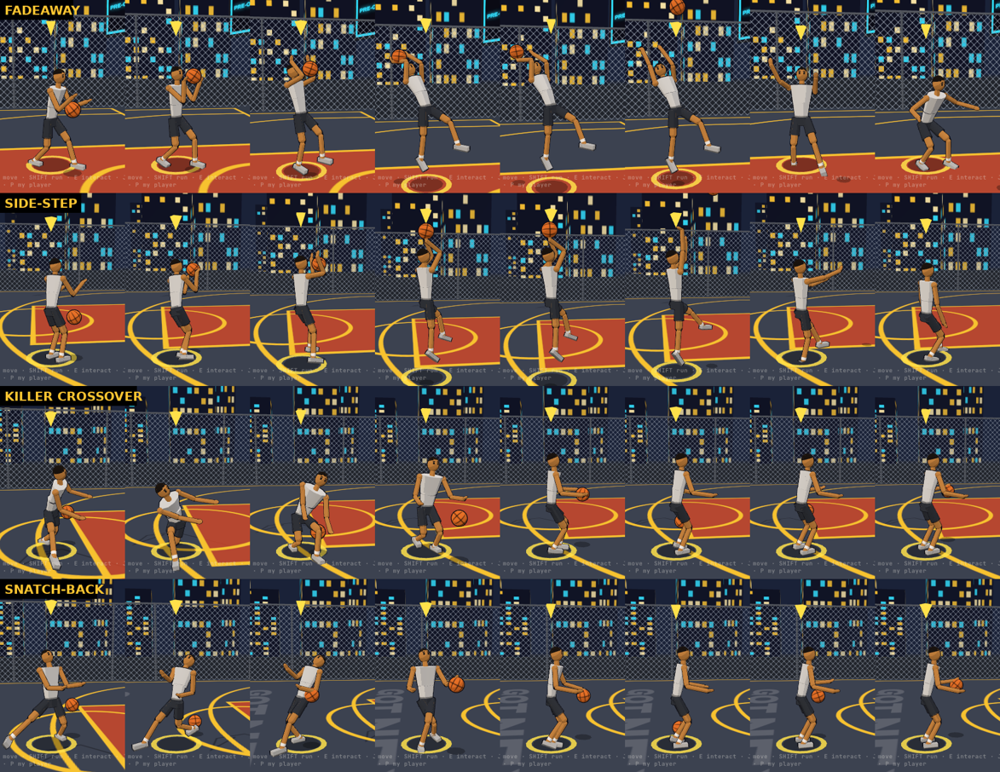

All filmed from the game with `node tests/reel.mjs <group>`, which plays the Dev Room reel through the real game loop.

**New:**
- **Dunks:**
  - Rock The Cradle (ball on the forearm at the hip, swung up behind and thrown down)
  - Double Dip (double clutch: up, down to the waist with the knees tucked, back up)
  - The Loophole (between the legs: the right hand passes the ball under the right thigh, the left hand finishes; the
    ball really changes hands)
  - the reverse dunk (anyone who can dunk: stick away from the rim)
- **Layups:**
  - lay-in
  - finger roll (full speed from a step out)
  - scoop (underhand, when someone is close)
  - power layup (two feet, two hands; strong players use it under pressure)
  - euro step
  - reverse (under the rim and up the far side, back to the rim; the body turns with the path and keeps facing the
    way it ends up, with no snap back)
- **Hop step:** a two-foot hop and gather, then a strong finish. Contests and blocks count for about 22% less.
- **Jumpers:**
  - fadeaway (drifts away from the rim in the air, off leg kicked out, harder to block, slightly harder to make)
  - side-step (a quick step across the rim line before the rise)
  - hop-step jumper (↑ from mid-range)
- **Dribble moves:**
  - Insider Trading (in-and-out, same hand)
  - Hostile Takeover (killer crossover, very low)
  - Clawback (snatch-back)
- **The AI uses them too:**
  - hop steps and reverses when the lane is closed
  - fadeaways when someone is on its jumper
- **Online:** guests see the same finish, jumper and move as the host. The state, the finish kind and the move id are
  sent with each player.

**Refinements to the engine found while filming:**
- **Dunk take-off:** both knees used to tuck so deep that the feet stayed near the floor, so dunks did not look
  airborne. Now:
  - one-hand dunks leave off one foot: drive knee up, the take-off leg trailing straight
  - two-hand dunks jump off both feet
  - the body rises a little higher with Vertical
- **A leg-flick at every jump take-off (an old bug):**
  - The leg IK could store a hip angle a full turn away (5.77 rad instead of −0.51).
  - As the IK faded out on take-off, blending back to the pose swung the leg the long way round, through the floor,
    for a frame or two.
  - Fixed by keeping the IK angle on the near side of the pose angle.
- **Airborne feet:** while the IK fades out in the air, it now aims at where the pose has the feet, not at the
  floor. Before, it pulled the hips down 0.22 m on every jump.

**Design choice, caught by acceptance test 4:**
- Letting go of the stick and shooting at speed first triggered a hop-step jumper. That turns an ordinary pull-up into
  something the player did not ask for.
- So the hop-step jumper moved to ↑ from mid-range. Letting go only hops near the rim, at more than 2.5 m/s.

**Dev Room:** see the README. A maxed-out player, any build, every move to equip and preview, games against maxed
players, and the reel.

**Checks:**
- `node tests/gestures.mjs`: eight inputs from real key presses each produce the right finish or jumper, and max then
  restore gives back the exact player.
- `node tests/devroom.mjs`: clicks through every tab, a reel and a 1v1 against a maxed player, with no page errors.
- The eight court acceptance tests, smoke, input, online and crew all pass.

## 9. Contested finishes and finisher quality (v0.7.1)

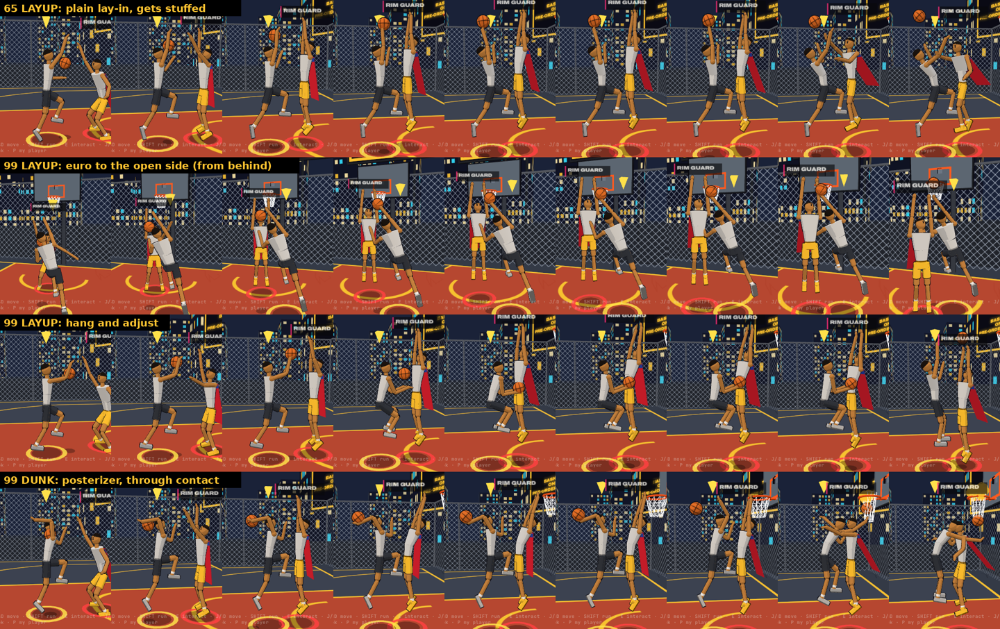
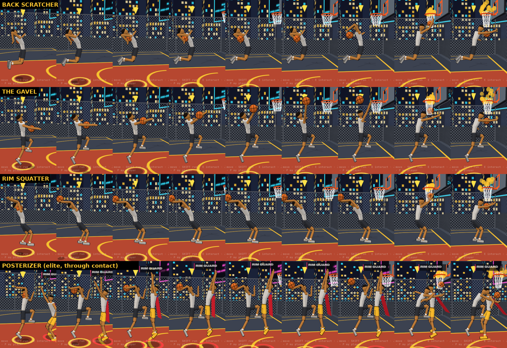

**What filming against a rim protector showed (before):**
- The finisher and the defender passed straight through each other in the air. Nothing reacted to contact.
- The finish ignored a shot-blocker waiting under the rim. A defender only counted if within 1.6 m at take-off.
  So everyone threw a finger roll straight into him.
- An average and an elite finisher did exactly the same thing.

**Now:**
- **Reading the defense:** the finish looks for the opponent most in the lane between you and the rim (or under it).
- **Contact in the air:**
  - Bodies never overlap. The finisher slides off the defender.
  - The first touch is contact. Both bodies react, and Strength decides who gives.
  - A finisher who loses the line misses more (BODIED).
- **Contested layups:** the off arm comes up and out to shield the ball.
- **Blocked finishes:** a blocked finisher is knocked back with the shooting arm thrown back (stuffed).
- **How the finish is picked depends on how good the finisher is.** With the move stick toward the rim (no euro,
  reverse or hop asked for):
  - Layup under 75: a plain lay-in. No adjustment.
  - Layup 75–87: a power layup if strong (Strength 80+), else a euro around a defender who is well ahead, else a scoop.
  - Layup 88+: whatever the defense allows, mixed up so a shot-blocker cannot sit on one answer:
    - euro step to the open side
    - hang and adjust (new: tuck, pull the ball down while the blocker flies by, release late)
    - switch hands (new: the ball moves to the hand away from the defender, and that hand finishes)
    - reverse off the rim
  - Dunk under 90 into a shot-blocker, with a 70+ layup: pulls out of the dunk and finishes with a layup.
  - Dunk 90+ with Strength 78+ (or Dunk 97+): the Posterizer (new, not for sale). Knee up, ball cocked way back,
    forearm into the defender, through him. The defender goes down.
- **Finishing skill above 70** makes the same contest count for less (up to 30%) and lowers the block chance (up to
  35%).

**Measured** (`node tests/contest.mjs 80`): 80 drives each at the same rim protector (85 Block, Silver No Fly Zone),
through the real game. The middle column is what the game picked.

| Finisher | Picked | Made | Blocked |
|---|---|---|---|
| 65 Layup | lay-in | 38% | 51% |
| 85 Layup, 92 Strength | power layup | 54% | 40% |
| 99 Layup | euro 34 · hang 27 · switch 19 | 74% | 19% |
| 72 Dunk, 99 Layup | pulled out: euro, hang, switch | 70% | 28% |
| 99 Dunk, 99 Strength | Posterizer | 94% | 6% |

**New dunks:**
- Back Scratcher (the ball behind the head until it touches the back, feet kicked up behind)
- The Gavel (arm straight out to the side, swung up and over)
- Rim Squatter (two hands, then hangs on the rim with the knees up; the hang pose now shows while hanging, it
  never did before)
- the Posterizer (contextual, above)

**Dev Room reel:** CONTESTED AT THE RIM shows the same drive with finishers of different quality, plus forced hang,
euro, switch and a stuffed dunk. The reel's defender stands in the lane and jumps at the shot.

## 10. Walking from gait-lab data (v0.8.1)

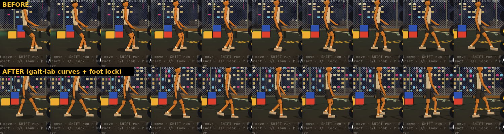

The walk around The Block still looked wrong. He leaned back with bent knees and his feet out in front, as if walking
while sitting in a chair. Two causes:
- The planted-feet IK bent the legs to reach targets.
- The "street walk" lean-back pushed the body behind them.

Video could not be watched from here, and image hosts are blocked by this environment's network. So the walk was
rebuilt from the numbers gait labs measure from filmed walkers:

**Joint angles through one stride** (0% = heel strike, toe-off at 60%):
- **Hip:** about 30° flexed at heel strike, extending to about 10° behind at late stance.
- **Knee:** nearly straight at heel strike, a 15–20° give as the weight lands, about 40° at toe-off, about 60° mid-swing.
- **Ankle:** neutral at heel strike, a little down onto the foot, about 10° up in late stance, about 17–20° pointed at
  toe-off.

**How it runs:**
- **Stepping:** the cycle advances with distance walked, and steps lengthen with speed.
- **The hip swing is solved for** so the body travels exactly one step over the standing foot.
- **A light foot lock:** during stance, the hip angle is nudged each frame (forward-back and sideways) so the planted
  ankle stays where it landed. It releases through push-off.
- **Hip height:** comes from the standing leg, so the body rises and falls like a real walker.
- **Pelvis:** turns and tilts, and the legs counter-rotate so the feet do not swing with it.
- **Trunk and arms:** the trunk counter-turns and stays upright (about 4° forward). The arms swing opposite the legs.
- **Swagger:** a little stays, in the upper body only.
- **Running:** above a brisk walk the run (planted-feet IK) blends in. The court is unchanged.

**Measured** (`node tests/walkfeel.mjs`), walking at 1.5 m/s on The Block:

| | before | after | a real walker |
|---|---|---|---|
| Steps per second | — | 2.0 | about 1.8–2.0 |
| Step length | — | 0.77 m | about 0.7–0.75 m |
| Standing-foot slide (median) | 0.50 m/s | **0.04 m/s** | 0 (the ankle only moves at heel rock and push-off) |
| Trunk lean | backward | **4° forward** | slightly forward |
| Body bob | — | 7 cm | about 4–5 cm (a little high) |

Sources for the angle values:
- [University of Missouri, Normal Gait](https://medicine.missouri.edu/sites/default/files/pm-r/Normal_Gait.pdf)
- [PMC normative ranges table](https://pmc.ncbi.nlm.nih.gov/articles/PMC555760/table/T3)
- [OUHSC kinematic analyses of gait](https://ouhsc.edu/bserdac/dthompso/web/gait/KNMATICS/gait.htm)
- the standard normative curves (Winter)

## 11. Running from running-biomechanics data (v0.8.4)

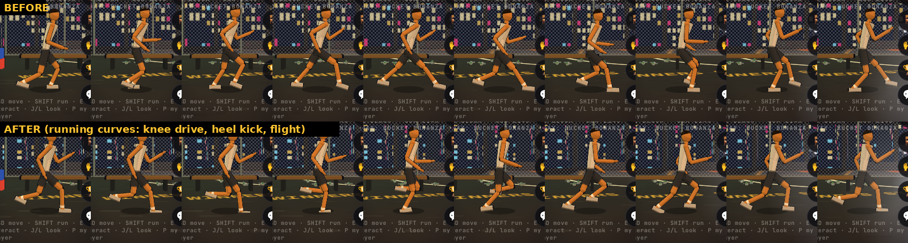

The run looked like a fast lunge. Both feet stayed near the ground, there was no knee drive, the back heel never came
up, and the arms hardly moved. It was the planted-feet stepping stretched to speed, with no flight phase.

It is rebuilt the way the walk was, from the joint angles running labs measure (video still could not be watched from
here).

**Joint angles through one running stride:**
- **Hip:** about 28° flexed at foot strike, to about 12° behind at toe-off, driving to about 48° forward in the swing
  (more at a sprint).
- **Knee:** about 18° at strike, giving to about 42° under the body, about 20° at toe-off, folding to about 100° in the
  swing (up to about 125° at a sprint: the heel comes up toward the hip).
- **Ankle:** about 6° up at strike, about 22° up at mid-stance, about 24° pointed at toe-off.

**How it runs:**
- **Stance shortens with speed:** 42% of the stride at a jog, 29% at a sprint. Between stances both feet are off the
  ground and the body follows a short ballistic hop.
- **Cadence:** 2.65 steps a second at a jog to 3.5 at a sprint. The stride lengthens with speed.
- **One stride clock** for walk and run, so the change between them stays in step.
- **Upper body:** the trunk leans in, the pelvis and shoulders counter-rotate, and the elbows sit near a right angle and
  drive from the shoulder, opposite the legs.
- **Foot lock:** it now corrects in two passes using the real hip-to-ankle height (a bent knee shortens the leg). This
  also took the walk's standing-foot slide from 0.04 to 0.00 m/s.

**On game courts:**
- The same run is used when a player runs forward at speed, with or without the ball. With the ball, the arms stay with
  the dribble.
- Sideways, backward, slow and defensive movement keep the planted-feet stepping.
- It fades in over about a third of a second.

**Measured** (`node tests/runcheck.mjs`), sprinting on The Block at 6.2 m/s:

| | value | a real sprinter at that speed |
|---|---|---|
| Steps per second | 3.8 | about 3.5–4 |
| Both feet off the ground | 40% of the time | about 35–45% |
| Peak knee bend | 123° | about 110–130° |
| Body bounce | 7.7 cm | about 6–10 cm |
| Planted foot slide (median / p90) | 0.01 / 0.01 m/s | 0 |

All eight court acceptance tests pass. Test 1 now reads "planted" from the stride clock while running: p50 0.00, p90
0.42 m/s at 4.9 m/s. The p90 includes the moments the run blends in and out.

Sources for the running values:
- [Physiopedia, Running Biomechanics](https://www.physio-pedia.com/Running_Biomechanics) (summarising Novacheck 1998)
- [Novacheck, The biomechanics of running](https://core.ac.uk/download/357229176.pdf)

## 12. Run follow-up: stomp, arms, and the ball (v0.8.5)

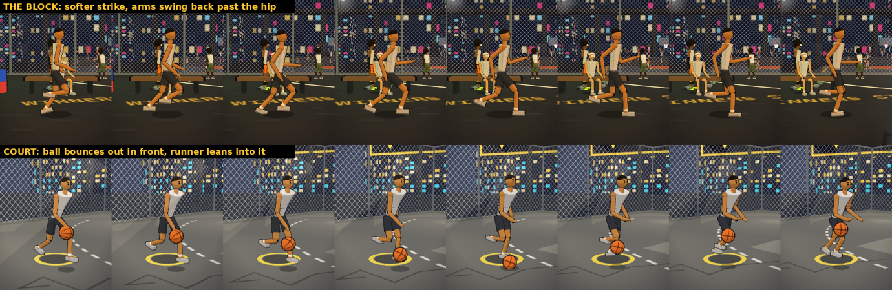

Feedback on v0.8.4: it still read as a power stomp, the arms were strange, and the ball had problems.

- **Stomp:**
  - The front foot landed far ahead with a hard heel plant. The stance hip swing is now centred further back, so the
    foot lands closer under the body and pushes further behind (capped at 1.5× the reference swing).
  - The end of the swing now eases into the angle the stance starts at. Before, it snapped at foot strike.
  - Lower knee drive, a flatter foot at strike, less give at mid-stance, and less forward lean.
  - Cadence is a little higher and stance shorter at speed (2.7 → 3.8 steps a second).
  - The body's rise and fall is damped by 28%: bounce 6.5 cm, down from 9.
  - Top running speed off the court is 5.6 m/s (was 6.2).
- **Arms:**
  - Both forearms used to sit out in front. Now the upper arm swings about 40° behind the body and about 20° in front.
  - The elbow closes as the hand comes up and opens as it passes the hip.
  - With the ball, the free arm runs the same way. Before, it stuck out straight.
- **Ball:** an old bug that the new run exposed.
  - `dribFloor` worked out how far ahead of the body the ball should bounce (more at speed, and per move), then never
    added it. The ball always bounced level with the hips.
  - With the upright run the hand was higher and the drop longer, so a sprinting player outran the ball: it landed
    15 cm behind him.
  - The offset is now applied. A drop that takes longer than planned re-aims further ahead.
  - The speed dribble leans the trunk forward, which brings the hand down to about 0.7–1.0 m.
  - Through a sprint the ball now stays 0.24–0.70 m ahead of the body.

Measured: sprint at 5.6 m/s, 3.8 steps/s, 45% flight, 117° peak knee bend, 6.5 cm bounce, planted foot slide 0.00 /
0.01 m/s. All eight court tests pass: test 1 planted feet p90 0.27 m/s, ball in hand 33%, max ball speed 12.0 m/s.

## 13. Crossovers (v0.8.7)

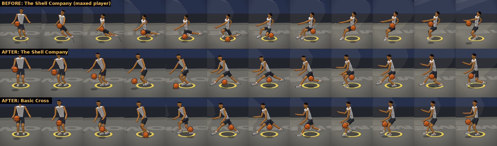

Filmed in gameplay with a maxed player (`node tests/movelook.mjs <move>`), the side moves looked terrible:
- The move threw the body sideways at full burst from the first frame (8.5 m/s with maxed Burst).
- The feet could not keep up, so the legs trailed and the hips sank from 0.88 m to 0.52 m, a near-sitting squat.
- The torso leaned over hard.
- The Shell Company ended with the arm locked straight out holding the ball.

**Now, for every side move:**
- **Two beats:** a set (the first 30%: barely moving, a shoulder dips toward the ball side while the ball is pushed low
  across), then the burst. Peak speed is a little higher and total distance about the same.
- **Feet:** during a move the stepping is quicker and reaches further. The hips may drop at most 9 cm to reach, so
  nobody sits down.
- **Pose by beat:** after the set, the shoulders turn and lean into the new direction. The receiving hand waits low by
  the lead knee, and the other arm comes up to shield.
- **The Shell Company:** one hand pushes the ball out with a long reach, the other rakes it back. No locked arm.
- **Hostile Takeover:** dips the wrong way in the set, then swings through.
- **The ball** aims for where the body will really be. It used to assume full burst speed. The Shell Company's ball
  went 1.42 m from the body and Insider Trading's 1.2 m; every side move now stays within 0.73 m.

Lowest hip height during the move, maxed player: 0.72–0.78 m (was 0.52–0.63). All eight court tests pass, including the
crossover and four-move chain.

## 14. Defense controls and reactions (v0.8.8)

**Defense controls:**
- **Defense assist** (people only; an OPTIONS toggle, on by default; sprinting turns it off):
  - Within 4 m of the man you are guarding, it steers you to a spot between him and the rim: about 1 m off the ball
    handler, about 1.6 m off a man without the ball, shading toward the ball.
  - It mirrors his steps.
  - With the stick released it guards for you. Pushing the stick still steers, with the assist reduced to about a third.
  - Measured with the handler driving at the rim: goal-side 100% of the time, 0.72 m away on average. With the assist
    off, 41% goal-side.
- **Timed contests:**
  - A jump that is rising or at its peak when the shot leaves counts 1.15× a normal contest. Too early or too late
    counts 0.7×.
  - Jumping at a shooter up to 3.2 m away closes out at him, stopping a step short.
  - Your hands go up by themselves on a shooter in front of you.
  - Measured at 1.2 m: timed 0.42, early 0.25, no jump 0.16.
- **Steals go for the ball:**
  - The chance depends on how close the ball is to your reaching hand, ×1.8 at its best.
  - It is halved when the ball is on the handler's far side, and better on a low bounce in front of you.
  - A whiffed reach says REACHED. Pressing steal also lunges you a step at the handler.
  - Measured: ball low in front 17%, tucked away 4%.
- **Jumping the lane:** steal while a pass is in the air lunges you to the ball's path, with a longer reach and a better
  chance. Measured over 40 passes thrown past you: 13 intercepted jumping the lane, 0 standing still.

**Reactions:**

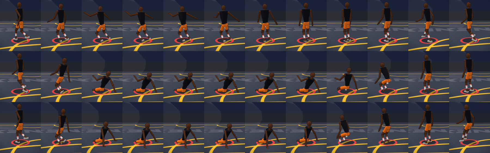

- **Every reaction has a direction:** the defender's first steps go the way he bit, which is opposite to where the
  ball handler went (or away from the dunker or shover).
- **Ankle break, on his feet:** the weight goes onto the outside leg and the inside knee caves. He stumbles the wrong
  way with arms out for balance, turns his shoulders back, and recovers. Before: a fast wobble in place.
- **Ankle break, down:**
  - The knees go first and he sits down hard on the side he bit to, posting a hand behind him.
  - He watches the play, rolls forward into a crouch, and stands up.
  - Before: he tipped backwards and snapped back upright when the timer ran out.
- **Posterized or shoved:** straight back onto the floor, both hands behind, then the same get-up.
- **Online:** guests receive the direction and the length of each reaction.

## 15. Animation blending and player identities (v0.10)

An extension of the system above, not a rebuild. Saved recoverable point: commit `7a54b23` (the build before any of
this; the local tag `pre-anim-blend` points at it).

### Audit (phase 0)

| System | Where | State | What happened |
|---|---|---|---|
| Rig and skeleton | `gfx.js` `makeRig` | 17 joints, Euler rotations, body proportions from the build | Untouched. Each rig now carries a profile (`R.prof`). |
| Pose library | `gfx.js` `poseOf` | ~45 procedural poses; joint targets per action | Kept. The jump shot and the idle now come from blended styles; everything else as it was. |
| Transitions | `gfx.js` `applyPose` | Every joint eases exponentially from its current angle toward the target at the pose's `rate` | Already blends from the current evaluated pose. Kept; now the rate is chosen per pair of actions (`TRANS`). |
| Locomotion | `walkPose`, `runPose`, `gaitStep`, `legIK` | Gait-lab curves, planted feet, leg IK | Untouched; profile adds posture on top. |
| Shooting | `ball.js` shot state, `poseOf('shoot')` | Release at `t = rel` (from the jumper and attributes); pose was three stepped targets | Gameplay untouched. Pose is now three phase-synced styles blended per player. |
| Ball contact | `ball.js` `ballHeld` | Ball rides between the hands, then up into the right hand | Unchanged, except a left-handed profile shoots out of the left hand. |
| Player data | `S`, `myBuild`, `packBuild` | Build, attributes, badges, moves, drip | Added `anim` (the profile), kept separate from every gameplay field. |
| Rendering | three.js r1xx, one file | ~2 ms a frame for a 2v2 in the test browser | Unchanged. |

### Architecture (`src/anim.js`)

1. **Skeleton map**: joint list, upper/lower halves, `mirrorPose` (left-handers).
2. **Evaluation**: keyframe tracks over a normalised phase (`evalTrack`), smoothstep between keys.
3. **Blending**: `blendPoses([[pose, w], ...])` turns each joint into a quaternion, sign-aligns, takes the weighted
   average and normalises; `slerpPose` is the two-pose case. No Euler wobble between very different poses.
4. **Styles**: three jump shots and three idles.
5. **Profiles**: `animProfile(spec)` per player, persistent.
6. **Transitions**: `TRANS` table of blend rates per pair of actions.
7. **Layers**: additive idle life, profile posture, a corrective landing.

The dev sandbox is its own file (`src/animlab.js`), loaded only into the game page, reachable only from the Dev Room.

### Shot styles (phases 1-2)

Every style hits the same beats, as a fraction of the release time: gather 0, dip 0.4, extend 0.62, jump 0.75,
set 0.9, **release 1.0**, follow 1.12, land 1.42, recover 1.6. A blend of any weights therefore still lets go at
u = 1, which is the moment the game releases the ball. The test measures it: a pure high-release and a pure
quick-release shot in a game release at the same 0.933 s.

- **Traditional**: the game's original jumper. Its three poses (dip, set point, gooseneck) are the dip, set and
  follow keys; the test checks the set-point shoulder is still exactly the original -2.55 rad.
- **High release**: shallower dip, the ball goes up over the head (shoulder -2.95), long arm, big ankle extension.
- **Quick release**: compact, the ball stays in front of the forehead (shoulder -2.2), shallow dip, quicker recovery.

On top of the blend: knee bend scales the dip, elbow flare, torso lean, shoulder turn, stance width, and the
follow-through hold (the clock slows after the release so the arm stays up longer, landing on the same beat). Each shot
gets a small seeded variation (weights ±0.04, knee ±0.04, elbow ±0.08) so no two jumpers are identical, but a
player's shot is always recognisably theirs.

### Idle styles

Relaxed (the original idle), athletic (knees bent, hands ready), wide (grounded). Additive on top: breathing,
a slow weight shift (more for a restless player), the hand coming up to the waistband and back, fatigue (gassed
players hunch: from stamina in games) and readiness (the closer the ball, the more athletic the stance).

### Profiles (phase 3)

Parameters: shot weights, idle weights, dominant hand, knee bend, elbow flare, torso lean, stance width,
follow-through hold, shoulder turn, idle tempo, movement intensity, recovery speed, idle restlessness, dribble
crouch, defensive crouch, run arm carry, walk swagger.

- **Built-in players** get theirs from a hash of name, style and height, leaned by the build (shooters balanced or
  high, slashers quick, bigs high release and wide stances, lockdown defenders crouch lower, showmen swagger). Same
  player, same profile, every time.
- **Your builds and homies** keep theirs in the save (per build slot), edited in the ANIM LAB. It goes with the build
  code and online (`packAnim`, about 200 bytes, clamped on arrival).
- **Cosmetic only.** Nothing in `ball.js` gameplay reads the profile; release timing, speed, contests and ratings are
  unchanged. The one visible link: a left-handed profile shoots with the left hand (the shot is mirrored and the ball
  goes to that hand), with no effect on makes.

### ANIM LAB (phase 4)

Dev Room → ANIM LAB. Two players side by side (your builds, homies, or a built-in player of each style) doing the
same thing: jump shot, pump fake, idle, dribble, triple threat, defense, run, walk, pass, contest, and transitions
(idle → shot → land → run, dribble → shot, dribble → pass, run → stop, defense → run → offense, walk → run → stop).
Speed 0.05x to 2x, pause, frame back and forward, ball on or off, turn the camera. The left player's whole profile is
on sliders; SAVE writes it to that build or homie, RESET goes back to the defaults its build gives it. The readout
shows the time and the shot phase (gather, dip, set, release...).

### Transitions and layers (phases 5-6)

- The rig never resets: every action eases from the current joint angles. What changed is how fast: `TRANS` has a
  rate for each pair (anything into a shot, pass, steal, contest or stumble: 30-36, about 0.1 s; idle into a run 12;
  a run into a stop 10; a shot into a run 14 times the player's recovery). Gameplay never waits for a transition;
  input acts on the same frame it always did.
- Layers, in order: base (the locomotion or action pose, with the existing run-stride mix), upper body (dribble, shot
  and pass arms as before), additive (idle life above; profile posture on dribble, defense and run), corrective (leg
  IK and planted feet as before, plus a landing that bends the knees and hips by how far the player fell, quicker
  with better recovery). Additive personality is only applied where it fits (idle, dribble, defense, run), not on a
  shot, a dunk, a move or a stumble.

### Expanded actions (phase 7)

Profile posture now reaches the dribble (crouch), defense (crouch and width), the run (arm carry, intensity) and the
walk on the Block (swagger). Hub people and your player on the Block use profiled idles.

### Measured

`tests/anim.mjs`: blend ordering (a 50/50 blend sits between the two styles at every joint checked), persistence,
phase sync (every style reaches full arm extension at u 1.12-1.14, just after release), release time identical
across styles in a real game, a lefty's ball in the left hand at the set point, 2v2 frame cost (~2 ms in the test
browser), the lab opening with two players. Screenshots: `tests/shots/anim-dip.png`, `anim-set.png`,
`anim-follow.png`, `anim-land.png`.

## 16. Not checked

- **Not seen in motion by a person.** Only scripted runs, frame metrics and filmstrips.
- **Not checked with a real controller.** The controller path uses the same code as the simulated one.
- **Not checked on a phone.** Performance with IK on every player is unmeasured.
