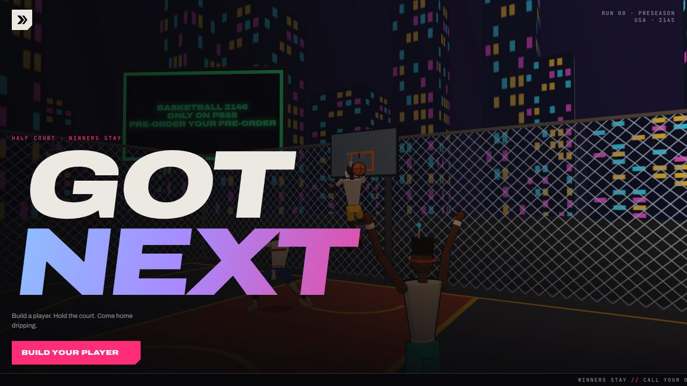

# GOT NEXT — brand

The name is what you say at a park to claim the next game. It is a promise that you are coming, said out loud in
front of everybody. That is the whole game: call next, hold the court, come home with more than you left with.

**To rename the game** change `BRAND` at the top of `src/data.js`. The title, the court paint, the posters, the build
codes and the ticker all read from it.

## 1. What it should feel like

A streetwear label that happens to be a basketball game. Night, sodium lamps, chain link, brick, a clean hangtag on an
expensive jacket. Confident and quiet until the moment it is loud.

- **Slick, not goofy.** The interface never tells a joke. The world can (billboards, fiends, the statue).
- **Flash is earned.** Almost everything is black, bone and one hot pink. The foil gradient is rare and means "this is special".
- **Street words, short.** Say it the way it is said at the park.

## 2. The mark and the wordmark

- **Mark:** a double chevron (next, forward) in a bone square with one corner cut off.
- **Wordmark:** GOT over NEXT, Archivo at its widest and heaviest, leaning forward seven degrees, tight. GOT is bone,
  NEXT is foil on the title screen and heat pink everywhere it is printed small (posters, paint).
- **The cut corner** is the signature shape. Buttons, the overall badge, the prompt and the mark all lose their
  bottom-right corner, like a clipped hangtag. Nothing is rounded.

## 3. Colour

Tokens live in `:root` in `src/shell.html`. Use the role, not the hex.

| Token | Hex | Role |
|---|---|---|
| `--ink` | `#08080a` | The ground. Screens start here. |
| `--tar` | `#111114` | Panels and cards. |
| `--grit` | `#1a1a1f` | A selected or raised card. |
| `--line` | `#2c2c35` | Hairlines. One pixel, never thicker. |
| `--bone` | `#ece9e2` | Type, and the default button. |
| `--ash` | `#8d8d99` | Labels and secondary type. |
| `--heat` | `#ff2d78` | The one accent: the main action, the selected thing, focus. |
| `--gold` | `#f2c14e` | VC, and only VC (plus the Grail tier). |
| `--ice` | `#7de3ff` | Respect and rank, and your team. |
| `--go` | `#3dffa0` | Good: green release, a buff, a requirement met. |
| `--warn` | `#ff8a3c` | Not yet: a requirement missed, take it back. |
| `--foil` | gradient | Flash. Bravado, the wordmark, and later the rarest things. |

Skill groups keep their own five colours (`CATS` in `src/data.js`): finishing orange, shooting green, playmaking gold,
defense ice, athletics violet. They appear only on attribute bars and badge headers.

## 4. Type

Two families, both embedded in the file so every phone shows the same thing.

| Role | Face | How |
|---|---|---|
| Display | Archivo, width 125, weight 900 | Uppercase, tight. Headings, buttons, numbers, calls, signs in the world. |
| Body | Archivo, normal width | Sentence case. Descriptions. |
| Label | JetBrains Mono, 500 | Uppercase, small, wide tracking. The hangtag voice: categories, tiers, hints, the ticker. |

## 5. Voice

| Do | Don't |
|---|---|
| "Call next." "Run it back." "Winners stay." | Puns in buttons or headings |
| Name places the way a block would: The Pit, The Plug, The Lab, Tape Deck, The Link | Corporate parody names for the player's own tools |
| Sneaker words for rarity: GR, Limited, Exclusive, Grail, 1 of 1 | "Common / Rare / Epic / Legendary" |
| Let the 2145 satire live in the world: ads, fiends, the statue | Satire in the menus |
| | The word swag. Anywhere. |

## 6. Names in use, and names held for later

The point of this table is to save the space now, so new things arrive with a name that already fits.

| Layer | In the game now | Held for later |
|---|---|---|
| The game | GOT NEXT. Never "cage" or "born" in the game's name. | — |
| Seasons | RUN 00 · PRESEASON (shown on the title; `BRAND.season`) | RUN 01, RUN 02 … each with a one-word name and its own foil |
| Places | The Block, The Pit (it is a cage: chain link, floodlights, gates), The Plug, The Lab, Tape Deck, The Link, My Crib, Last Call, Money Rack | The Roof, The Yard, The Rec, The Bridge (new courts and districts); Uptown is already promised by the chained subway gate on The Block (UPTOWN LINE); The Chair (barber: hair and face), The Vault (grails) |
| Modes | Street 2v2, Street 3v3, JAM 2v2, JAM 3v3 | Ones (1v1), 21, King of the Court, Crew runs |
| Court tiers | Side Court, Main Court, The Cage, Kings Court | Open Run, The Invitational |
| Ranks | Nobody, Local, Regular, Problem, Certified, Big Name, City Legend, Immortal | Prestige loops: Immortal II, III |
| Rarity | GR, Limited, Exclusive, Grail, 1 of 1 | Collab (a named drop), Player Exclusive (earned, never sold) |
| Badge tiers | Bronze, Silver, Gold, Iced Out | — |
| Currencies | VC (spent), Respect (never spent) | Tickets (events), a crew bank |
| People | Homies (imported builds), fiends, the old head, Sharpie | Crews, a rival with a name, a plug with a face |

## 7. Room left in the interface

- The title's top-right slot shows the season and is the place for an event tag.
- The title's button column takes more entries without moving the wordmark.
- The ticker is a list in `BRAND.ticker`; news and drops can run there.
- My Player's tab bar scrolls sideways, so new tabs (Crew, Contracts, Stats) need no redesign.
- Rarity, ranks, court tiers and badge tiers are arrays; a longer array is a longer ladder.
- The save has a version number (`v`) and the previous name's saves are still read.

## 8. Not yet rebranded

Badge names, attribute blurbs, origins, trophies and the announcer's calls are still in the first version's joke
voice. The players themselves (bodies, faces, how flashy the drip reads) have not been touched yet.

## 9. The Block, as built in v0.3

One street corner you can cross in a few seconds. What makes it the brand's place, so new districts can match it:
chain link and floodlights, brick with wheat-pasted GOT NEXT posters, spray-paint pieces (BALL IS LIFE, RUN IT BACK,
WHO GOT NEXT, NO REFS, KINGS STAY), court paint spilling out of the cage gate onto the asphalt, string lights
overhead, kicks hanging on a wire, a boombox with a live level meter and people dancing at it, a barrel fire, milk
crates, grails under glass in The Plug's window, and an elevated train going by behind the cage.
