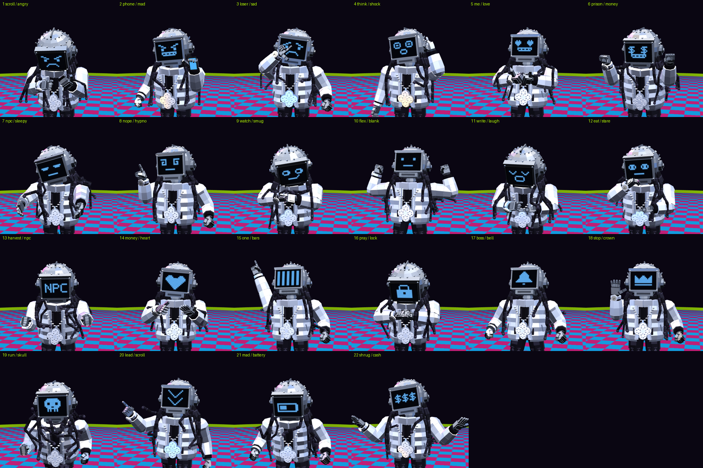

# lil Bottie

Everything for lil Bottie in one place: how he looks, his 3D model, his songs, his lyrics and the music video work.

lil Bottie is a fictional rapper, born in the server and raised by code. The look is locked: chrome helmet with a
blue LED smiley screen for a face, long black braids, silver puffer jacket over a black hoodie, iced clover chain,
chrome hands, iced watch.

## What is in here

| Folder | What it holds |
| --- | --- |
| `index.html` | Open this. The model on a stage: turn him, try the poses and faces, and press **The Algorithm** to watch him rap it with the timed lyrics on screen. |
| `asset/` | `lil-bottie.js`, the 3D model (needs only three.js r128), and a sheet of ten views. |
| `refs/` | The thirteen reference photos the model was built from. |
| `songs/` | `algorithm.mp3` (3:20), copied unchanged from the studio's music. |
| `lyrics/` | *The Algorithm*, word for word from the archive, and its timing file. |
| `lore/` | `artist-archive.pdf`: tracklist, persona rules, visual lock, lore and every saved lyric. |
| `music-video/` | The plan for the music video in the Grok Fable Astra world. Not built yet. |

There is an older lil Bottie game, *Clankin' in the Cloud*, in the `bottie/` folder on the branch
`claude/modest-ride-rgjg4r`. Nothing here changes it.

## The model

`asset/lil-bottie.js` builds him in the Grok Fable Astra style: blocky, low-poly, flat shaded. He is **not in the
game yet**. To use him:

```js
const b = LilBottie.build(THREE);       // b.group is about 1.5 units tall, feet at y = 0
scene.add(b.group);
b.group.scale.setScalar(2.2);           // the size the game uses for people
b.setPose('rap');                       // idle, walk, dance, rap, shake, point, thumbs, arms, chain, wave, sit
b.setFace('hype');                      // smile, talk1, talk2, wink, hype, dead, btv
b.setMouth(0.7);                        // lip sync, 0 to 1
b.update(time, dt, songSeconds);        // every frame; songSeconds (optional) locks the moves to the beat
```


How he moves (v0.4):

- Shoulders, elbows, wrists, hips, knees and ankles are all joints. Each hand has four fingers with two joints
  each and a thumb, and nine hand shapes: open, relax, fist, point, thumb, peace, grip, spread, horns.
- Every joint is a spring chasing its target, so a move overshoots a little and settles, and the pinky lags the
  index when a hand opens or closes. The braids and the clover swing behind his turns and bounces.
- Each of his 25 dreads is a simulated chain: five points with weight and momentum, joined by four segments.
  The points are pushed out of his head, jacket, hood, shoulders, arms and thighs, so the dreads drape over him
  and cannot pass through him. `shake` is the move that throws them: head side to side on the beat, then a headbang.
- Arms are kept out of the jacket: after every pose is set, any forearm or hand point found inside the torso
  swings the arm out or forward by that much. The `chain` pose was solved so the palm sits on the clover.
- Clipping is measured, not eyeballed: over 7 seconds of every pose, the deepest an arm goes into the jacket is
  0.5 cm (it was up to 24 cm) and no dread point sits inside it (there were up to 15 a frame).
- His knees never lock straight: there is a kneecap, creases and stacked cuffs, and they bend in every pose.
- `dance`, `rap`, `shake` and `walk` are locked to the beat (137.2 bpm; `setTempo` changes it). `rap` chops one hand on
  every beat, changes the hand shape each bar, grabs the chain on the third bar and swaps hands every four bars.

## Faces, icons and lyric poses (v0.5)

- **Faces** are built from eyes and a mouth, so he can hold an expression and lip-sync at once. 15 eyes
  (happy, open, wide, angry, sad, side, sleepy, closed, heart, dollar, spiral, x, dot, hype, wink) and 8 mouths.
  18 presets combine them: smile, angry, mad, sad, shock, love, money, sleepy, hypno, smug, blank, laugh, stare …
- **Icons** fill the whole screen: npc, heart, bars, lock, bell, crown, skull, scroll, battery, cash, btv and more.
- **22 poses written for lines of The Algorithm:** scroll (with his phone), phone, loser, think, me, prison, npc,
  nope, watch, flex, write, eat, harvest, money, one, pray, boss, stop, run, lead, mad, shrug.



## The Algorithm, line by line

`lyrics/the-algorithm.choreo.json` gives every one of the 52 lines a pose, eyes, a resting mouth and (for some)
an icon that flashes on his screen for the first 0.9 seconds. `index.html` plays it: each line shows its
**number, start time, pose and face**, with previous / next line buttons, a list of all 52 lines to jump from,
half speed, and "lyrics −¼s / +¼s". To correct it, say the line number and what is off (timing, pose or face).

## The Algorithm: lyrics and timing

- `lyrics/the-algorithm.md` is copied word for word from the archive. **Do not reword his lyrics and do not write
  new ones in his voice** (the rule from the archive and from the `bottie/` README).
- `lyrics/the-algorithm.timing.json` gives a start time for each of the 52 lines.

How the timing was made: the song runs at about 137 beats a minute and the lyric sheet has one line per 8-beat
bar (3.50 seconds). The grid is anchored where the bass comes back in at 28.45 s, and the sheet's section
boundaries then land on the track's own breaks at 14.4, 56.4, 126.4 and 168.3 seconds.

**The grid is wrong against the vocal** (Will, 24 Nov). To fix it, open `index.html` and press **⏱ time it
yourself**: the song plays and you tap once at the start of each line. Your times are used straight away, kept in
that browser, and can be copied out to be saved into the two timing files here. Each line in the list also has
−0.1s / +0.1s buttons. Timing from the vocal by speech recognition was tried and could not be run in the build
session.

**Not checked by ear.** Nobody has listened to it against the track, and it was not transcribed from the vocal, so
a line could sit early or late inside its bar, and the last 17 seconds (after 3:02) have no lines on the sheet.
`index.html` has "lyrics −¼s / +¼s" buttons for checking it.

## Rules

- His lyrics are his: copy them, never rewrite them.
- The General and the council in his story are fictional. No real flags, no real officials.
- The visual lock is in `lore/artist-archive.pdf`, section 6.
