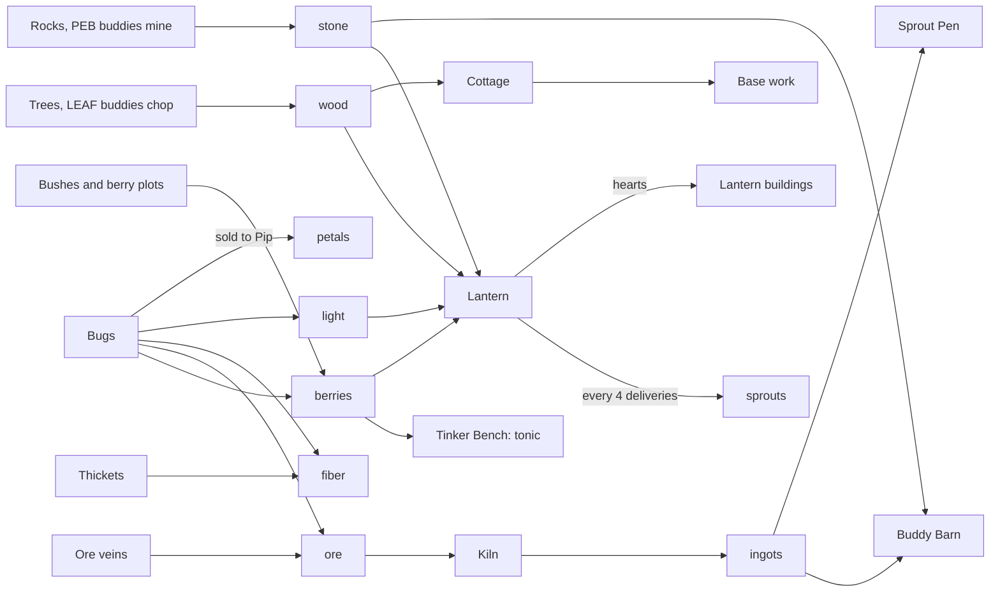

# Pocket Lantern: resource map (from the code, Nov 17, 2026)

Read from the source on `main` (Sproutwild v9.9), not from playing. Numbers are the values in the code now and may drift. Where the code doesn't settle something, it says so.

## The resources

| Resource | Where it comes from | What it's for |
| --- | --- | --- |
| **Wood** | Trees (LEAF buddies chop them), Sawmill (yields wood), a few field drops | Cottage 8, Garden Bed 6, Nursery 6, Kiln 4, Quarry 8, Sawmill 10, Bench 10, Pen 12. Recipes: Lantern Oil 2, Seed Pouch 4. |
| **Stone** | Rocks (PEB buddies mine them), Quarry Pit (yields stone) | Garden Bed 2, Nursery 2, Kiln 8, Sawmill 4, Lantern Statue 8, Buddy Barn 8. |
| **Berries** | Bushes, berry plots (a crop), bugs, Louie digs them up, some drops | Tonic 3, Lantern Oil 2, Lucky Charm 5. Berries are also what the Lantern wakes on, and the Nursery takes 3 to plant a buddy. |
| **Ore** | Ore veins, some bugs (Hellgrammite gives 1) | Kiln smelts it into ingots. Climbing Rope 2. |
| **Ingots** | Kiln (from ore), some rewards | Tinker Bench 1, Sprout Pen 2, Buddy Barn 2, Lantern Statue 2, Lucky Charm 1. |
| **Fiber** | Thickets (fetched by a buddy), fiber crops, bugs | Seed Pouch 4, Climbing Rope 6. |
| **Petals** | Trainers and wilds beaten, bounties, bugs sold to Pip (their value), some berries and drops, raids | The shop currency: Lantern Upgrades aren't petals (they're hearts), but petals pay for the rest. Lose 10% if you black out. |
| **Hearts** | Gratitude hearts (wild buddy feedback), buildings, the well, Louie's pets | Buy Lantern buildings: Lantern Nook 15, Lantern Statue 25. The Lantern "buys plans" for hearts. |
| **Light** | Bugs (a Firefly-type gives 1), LIGHT SHOWN calms | The Lantern. Ten calmed buddies grow a ring. |
| **Sprouts** | Garden seeds, the Lantern (every four deliveries), blooms in the grass | Work, carrying, throwing. Pluck grown ones from the garden. |
| **Buddies** | Catching and blooms in the wild, the Nursery (plant a seed, harvest a buddy) | Party (3 at a time), the Buddy Barn (more storage), base work. |
| **Tonics** | Tinker Bench (brew from berries) | Healing in battle. |

## What builds what

| Building | Cost | What it does | Levels up? |
| --- | --- | --- | --- |
| **Cottage** | 8 wood | Roof for buddies. Buddies left at home work the base. Starts the first evening. | No |
| **Garden Bed** | 6 wood, 2 stone | Yields berries over time (a DEW or LEAF sprout). | No |
| **Buddy Nursery** | 6 wood, 2 stone | Plant a sprout (3 berries), harvest a buddy. Max 2. | No |
| **Kiln** | 8 stone, 4 wood | Ore into ingots (EMBER or ZIP sprout). | No |
| **Quarry Pit** | 8 wood | Stone over time (PEB sprout). | No |
| **Tinker Bench** | 10 wood, 1 ingot | Unlocks brewing tonics at the Cottage. | No |
| **Sprout Pen** | 12 wood, 2 ingots | Adds 2 to crew capacity each. | Stacks |
| **Sawmill** | 10 wood, 4 stone | Wood over time (LEAF sprouts). Max 2. | Max 2 |
| **Lantern Statue** | 8 stone, 2 ingots, ♥25 | Gratitude hearts drop more often. | No |
| **Buddy Barn** | 8 stone, 2 ingots | Storage: 15 buddies instead of 3. | No |

**Lantern Nook** is in the build menu for ♥15, but the code doesn't have it as a separate building in this list, so check before relying on it.

## Sunkeep's own level

- **Sunkeep Lv** rises as you finish base missions (Lv1 to Lv2 and so on). Each level adds 2 to the worker cap and 2 to the crew cap.
- **Sprout Pen** adds 2 to the worker cap and 2 to the crew cap each.

## Data Center or Buddy Barn?

- **The Data Center is gone as a name.** It was the storage building in v7 (12 extra buddies). In v9.2 it became the **Buddy Barn** (15 buddies). The old Data Center is Bottie's ruin in the story.
- **The Buddy Barn doesn't level up.** It's one building, and the cap is 15 with it or 3 without.
- **Open idea:** a Buddy Barn that upgrades (more storage, then a "mini computer" that does base work), or a rebuilt Data Center later as a post-game or lore beat (already noted in PROGRESS.md). This is Will's call.

## How the flow works

## What doesn't scale yet

- **Storage:** the Buddy Barn caps you at 15. Nothing sells or releases buddies, so the box fills up. (REFINE-SLICE.md covers this.)
- **Sprouts:** the Lantern grows one per four deliveries, and there's no cap on them at home.
- **Petals:** the main sink is the shop, and it's thin. The code shows where petals go but not how much the player can spend them on.
- **Late game:** the code has only the early buildings. Nothing past the Sawmill and Statue is built yet.

## Not checked

- The real pace of each resource in play. Check this once the slice is played through.
- Whether the Cottage's party and farm numbers match the mission text.
