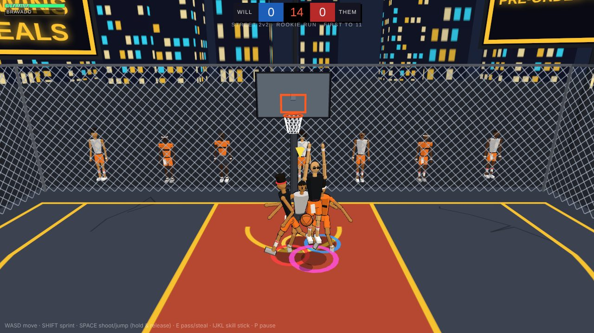
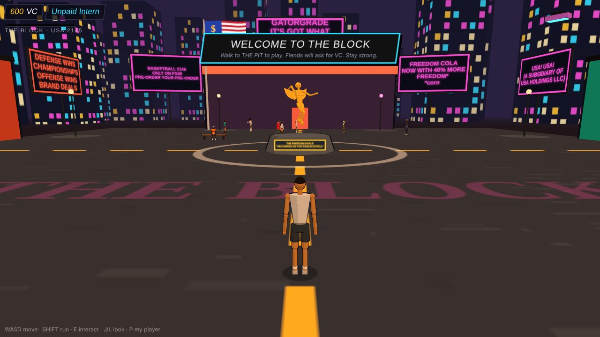
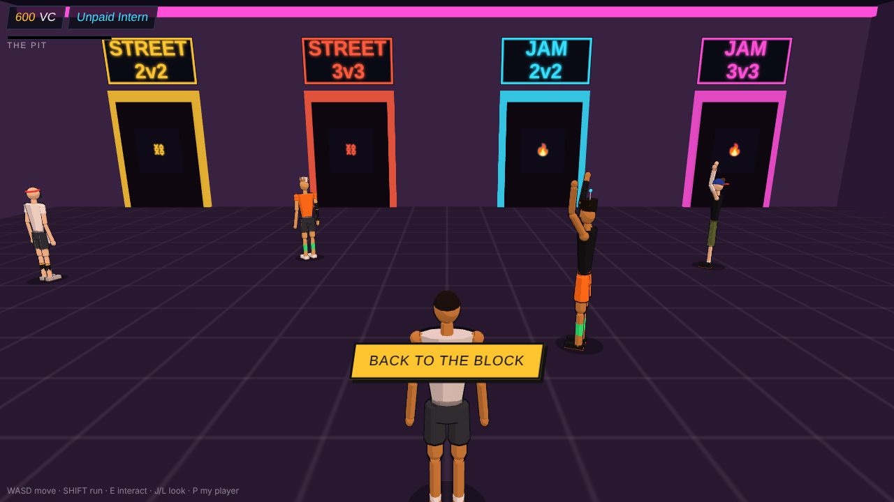
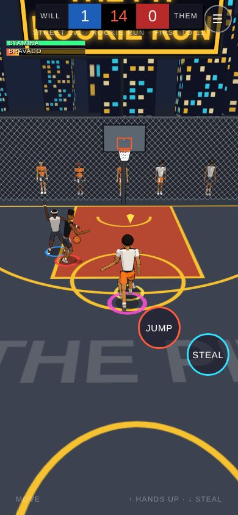

# PITBORN 2145

*United States of America™. Ball is the only law left.*

A park-basketball career game in one HTML file. Phone first, plays on a computer, two players with a controller.
You build a player, walk The Block, take games in The Pit, and spend what you earn on your player, your drip and your
crib. A North Coast Studios game. **Version 0.1, first playable.** It is a standalone game, not a Pocket Lantern cartridge.

**Play:** open [`index.html`](index.html) in a browser. That one file is the whole game; send it to a friend and they
have it too.



| The Block (hub) | The Pit (mode doors) | On a phone |
|---|---|---|
|  |  |  |

## What is in v0.1

- **The builder.** Six playstyles, six origins, height / weight / wingspan sliders that move the caps of 19 attributes
  live. See [`docs/DESIGN.md`](docs/DESIGN.md) for how the numbers work.
- **The Block.** Third-person hub: The Pit, Drip Depot, Gainz Lab, the Animation Plug, your crib, the Money Rack
  shootout, the old head, and six build fiends who need VC for their Basketball 2146 builds on PS88.
- **The Pit.** Four doors: Street 2v2, Street 3v3, JAM 2v2, JAM 3v3. A side kiosk (Last Call) for one-game boosts and
  the Homie Terminal for build codes. Four court tiers, opened by Respect.
- **The basketball.** Half court, camera on your player. Street: 1s and 2s to 11, take it back past the arc, 14-second
  clock. JAM: 2s and 3s to 21, shoving is legal, dunks from the logo, three makes in a row sets you on fire.
- **Two-stick control,** on a phone too: left stick moves, right stick is the skill stick (shoot, drive, side move,
  stepback, spin; hands up and steal on defense).
- **16 badges** in four tiers, earned with badge XP from real games. **Bravado** meter: big plays fill it, a full bar is
  +8 to everything for 20 seconds.
- **Unlocks:** 74 pieces of drip in ten slots (some carry small buffs), 22 animations (dribble moves, jumpshots, dunk
  packages, celebrations), 8 crib upgrade lines with passive buffs, 29 trophies, 8 Respect ranks.
- **Friends.** Export your build as a code; a friend imports it and your player is in their park as a teammate or the
  rival. On a computer a second player joins with a controller, co-op or versus.

## Controls

| | Phone | Keyboard | Controller |
|---|---|---|---|
| Move (full push = sprint on a phone) | left thumb | WASD, Shift to sprint | left stick, RT |
| Skill stick | right thumb | I J K L | right stick |
| Pass / steal / call for ball / interact | PASS button | E | A |
| Shoot / jump (hold, release in the green) | SHOOT button | Space | X |
| Pause / My Player | ☰ | P | Start |

Skill stick with the ball: **↓ hold** shoot, **↑** drive (layup or dunk), **← →** side move, **↙ ↘** stepback,
**↖ ↗** spin. Without it: **↑** hands up, **↓** steal (JAM: shove).

## Build

Source is in `src/`. After editing, run:

```
python3 build.py        # writes index.html
```

| File | What it holds |
|---|---|
| `src/data.js` | Every table: attributes, playstyles, origins, badges, moves, drip, crib, boosts, modes, trophies, all the writing |
| `src/core.js` | Save, build codes, input (touch sticks, keyboard, gamepads), synthesised sound and music |
| `src/gfx.js` | Renderer, cel shading and ink lines, the player rig and its drip, poses, courts, signs |
| `src/ball.js` | The basketball: rules, shooting, finishing, dribble moves, steals, blocks, rebounds, AI, camera |
| `src/hub.js` | The Block, The Pit, My Crib, walking and talking |
| `src/ui.js` | HUD and every menu |
| `src/main.js` | Boot, the loop, rewards, ranks, trophies |
| `src/shell.html` | Page and CSS |
| `vendor/three.min.js` | three.js r160 (MIT), inlined by the build so the game stays one file |

## Tests

Scripted Chromium runs (Node and Playwright; set `PLAYWRIGHT` to the module path if it is not found):

```
node tests/smoke.mjs              # title → builder → hub → a game → results → shops, crib, menus (PORTRAIT=1 for a phone, MODE=j2 for JAM)
node tests/input.mjs              # real touch events on both sticks; a fake second controller
tests/sim.sh                      # an all-AI game in each mode, printed as box scores
```

## What was and was not tested

- **Checked by script:** the whole loop above with no page errors, landscape and portrait; all four modes play to a
  finish with AI on both sides (about four minutes a game, no stalls, no shot-clock stalls); touch sticks walk, shoot
  and do a move; a simulated controller drives player 2; build codes export and import.
- **Not checked:** nothing has been played by a person, on a phone or anywhere else. Feel, difficulty and the economy
  are first guesses. A real controller has not been plugged in. Sound has not been heard.

## Known gaps

- Animation is procedural poses, not keyframed. It reads, but it is stiff.
- No fouls, no out of bounds (the cage keeps the ball in), no alley-oops, no screens.
- Two players share one camera, so they can drift apart on screen.
- Play with a friend over the internet is not built. Friends share builds by code and the game by file.
- Court tiers change opponents and pay, not the look of the court.
