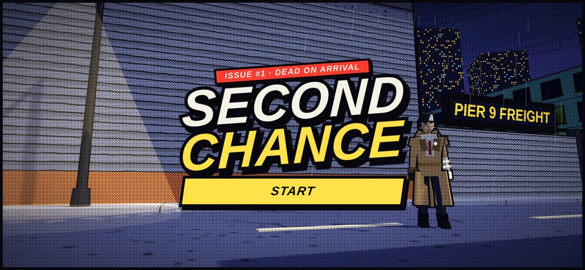
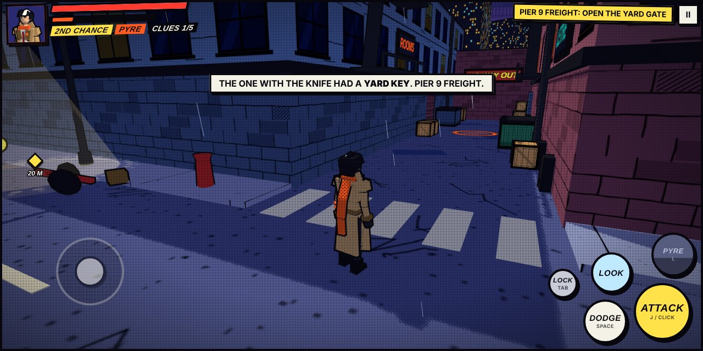
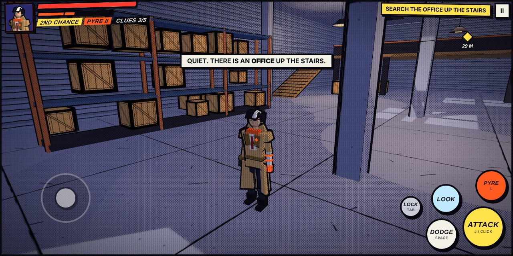
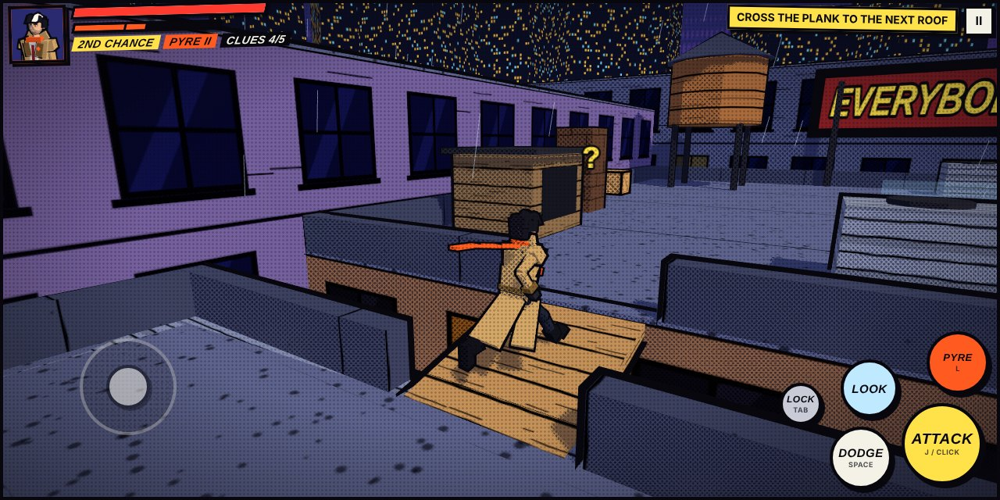
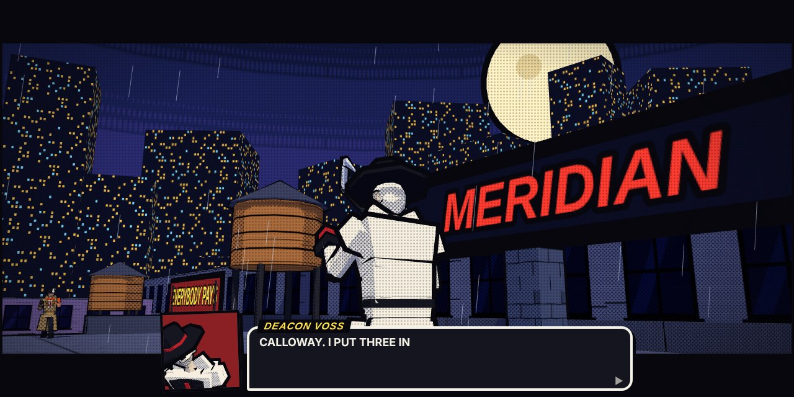

# SECOND CHANCE

**Issue #1: Dead on Arrival.** A third-person supernatural action-adventure in one HTML file, built phone-first
(landscape), in a cel-shaded comic-book style: thick ink outlines, flat colour, halftone shadow, lettered impacts.

You are Dez Calloway, a courier shot dead in Halloran Alley at 11:47 PM. At 11:48 a man with a ledger offers you
your life back until dawn, on terms: find out who is stealing souls in this city.

**Play:** open [`index.html`](index.html) in a browser, on a phone or a desktop. It is self-contained (Three.js r160
is inlined), downloads nothing, and works offline. Progress saves to the browser on that device.

This is its own game. Nothing outside the `second-chance/` folder is touched by it.

| Title | The opening page | Taking the mark |
|---|---|---|
|  |  |  |

| Ember: Pyre | Shade: Shadowstep | Tether: Grave Chain |
|---|---|---|
|  |  |  |

| Ferry Street | Warehouse 9 | The rooftops |
|---|---|---|
|  |  |  |

| Finisher camera | Deacon Voss | On a phone |
|---|---|---|
|  |  |  |

## The camera rule

**Third person, always.** There is no first-person mode in the game, for aiming, powers or anything else.

- The camera rides behind and a little above Dez and keeps the whole body in frame.
- Drag to turn it; the drag is eased so a thumb never jerks the view. Leave it alone while running and it drifts
  back behind you, the way PS2-era action games did.
- Near a wall it shortens. If there is no room behind at all it **climbs** and looks down rather than closing in.
- In a fight it pulls back for a wider view, and further still while locked on to someone far away.
- It only leaves Dez's back for staged shots: the opening, taking the mark, the shutter rising, Voss's entrance,
  finishers and the ending.

The automated playthrough (below) checks this on every frame of a whole run.

## Controls

| | Phone | Keyboard and mouse | Gamepad |
|---|---|---|---|
| Move | Left thumb, anywhere on the left side | `W A S D` | Left stick |
| Camera | Drag on the right side | Drag the mouse, or arrow keys | Right stick |
| Attack | ATTACK | `J`, or click | X |
| Dodge | DODGE | `Space` or `K` | B |
| Power | The path button | `L` or `Q` | Y |
| Interact | LOOK (its label changes) | `E` or `F` | A |
| Lock-on | LOCK | `Tab` or `R` | RB |
| Pause | II | `Esc` or `P` | Start |

- **Attack** three times for a combo: a straight, a hook with the marked hand, a spinning kick.
- **Dodge** is a roll with a moment of safety. Dodge just as a blow lands and time slows ("TOO SLOW!").
- **Power** costs a third of the bar. Hits, kills and late dodges refill it.
- **Interact** looks at clues, opens things, and finishes a staggered enemy.
- **Second chance:** the first time you go down you get back up. A crossing gives it back.

## The three paths

You choose at the first crossing (the glowing mark in the alley) and can change at any crossing. The path colours
Dez's scarf, eye and marked arm.

| Path | Power | What Dez does | Passive |
|---|---|---|---|
| **Ember**, the Furnace | Pyre | Leaps and slams a burning fist into the ground: a ring of fire around him | The third combo hit bursts into flame |
| **Shade**, the Long Dark | Shadowstep | Drops into his shadow and comes up behind the target with a rising slash | Dodge goes further and forgives more |
| **Tether**, the Drowned Chain | Grave Chain | Throws spectral chains, drags up to three enemies in and holds them still | Every Hollow put down heals a little |

Finding three of the five clues deepens the mark: Pyre II (wider, harder), Shadowstep II (chains to a second
enemy), Grave Chain II (five targets).

## What is in the slice

One connected block of the city (my estimate is ten to fifteen minutes for a person; nobody has timed it):

1. **Halloran Alley.** Wake up, look at where you died, choose a path, first Hollows.
2. **Ferry Street.** Two waves; the one with the knife has the yard key.
3. **Pier 9 yard.** A Bruiser who needs finishing. Throw the breaker to raise the shutter.
4. **Warehouse 9.** Two waves under the skylights, the office ledger, the back stairs.
5. **The rooftops.** A plank to the next roof, an ambush, a scaffold bridge to the Meridian.
6. **Deacon Voss.** Two phases, then a finisher and the end of the issue.

Three crossings save, heal and restore the second chance. Breakable crates hold health and power. Falling off a
roof is allowed; the stairs take you back up.

Enemies: **Hollows** (swing), **Knifers** (lunge from range), **Bruisers** (armoured, ground slam, must be
finished), **Deacon Voss** (combo, leap, and in phase two a blink behind you).

## How it is built

- Build: `python3 second-chance/build.py` writes `second-chance/index.html` from `src/`.
- `src/core.js` tunables and the path table. `gfx.js` renderer, toon material with halftone, drawn textures, static
  batching, effects. `rig.js` skinned low-poly people, drawn faces, poses. `world.js` the level and collision.
  `camera.js` the third-person camera. `actors.js` player, powers, enemies. `ui.js`, `story.js`, `audio.js`,
  `input.js`, `main.js`.
- Everything visible is made in code: no image, model or sound files.
- With six enemies on screen the frame is about 110 draw calls and 23,000 triangles.

## Tests

From the `second-chance/` folder, after building (needs Node and Playwright):

| Command | What it does |
|---|---|
| `node tests/playthrough.js ember` (or `shade`, `tether`) | A bot plays the whole slice on a fixed clock and fails if anything blocks it, if there is a console error, if the camera ever comes within 1.2 m of Dez, or if Dez is out of frame for more than 1% of play |
| `SKILL=0 node tests/playthrough.js ember` | The same bot, never dodging |
| `node tests/shot.js <dir> 1280 640 tests/steps_fx.js` | Screenshots of the powers, finisher, dodge, lock-on, second chance, pause |

## What was and was not tested (Nov 19 2026)

Tested, by script, in headless Chromium:

- The full slice completes on all three paths, start to end card, with no console errors.
- Camera: closest approach to Dez in a full run was 1.7 to 2.1 m; Dez was partly out of frame for under 0.2% of
  frames (on the back stairs).
- A bot that never dodges also finishes, with 5 health left on Voss.
- Layout at phone size, landscape (844x390) and portrait (390x844).

Not tested:

- **No person has played it**, and it has not run on a real phone. Thumb feel, camera speed, difficulty and frame
  rate on a device are unknown. The bot aims perfectly, so its results flatter the difficulty.
- Sound has not been heard by anyone; it is all synthesised and may need balancing.
- Gamepad support is written but untested.
- iOS Safari is untested.
