# SECOND CHANCE

**Issue #1: Dead on Arrival.** A third-person supernatural action-adventure in one HTML file, built phone-first
(landscape), in a cel-shaded comic-book style: thick ink outlines, flat colour, halftone shadow, lettered impacts.

You are Dez Calloway, a courier shot dead in Halloran Alley at 11:47 PM. At 11:48 a man with a ledger offers you
your life back until dawn, on terms: find out who is stealing souls in this city.

**Play:** open [`index.html`](index.html) in a browser, on a phone or a desktop. It is self-contained (Three.js r160
is inlined), downloads nothing, and works offline. Progress saves to the browser on that device.

This is its own game. Nothing outside the `second-chance/` folder is touched by it.

| Title | The opening page | Taking the mark |
|---|---|---|
|  | 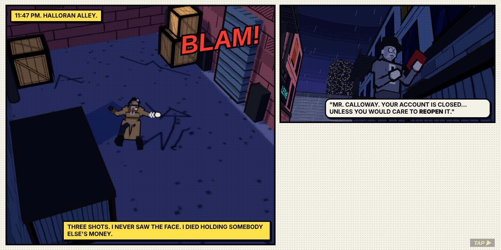 | 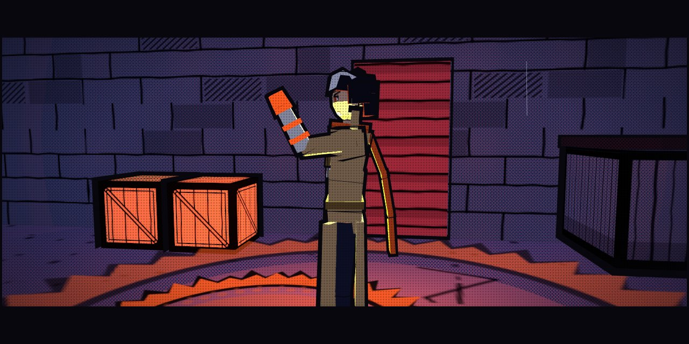 |

| Ember: Pyre | Shade: Shadowstep | Tether: Grave Chain |
|---|---|---|
| 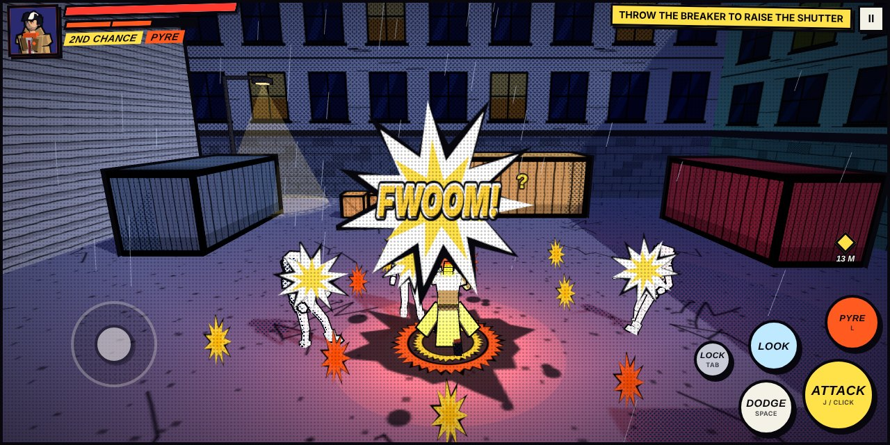 | 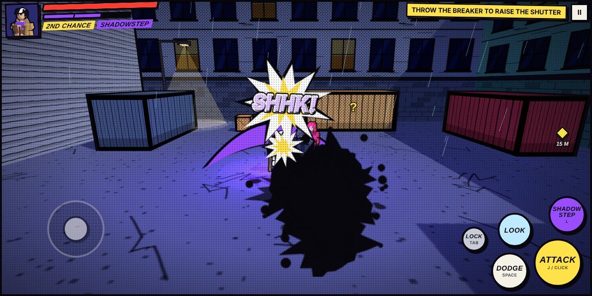 | 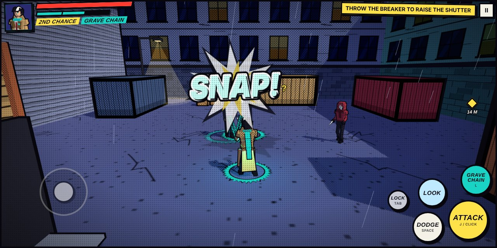 |

| Ferry Street | Warehouse 9 | The rooftops |
|---|---|---|
|  |  |  |

| Finisher camera | Deacon Voss | On a phone |
|---|---|---|
| 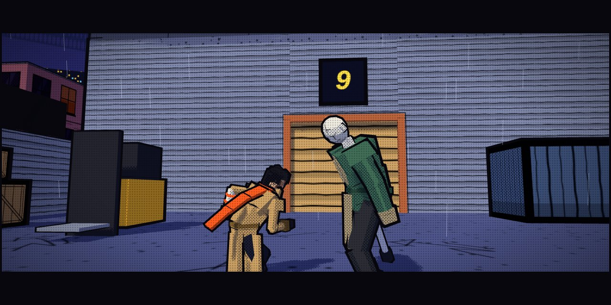 |  | 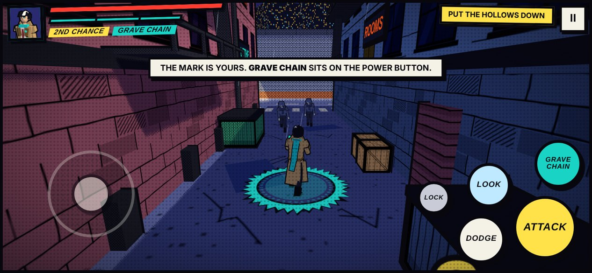 |

New in v0.2:

| Echo: the alley remembers | Echo: the office | Ruth on the tenement roof |
|---|---|---|
| 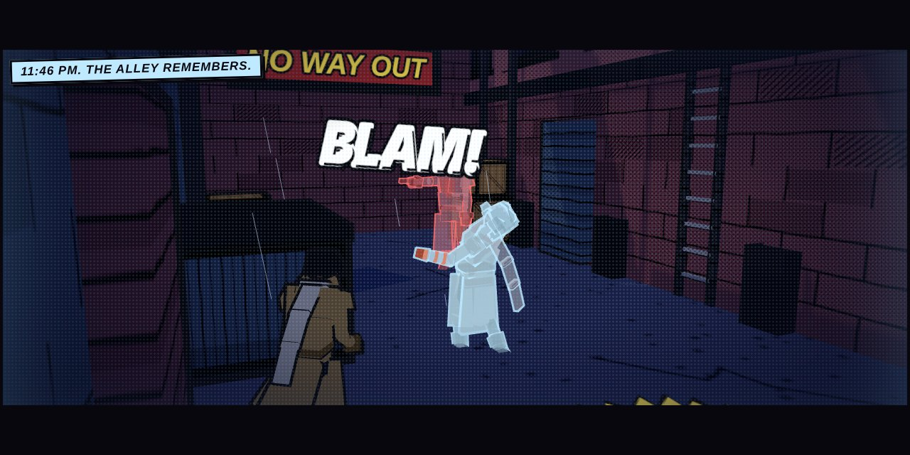 | 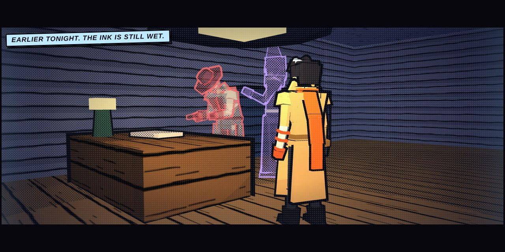 | 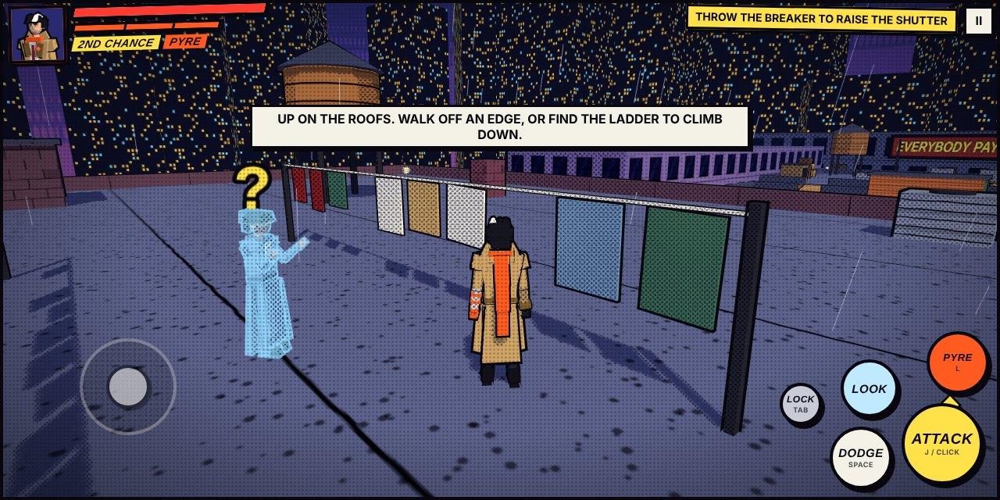 |

| Tally's ledger | Counter after a late dodge | Lamp-oil drum |
|---|---|---|
| 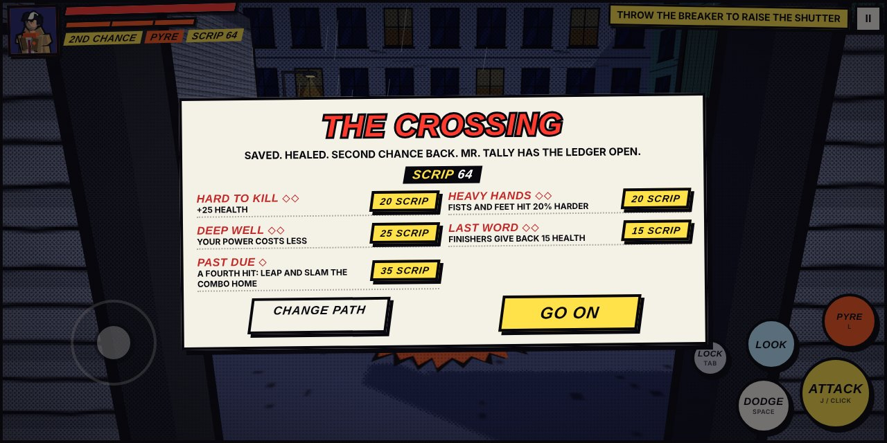 | 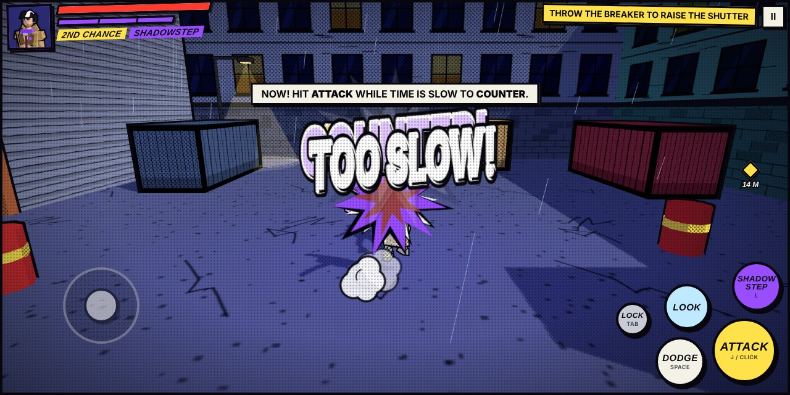 | 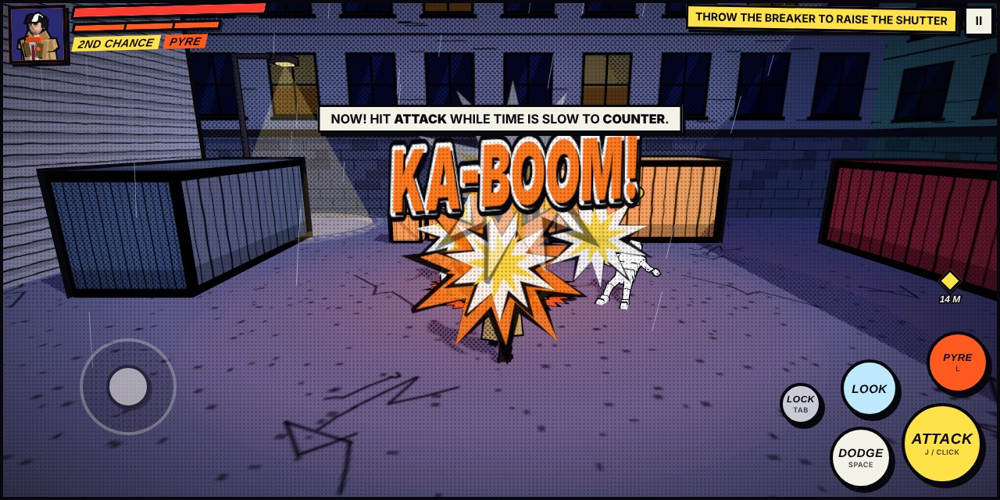 |

| A Caller's bottle | Up the containers | The roofs and the plank |
|---|---|---|
| 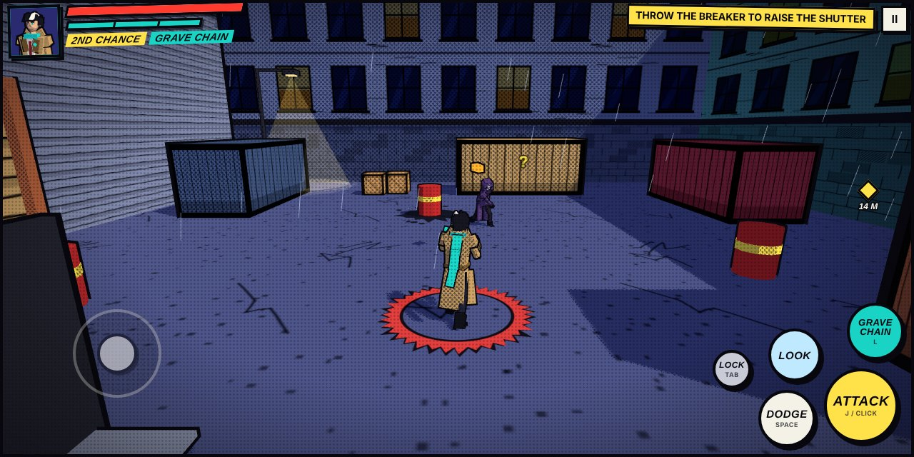 | 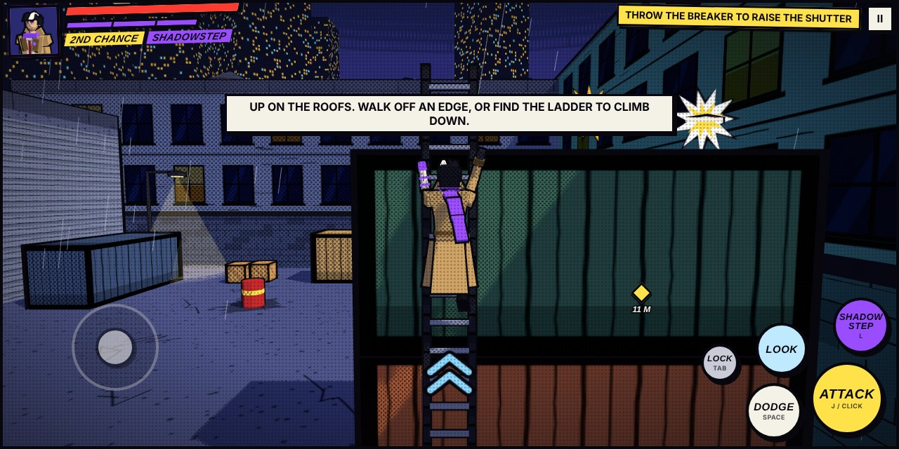 | 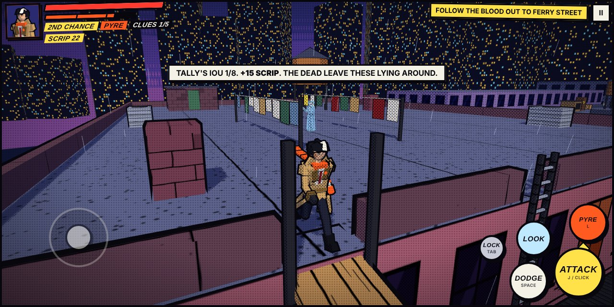 |

New in v0.3, the mystery:

| Otis at the Lethe | Nell on the radio | The case board |
|---|---|---|
| 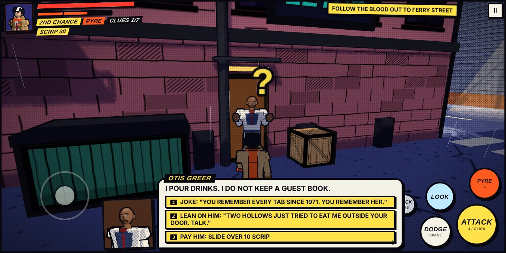 | 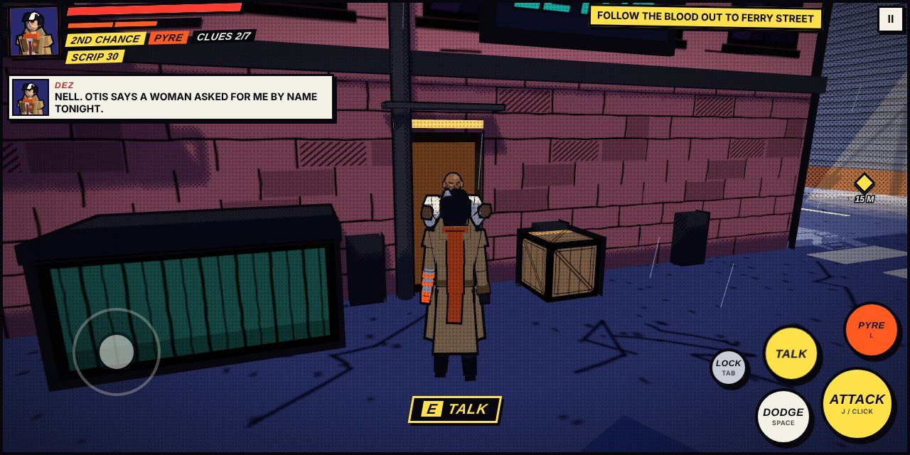 | 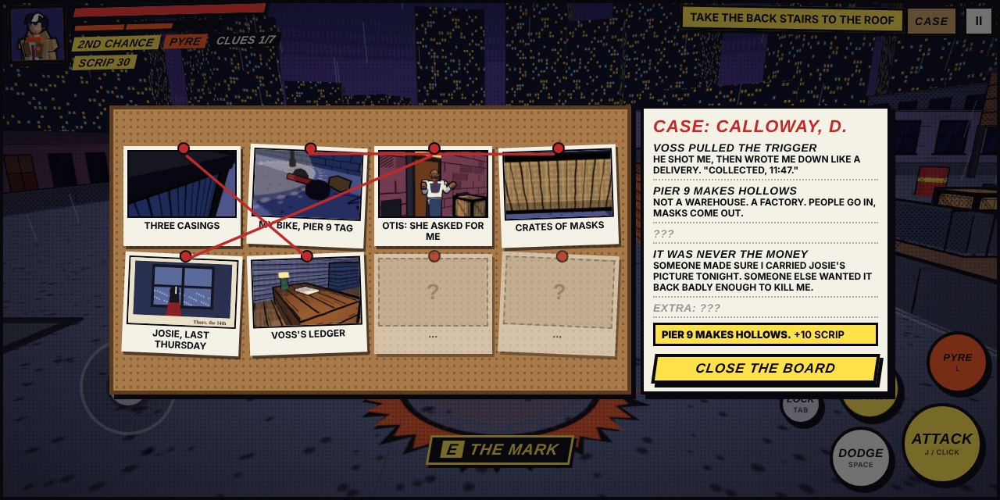 |

| A chapter card | The last page |
|---|---|
| 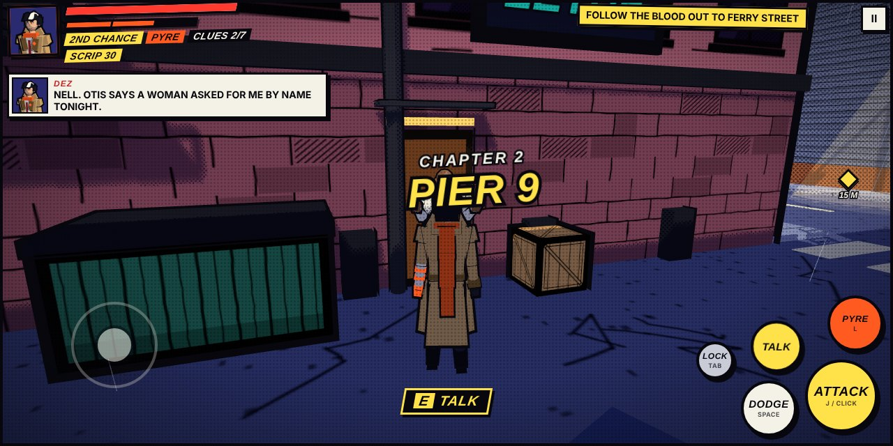 | 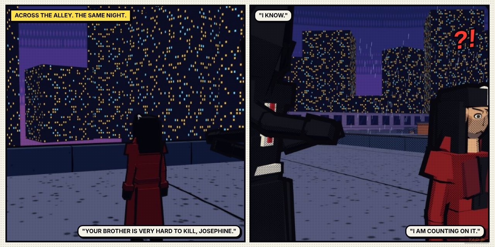 |

## The camera rule

**Third person, always.** There is no first-person mode in the game, for aiming, powers or anything else.

- The camera rides behind and a little above Dez and keeps the whole body in frame.
- Drag to turn it; the drag is eased so a thumb never jerks the view. Leave it alone while running and it drifts
  back behind you, the way PS2-era action games did.
- Near a wall it shortens. If there is no room behind at all it **climbs** and looks down rather than closing in.
- In a fight it pulls back for a wider view, and further still while locked on to someone far away.
- It only leaves Dez's back for staged shots: the opening, taking the mark, the shutter rising, Voss's entrance,
  finishers and the ending.

The automated playthrough (below) checks this on every frame of a whole run.

## Controls

| | Phone | Keyboard and mouse | Gamepad |
|---|---|---|---|
| Move | Left thumb, anywhere on the left side | `W A S D` | Left stick |
| Camera | Drag on the right side | Drag the mouse, or arrow keys | Right stick |
| Attack | ATTACK | `J`, or click | X |
| Dodge | DODGE | `Space` or `K` | B |
| Power | The path button | `L` or `Q` | Y |
| Interact | LOOK (its label changes) | `E` or `F` | A |
| Lock-on | LOCK | `Tab` or `R` | RB |
| Pause | II | `Esc` or `P` | Start |

- **Attack** three times for a combo: a straight, a hook with the marked hand, a spinning kick. Buy PAST DUE from
  Tally and a fourth hit leaps and slams the combo home.
- **Dodge** is a roll with a moment of safety. Dodge just as a blow lands and time slows ("TOO SLOW!"). Hit
  **Attack** inside that slowdown to **counter**: Dez crosses the gap and lands a heavy blow.
- **Power** costs a third of the bar. Hits, kills and late dodges refill it.
- **Interact** looks at clues, opens things, climbs ladders, talks, and finishes a staggered enemy.
- **Second chance:** the first time you go down you get back up. A crossing gives it back.

## The three paths

You choose at the first crossing (the glowing mark in the alley) and can change at any crossing. The path colours
Dez's scarf, eye and marked arm.

| Path | Power | What Dez does | Passive |
|---|---|---|---|
| **Ember**, the Furnace | Pyre | Leaps and slams a burning fist into the ground: a ring of fire around him | The third combo hit bursts into flame |
| **Shade**, the Long Dark | Shadowstep | Drops into his shadow and comes up behind the target with a rising slash | Dodge goes further and forgives more |
| **Tether**, the Drowned Chain | Grave Chain | Throws spectral chains, drags up to three enemies in and holds them still | Every Hollow put down heals a little |

Finding three of the five clues deepens the mark: Pyre II (wider, harder), Shadowstep II (chains to a second
enemy), Grave Chain II (five targets).

## What is in the slice

One connected block of the city (my estimate is ten to fifteen minutes for a person; nobody has timed it):

1. **Halloran Alley.** Wake up, look at where you died, choose a path, first Hollows.
2. **Ferry Street.** Two waves; the one with the knife has the yard key.
3. **Pier 9 yard.** A Bruiser who needs finishing. Throw the breaker to raise the shutter.
4. **Warehouse 9.** Two waves under the skylights, the office ledger, the back stairs.
5. **The rooftops.** A plank to the next roof, an ambush, a scaffold bridge to the Meridian.
6. **Deacon Voss.** Two phases, then a finisher and the end of the issue.

Three crossings save, heal and restore the second chance. Breakable crates hold health and power. Falling off a
roof is allowed; the stairs and ladders take you back up.

Enemies: **Hollows** (swing), **Knifers** (lunge from range), **Callers** (keep their distance and lob burning
lamp oil; a red ring shows where it lands), **Bruisers** (armoured, ground slam, must be finished), **Deacon
Voss** (combo, leap, and in phase two a blink behind you).

### The mystery (v0.3)

A crime story in the mould of modern mystery thrillers: a hero who jokes when things are worst, a friend on the
other end of the line, a case that turns out to be about his own family.

- **Nell Szabo**, night dispatcher at the courier firm, calls Dez on the radio at each turn of the case. Her calls
  play while you keep moving; nothing to tap.
- **Otis Greer**, bartender at the Lethe, stands in his side door once the alley is clear. Get the story out of him
  with a joke, by leaning on him, or with 10 scrip. Each way gets a different answer and a different bonus.
- **Josie.** Dez's sister walked out eleven years ago and never came back. A photograph of her, dated last
  Thursday, is in the satchel Voss stole.
- **The case board** (CASE, top right, or the pause menu): pin two clues together. Four deductions make the shape
  of the case and a fifth is extra; each pays 10 scrip. Wrong pairs get a remark from Dez.
- **Chapters**: four chapter cards mark the turns of the night. Dez has a line for finishers, close calls and
  climbing.
- **The last page**: find Josie's photo and the issue ends on one more page, somewhere you have already been.

### Off the main road (v0.2)

- **Echoes.** Two clues replay what happened there as see-through ink figures, with the lights down: Dez's own
  murder in the alley, and who Voss answers to, in the warehouse office.
- **Ladders and roofs.** Fire-escape ladders climb both tenements over Halloran Alley; a plank joins the two roofs.
  A ladder in the Pier 9 yard climbs the container stack.
- **Ruth Okafor.** A ghost who still hangs out her washing on the west roof. Her locket is somewhere in the yard.
- **Tally's IOUs.** Eight notes hidden around the block, 15 scrip each.
- **Scrip and the ledger.** Hollows and crates drop scrip. At any crossing after the first, Mr. Tally sells five
  upgrades: Hard to Kill (health), Heavy Hands (damage), Deep Well (cheaper power), Last Word (finishers heal),
  Past Due (a fourth combo hit).
- **The street fights back.** Hit a red lamp-oil drum and get clear: it takes anything close with it, Dez
  included. Callers' bottles light them too. Knock a Hollow hard into a wall and it splats.
- **Challenge**, in the pause menu: Story, Normal or Hard. Kept on the device with the other settings.

## How it is built

- Build: `python3 second-chance/build.py` writes `second-chance/index.html` from `src/`.
- `src/core.js` tunables and the path table. `gfx.js` renderer, toon material with halftone, drawn textures, static
  batching, effects. `rig.js` skinned low-poly people, drawn faces, poses. `world.js` the level and collision.
  `camera.js` the third-person camera. `actors.js` player, powers, enemies. `echo.js` the ghost replays. `ui.js` (HUD,
  dialogue with choices, the radio, the case board),
  `story.js`, `audio.js`, `input.js`, `main.js`.
- Everything visible is made in code: no image, model or sound files.
- With six enemies on screen the frame is about 110 draw calls and 23,000 triangles.

## Tests

From the `second-chance/` folder, after building (needs Node and Playwright):

| Command | What it does |
|---|---|
| `node tests/playthrough.js ember` (or `shade`, `tether`) | A bot plays the whole slice on a fixed clock and fails if anything blocks it, if there is a console error, if the camera ever comes within 1.2 m of Dez, or if Dez is out of frame for more than 1% of play |
| `SKILL=0 node tests/playthrough.js ember` | The same bot, never dodging |
| `DIFF=hard node tests/playthrough.js shade` | The same bot on Hard (or `story`) |
| `node tests/shot.js <dir> 1280 640 tests/steps_v3.js` | Screenshots of Otis's choices, the radio, a chapter card, a one-liner, the case board and the last page |
| `node tests/shot.js <dir> 1280 640 tests/steps_v2.js` | Checks the counter, a drum, a Caller's bottle, a wall splat, the fourth hit, the ledger and a climb, and prints what happened |
| `node tests/shot.js <dir> 1280 640 tests/steps_fx.js` | Screenshots of the powers, finisher, dodge, lock-on, second chance, pause |

## What was and was not tested (Nov 28 2026, v0.3)

Tested, by script, in headless Chromium:

- Full playthroughs pass on all three paths, on Hard, on Story and never dodging. Every run now also talks to
  Otis, finds Josie's photo, makes all five deductions on the case board through its real buttons, sees the last
  page and reaches the end card, with no console errors.
- Those runs found two real bugs, now fixed: Dez could get wedged behind Otis if he stood in the doorway as the
  alley fight ended, and a hard knock in the boss fight could throw him off the scaffold bridge into the back
  alley. Otis's space now runs to the wall, and all three bridges have handrails. Both have their own checks.
- Camera: closest approach to Dez 1.68 m; out of frame for under 0.3% of frames.
- Health at the end of the boss: 55 to 115 of 150 on Normal, 73 on Hard, 147 on Story.
- Layout at phone size for the new screens (choices, radio, case board).

Not tested:

- **No person has played it**, and it has not run on a real phone. Thumb feel, camera speed, difficulty and frame
  rate on a device are unknown. The bot aims perfectly, so its results flatter the difficulty.
- Sound has not been heard by anyone; it is all synthesised and may need balancing.
- Gamepad support is written but untested.
- iOS Safari is untested.
- Two IOUs (the back alley behind the warehouse, and the Meridian roof) are not on the bot's route, so only their
  placement has been checked, not a walk to them.
- Balance of scrip and upgrade prices is a first guess. A thorough player can afford almost everything by the boss.
