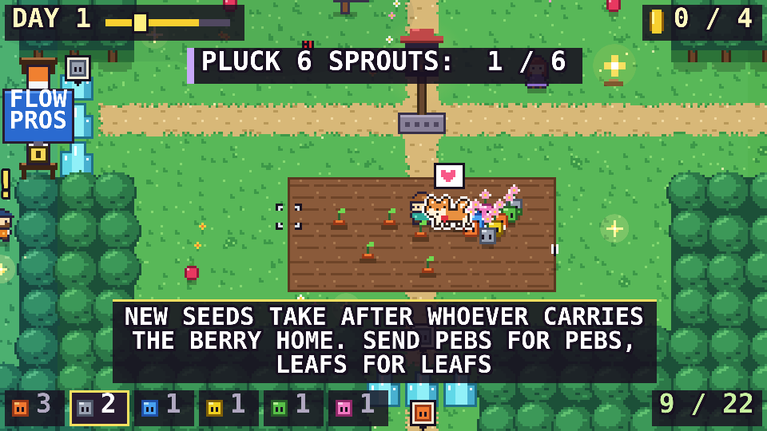

# Sprouts TV changelog

## First version (Nov 18 2026)

Will: clone the game and port it to a standalone without the console holder, to play on a TV from a PC browser over
HDMI. A wider view if that does not hurt the scenes. Keep the original file exactly as it is with all the games.
Build the standalone with an intro, boot up and titles.

**A separate copy.** `sprouts-tv/` has its own source, build script, tests and output. Nothing outside the folder
was changed. Own saves (`sprouts-tv:`).

**The screen.** 320 x 180 game pixels, 16:9. The canvas is drawn at the window's own resolution with a whole-number
scale (6 to 1 at 1080p, 12 to 1 at 4K), so pixel art stays square and text is sharp rather than stretched.

**The valley, wider.** The handheld shows 160 pixels of the valley across, zoomed 1.5x. Sprouts TV shows 320 with
no zoom. Night lighting, the screen wipe and floating numbers cover the whole screen. The HUD moved to the corners.

**The 3D scenes, wider.** 320 wide with the same lens, so each shot keeps what it showed top to bottom and gains at
the sides. The picture starts at the top edge of the screen and is as tall as the handheld's. All 87 shots of the 19
scenes were looked at on contact sheets at this shape. None needed re-framing.

**The way in.** A dark screen until a button is pressed (browsers need that before sound). Then a studio card: the
match, the lantern, NORTH COAST STUDIOS, the six sprouts. Then the title: SPROUTS dropping in over the valley in 3D
at night, the camera circling the Lantern. Start goes to the menu. The menu's last entry returns to the title.

**Controller.** Any standard gamepad, beside the keyboard. See the README for the buttons.

**Menus and story pages** keep their 240-wide layout in the middle of the screen. Backgrounds and bars reach the
edges. The 2D story scenes carry their sky and ground out to the edges.

**One thing the fork needed:** the eight wild buddies took their pictures and guide lines from the Sproutwild
cartridge's files. That art was copied into `src/buddies.js`. Without it the buddies had no picture, and a test
caught it.

**Tested:** `tests/tv.js` 34 checks (the way in, a simulated controller, the screen at five window sizes, the
valley and night edge to edge, HUD in the corners, every 3D shot, saves apart and kept across a reload).
The handheld's Sprouts tests, copied here and run against this build: `sprouts_coast.js` 168, `sprouts_valley.js`
50, `sprouts_story.js` 17, and the soak run. A frame of the valley at night at 1080p took 10.6 ms in headless
Chromium with no graphics card; a 3D shot took about 3 ms to work out. The Pocket Lantern build was not rebuilt and
`git status` shows nothing outside `sprouts-tv/` changed.

**Not tested:** on a television, with a real controller, in Firefox or Safari, or by ear. Whether 320 across is the
right amount of valley from a couch is Will's call; a closer view is a one-number change (`Z` in `src/game.js`).
