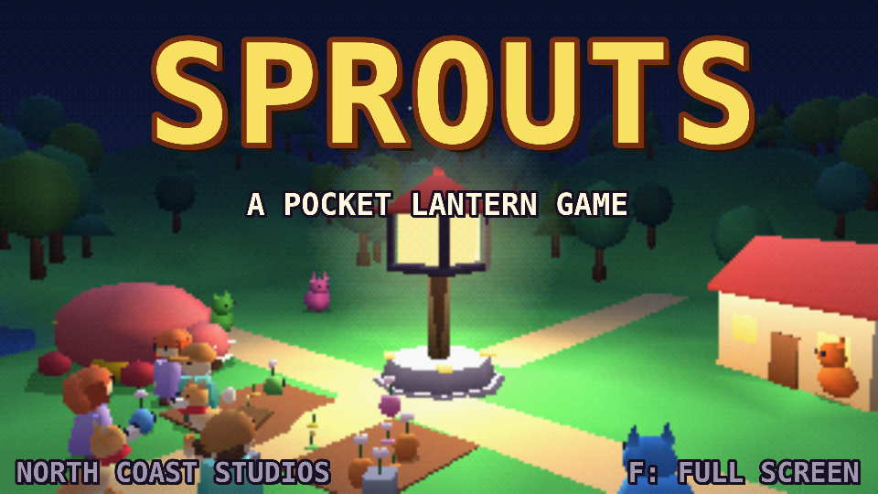

# Sprouts TV

Sprouts on its own, widescreen, for a browser on a television. No console body, no cartridge shelf, no other games.

**Play:** open `sprouts-tv/games/sprouts-tv.html` in Chrome or Edge on the PC, press **F** (or F11) for full screen.

## This is a separate copy

Forked from `alt/src` on Nov 18 2026. Nothing outside `sprouts-tv/` was changed to make it, and nothing here is read
by the Pocket Lantern builds. From now on the two change separately: a fix made in one does not reach the other
unless it is made twice.

Saves are separate too. Every key is stored under `sprouts-tv:`, so this game never reads or overwrites a Pocket
Lantern save, even in the same browser. There is no import yet: Sprouts TV starts as a new game.

## What is different from the handheld

| | Handheld (Pocket Lantern) | Sprouts TV |
|---|---|---|
| Screen | 240 wide, as tall as the phone allows | 320 x 180 (16:9), drawn at the window's own resolution |
| View of the valley | 160 wide, zoomed 1.5x | 320 wide, no zoom: twice as much to each side |
| 3D scenes | 240 wide | 320 wide, same height and lens: the framing is kept and the sides are added |
| Way in | shelf, cartridge, splash, boot | any button, studio card, 3D title, menu |
| Controls | touch buttons, keyboard | controller, keyboard |
| Menu's last entry | SWAP CARTRIDGE | TITLE SCREEN |

Menus, cards, speech and captions are still laid out 240 wide, in the middle of the screen. Their backgrounds and
bars reach the edges. The day bar, shard count, sprout tray and crew count sit in the screen's corners.

## Controls

| | Controller | Keyboard |
|---|---|---|
| Move | left stick or d-pad | arrows or WASD |
| Act (pluck, throw, talk) | A | Z, J or Space |
| Call the crew back | B | X or K |
| Swap sprout kind | X, Y, shoulders, Back | Shift, Q or E |
| Pause | Start | Enter or P |
| Full screen | (keyboard) | F, or double click |

A browser will not play sound until something has been pressed, which is why the game opens on PRESS ANY BUTTON.
A browser will not go full screen from a controller button either; use F or F11 once.

## Files

- `build.py` builds `games/sprouts-tv.html` (13.8 MB; the songs are 13 MB of it, read from the v0.3 build).
- `src/shell.html` the page. `src/game.js` the game (forked from `alt/src/console.js`). `src/sprouts3d.js` the 3D
  scenes, house and title. `src/buddies.js` art for the eight wild buddies, copied from the Sproutwild files.
- `tests/tv.js` what is new here (34 checks). `tests/sprouts_*.js` are copies of the handheld's Sprouts tests, run
  against this build.

`src/game.js` still carries code from the handheld that this build never reaches (the shelf, the Lantern menu,
the hooks for the other cartridges). It is dead weight, not a fault; it was left so the first version of this fork
stayed close to the game that was tested.

## Not done

- Not played on a television or with a real controller. The controller was a simulated one in the test.
- No import of a Pocket Lantern save.
- The studio card says NORTH COAST STUDIOS (the handheld's power-on already did). Say if it should say something else.
