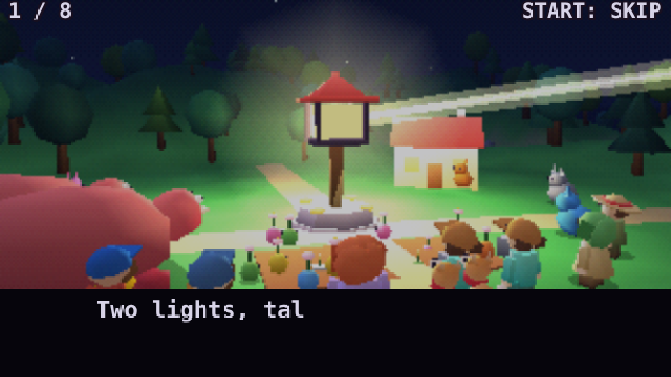
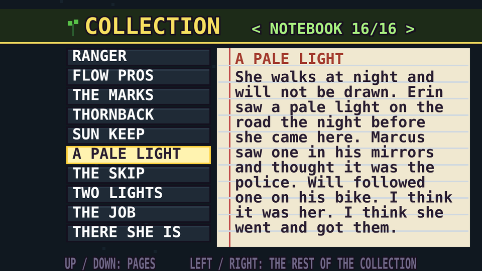

# Sprouts TV 2 changelog

## First version (Nov 19 2026)

Will: make a copy of the standalone Sprouts, implement everything in the review document and finish the game, clean up
every cutscene, fill in the lore from the characters' personas, and the placeholders become real characters.

The document is the review "Sprouts: State of the Game" (Nov 18). This entry goes through it item by item.
Everything was checked by script. **Nothing was played by hand, on a television or phone, or listened to.**

### The review, item by item

| Review item | What was done |
|---|---|
| The ending comes before half the game | **Done.** The blaze is a midpoint: the Lantern is whole and it still skips. The one ending and the win screen (TWO LIGHTS) come after the relight. |
| Erin's "You did it" moves to the relight; the blaze closes on Thornback | **Done.** Thornback half remembers at the blaze, fully at the call. |
| Marcus arrives on day 3 | **Done.** Flow Pros are locked out of their own job site, so Marcus and the van are by the west path from day one. His first ask is his lost key. In the story run he is met a third of the way through day one. |
| The second act is a single carry and a scene | **Done.** Beam, coast, pier, the flooded lamp room, fetch Marcus, ten sprouts to the light (a 3D scene), the lens, the relight, the ending. |
| Day 4 is thin; a reason to come back on day 5 | **Done.** The wedding book, expeditions, Scout's notebook, Ranger's posts, Marcus's bet, night grubs, rain days. |
| Ranger and Scout are placeholders doing chores | **Done.** Story asks, a line after every turn of the story, guide entries, and Scout's notebook. They keep their names. |
| Marcus and Derek get scenes but little story | **Done.** The leak they were rung about turns out to be the North Light. Derek has lines at the van. |
| Wedding planning | **Done.** The wedding book by the fire. Planned, not held: the date is left open. |
| A small threat with stakes | **Done.** Night grubs eat seedlings in the Lantern's soil. A handful at most, never the crew. |
| What the North Light does after it is lit | **Done (proposed).** It rests three nights after it is answered. Not out. |
| Reward inflation: constant toasts, fast ranks | **Done.** The story run had 2 pop-up toasts in six days (it was 40 on day one). Rank and Louie's levels are slower. |
| Hint banner covers the house and the field | **Done.** Hints are a strip above the tray; in the house they use the house's own strip. |
| Erase Everything is easy to land on | **Done.** It is in Settings. |
| Is 320 of valley right? A one-number change | **Done.** Settings has VIEW: WIDE or CLOSE. |
| Importing a Pocket Lantern save | **Done.** Settings, IMPORT A SAVE. Reads a Sprouts TV or Pocket Lantern save in the same browser. |
| Carriers "not on their target" in the story run | **Checked.** It was the test script's own helper. Fixed there; the last run has no flags. |
| All 13 thrown sprouts become gardeners | **Done.** No more gardeners than beds (five at least); the rest wait. |
| Unreached handheld code in the TV build | **Done.** Shelf, splash, boot, Lantern menu and other cartridges' hooks are removed. |
| One source, two builds | **Done inside this copy.** `build.py` writes the television build and a phone build from one source. The older copies in `alt/` and `sprouts-tv/` were left as they are, as asked earlier. |
| "See one, send one" means two things | **Done.** It is only the dab now. |
| Couch co-op | **Done as Louie.** A second controller walks Louie, barks and digs. Erin is not playable. |
| Weather or seasons | **Weather only.** About one day in five is a rain day. No seasons. |
| Photo mode | **Done.** Y. The 3D renderer draws where Will stands; A saves a PNG. |
| Louie's own day | **Done as a minute.** Louie's morning, from the beds. |
| Expeditions as a teaser | **Done.** After the ending, from the fire. |
| Buddies eating strays may need tuning | **Not touched.** It needs a hand playtest first. |
| The van jokes and the age rating | **Not touched.** Will asked for them; it is his call. |
| Bessie's rename in code | **Nothing to do here.** That is Sproutwild's code. |
| Verdicts on the proposed canon; play it on the TV | **Will's.** |

### Cutscenes

- Every story scene is 3D. Erin's welcome and the two- and three-shard beats were the last 2D ones. The project pages
  stay as 2D storybook pages.
- New scenes: three more shots on the blaze, THE JOB SITE (4), TWO LIGHTS (the ending, 8), SAVE THE DATE (4).
  25 scenes and 116 shots in all.
- Two shots that cropped the Lantern were re-framed. All story scenes were looked at on contact sheets at the TV shape.
- Erin no longer introduces herself to her fiance, and no longer speaks as someone who grew up in the valley.

### New systems

- **Scout's notebook:** a fourth Collection page, sixteen entries that fill in as the story is found out.
- **The wedding book:** six pages (a place, flowers, something old, guests, a ring bearer, light) filled by play.
- **Expeditions:** five house sprouts carry the light down a road for two days. Four come back with a postcard.
- **Night grubs:** from day three, at dusk. Thornback sees the first off. Throw sprouts at the rest.
- **Rain:** waters the beds, speeds the soil, brings snails and a frog, keeps the grubs in. Ranger forecasts it.
- **Player two is Louie**, **Louie's morning**, **photo mode**.
- **Sprouts Pocket:** the phone build.

### Tested

348 checks, all passing on the last run: `tv2.js` 48, `tv.js` 34, `pocket.js` 16, `sprouts_coast.js` 183,
`sprouts_valley.js` 50, `sprouts_story.js` 17. The story playthrough ran start to ending with no flags
(`playtest/story-run.txt`); it needed the script's help for the asks the autopilot cannot do.

### Not tested, and known weak spots

- By hand, on a television, on a phone, with a real controller, in Firefox or Safari, or by ear.
- Balance of everything new is a first guess: how many seedlings grubs take, how often it rains, the bet's eight
  berries, the wedding book's six pages, Louie's minute.
- Photo mode places people by map position in a 3D valley modelled on the map; they can stand slightly off from
  where the 2D view shows them.
- A grub raid in progress is not saved; a save loaded mid-raid has ordinary grubs.
- `sprouts_story.js` (autopilot) fails about one run in ten.
- Marcus now stands three tiles from the Lantern's soil. A at him talks; whether that gets in the way needs a playtest.
