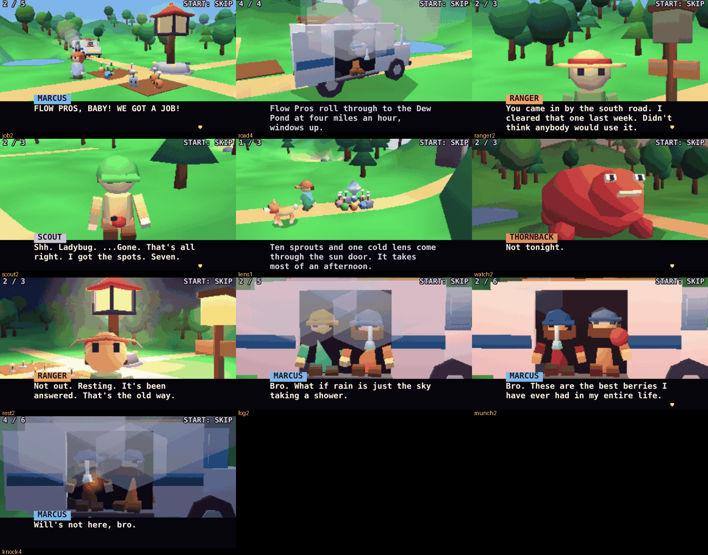

# Sprouts TV 2 changelog

## Cutscene clean-up and nine new scenes (Nov 19 2026, second round)

Will: "I love the van humor with Marcus and Derek and Will ... a little Cheech and Chong vibe. Check some of the
cutscenes and just clean them up. For example, the one where Derek rips through town, his truck's facing the wrong way
the whole time. Let's keep testing the new content as well. Add more cutscenes for the story."

Everything here was checked by script and by looking at rendered frames. **Nothing was played by hand, on a television
or phone, or listened to. No scene was watched running at full speed: each shot was looked at as stills.**

### Cleaned up

Every one of the 25 earlier scenes was rendered three frames per shot (start, middle, end) and looked at.

| Scene | What was wrong | Now |
|---|---|---|
| The job ("Derek rips through town") | The van was turned a quarter turn from the way it travelled in all three driving shots, so it slid sideways. | It drives nose first. A check now measures this in every shot of every scene where the van moves. |
| The job | Nobody was driving: Marcus and Derek both sat in the side door. | The cab is open framed, Derek is at the wheel, Marcus rides in the door with the rig. |
| Thornback wakes, shot 6 | Erin faced away from Thornback while speaking to him. | She turns to him; Louie moved out of her way. |
| The coast, shot 3 | Louie stood inside Will. | Apart. |
| The leak, shots 1 and 2 | The camera started inside a dune; Derek talked to a wall. | Camera moved; Derek faces the pipe. |
| The relight, shot 4 | Marcus and Will had their backs to the camera for Marcus's line. | They turn. |
| Thornback's speaking shots | He faced a quarter turn off camera. | He faces it. |
| The key, shot 4 | The van was parked across the job site gate, on the far side from everyone. | On the near side. |
| The blaze (shots 3, 5), the ending (all seven), three shards | A second Erin, Will and Thornback: the night set draws its own cast and these shots also placed theirs. | One of each. |
| Scout | Wore Erin's hair. | A green cap of her own. |

### Nine new scenes (34 scenes, 152 shots now; 22 in the story, 12 hidden)

Every line in these is mine, not Will's. They are listed in `STORY-NOTES.md`.

| Scene | When it plays |
|---|---|
| **The paths** (Ranger, 3 shots) | The first time Will talks to Ranger, before his first ask. |
| **The notebook** (Scout, 3 shots) | The first time Will talks to Scout. |
| **The pond road** (4 shots) | When the Flow Pros key opens the job site. Derek drives the van through. |
| **The lens** (3 shots) | When the lens reaches the Lantern by day. After dark it goes straight to the relight, as before. |
| **Not tonight** (3 shots) | The first dusk Thornback turns a night grub away. After that it is a line over his head. |
| **At rest** (3 shots) | Dusk on the third night after the ending: the North Light banks down. Asleep for it, Will is told in the morning. |
| **The driest place** (hidden, 5 shots) | A at the van on a rain day. |
| **Eleven berries** (hidden, 6 shots) | A at the van after dark on a day ten berries came home. |
| **Who is it** (hidden, 6 shots) | A at the van after dark, on a night after the session. |

At the van after dark the order is: the session first, then eleven berries (if it was a ten berry day), then who is
it, then the usual lines.

### Found while testing

- **A scene queued in one game could play in the next.** Starting a new game, or loading, did not clear scenes waiting
  to play. It does now.
- **The tests were racing the real clock.** The game's own loop and timers kept running while a test stepped it by hand,
  so the same test could pass or fail from run to run (the coast suite failed three runs in four once the new scenes
  made it longer). A test can now hold the game still (`HOLD`, only reachable with `?dev`), and the stepped suites do.
  Two failures that were left after that were the test's own staging: Louie standing where a throw was aimed, and a
  buried treasure spot that is placed at random.
- **Ranger's last ask could hold the arrow on Ranger with nothing to do.** "Walk the four trail posts" pointed only at
  posts in places Will had already found, and fell back to Ranger himself. The fourth post is on the North Coast, behind
  the sun door, so before the call the arrow sat on Ranger and he repeated the ask (the story run's bot talked to him
  about a thousand times). Now the arrow leads to the nearest post still to be stood at, found or not. When only the
  coast's post is left and the door is shut, the arrow lets go of Ranger, and he says where the fourth one is (a new
  line, mine: see the story notes). It picks the ask up again when the door opens.

### Tested

- `tests/scenes.js` (new, 36 checks): the scene list and captions, the van's heading in every moving shot, each new
  scene from its real trigger and only once, the van's order after dark, each new scene played start to finish.
- All suites together: 393 checks pass (tv 34, tv2 52, pocket 16, scenes 36, coast 188, valley 50, story 17).
- After the clock fix the coast suite was run three times in a row and tv2 four times: the same result each time.
  The story suite passed three runs in a row and failed one before that (its autopilot plays with the game's own
  dice, so it can still lose a run).
- Soak: Erin's day, two chaos seeds for two days each, one late-game seed. Nothing broke.
- The story run played from a fresh save to day 10 and met every story scene, the new ones included:
  `playtest/story-run.txt`. The script still helps itself in places (it counted the trail posts as walked, for one);
  every such place is marked "helped" in the file.
- Fifteen of the fixed and new shots were also rendered on the phone build and looked at.

### Not tested, not done

- Not played by hand. Not seen on a television or a phone. Not heard: four of the nine new scenes have a sound cue
  and none of them was listened to.
- Timing was judged from stills. Whether a shot runs too long or a joke lands too late needs someone watching it.
- The three hidden van scenes were checked for order by calling the van directly, not by walking there at night.
- `alt/` and `sprouts-tv/` were not touched.

## First version (Nov 19 2026)

Will: make a copy of the standalone Sprouts, implement everything in the review document and finish the game, clean up
every cutscene, fill in the lore from the characters' personas, and the placeholders become real characters.

The document is the review "Sprouts: State of the Game" (Nov 18). This entry goes through it item by item.
Everything was checked by script. **Nothing was played by hand, on a television or phone, or listened to.**

### The review, item by item

| Review item | What was done |
|---|---|
| The ending comes before half the game | **Done.** The blaze is a midpoint: the Lantern is whole and it still skips. The one ending and the win screen (TWO LIGHTS) come after the relight. |
| Erin's "You did it" moves to the relight; the blaze closes on Thornback | **Done.** Thornback half remembers at the blaze, fully at the call. |
| Marcus arrives on day 3 | **Done.** Flow Pros are locked out of their own job site, so Marcus and the van are by the west path from day one. His first ask is his lost key. In the story run he is met a third of the way through day one. |
| The second act is a single carry and a scene | **Done.** Beam, coast, pier, the flooded lamp room, fetch Marcus, ten sprouts to the light (a 3D scene), the lens, the relight, the ending. |
| Day 4 is thin; a reason to come back on day 5 | **Done.** The wedding book, expeditions, Scout's notebook, Ranger's posts, Marcus's bet, night grubs, rain days. |
| Ranger and Scout are placeholders doing chores | **Done.** Story asks, a line after every turn of the story, guide entries, and Scout's notebook. They keep their names. |
| Marcus and Derek get scenes but little story | **Done.** The leak they were rung about turns out to be the North Light. Derek has lines at the van. |
| Wedding planning | **Done.** The wedding book by the fire. Planned, not held: the date is left open. |
| A small threat with stakes | **Done.** Night grubs eat seedlings in the Lantern's soil. A handful at most, never the crew. |
| What the North Light does after it is lit | **Done (proposed).** It rests three nights after it is answered. Not out. |
| Reward inflation: constant toasts, fast ranks | **Done.** The story run had 2 pop-up toasts in six days (it was 40 on day one). Rank and Louie's levels are slower. |
| Hint banner covers the house and the field | **Done.** Hints are a strip above the tray; in the house they use the house's own strip. |
| Erase Everything is easy to land on | **Done.** It is in Settings. |
| Is 320 of valley right? A one-number change | **Done.** Settings has VIEW: WIDE or CLOSE. |
| Importing a Pocket Lantern save | **Done.** Settings, IMPORT A SAVE. Reads a Sprouts TV or Pocket Lantern save in the same browser. |
| Carriers "not on their target" in the story run | **Checked.** It was the test script's own helper. Fixed there; the last run has no flags. |
| All 13 thrown sprouts become gardeners | **Done.** No more gardeners than beds (five at least); the rest wait. |
| Unreached handheld code in the TV build | **Done.** Shelf, splash, boot, Lantern menu and other cartridges' hooks are removed. |
| One source, two builds | **Done inside this copy.** `build.py` writes the television build and a phone build from one source. The older copies in `alt/` and `sprouts-tv/` were left as they are, as asked earlier. |
| "See one, send one" means two things | **Done.** It is only the dab now. |
| Couch co-op | **Done as Louie.** A second controller walks Louie, barks and digs. Erin is not playable. |
| Weather or seasons | **Weather only.** About one day in five is a rain day. No seasons. |
| Photo mode | **Done.** Y. The 3D renderer draws where Will stands; A saves a PNG. |
| Louie's own day | **Done as a minute.** Louie's morning, from the beds. |
| Expeditions as a teaser | **Done.** After the ending, from the fire. |
| Buddies eating strays may need tuning | **Not touched.** It needs a hand playtest first. |
| The van jokes and the age rating | **Not touched.** Will asked for them; it is his call. |
| Bessie's rename in code | **Nothing to do here.** That is Sproutwild's code. |
| Verdicts on the proposed canon; play it on the TV | **Will's.** |

### Cutscenes

- Every story scene is 3D. Erin's welcome and the two- and three-shard beats were the last 2D ones. The project pages
  stay as 2D storybook pages.
- New scenes: three more shots on the blaze, THE JOB SITE (4), TWO LIGHTS (the ending, 8), SAVE THE DATE (4).
  25 scenes and 116 shots in all.
- Two shots that cropped the Lantern were re-framed. All story scenes were looked at on contact sheets at the TV shape.
- Erin no longer introduces herself to her fiance, and no longer speaks as someone who grew up in the valley.

### New systems

- **Scout's notebook:** a fourth Collection page, sixteen entries that fill in as the story is found out.
- **The wedding book:** six pages (a place, flowers, something old, guests, a ring bearer, light) filled by play.
- **Expeditions:** five house sprouts carry the light down a road for two days. Four come back with a postcard.
- **Night grubs:** from day three, at dusk. Thornback sees the first off. Throw sprouts at the rest.
- **Rain:** waters the beds, speeds the soil, brings snails and a frog, keeps the grubs in. Ranger forecasts it.
- **Player two is Louie**, **Louie's morning**, **photo mode**.
- **Sprouts Pocket:** the phone build.

### Tested

348 checks, all passing on the last run: `tv2.js` 48, `tv.js` 34, `pocket.js` 16, `sprouts_coast.js` 183,
`sprouts_valley.js` 50, `sprouts_story.js` 17. The story playthrough ran start to ending with no flags
(`playtest/story-run.txt`); it needed the script's help for the asks the autopilot cannot do.

### Not tested, and known weak spots

- By hand, on a television, on a phone, with a real controller, in Firefox or Safari, or by ear.
- Balance of everything new is a first guess: how many seedlings grubs take, how often it rains, the bet's eight
  berries, the wedding book's six pages, Louie's minute.
- Photo mode places people by map position in a 3D valley modelled on the map; they can stand slightly off from
  where the 2D view shows them.
- A grub raid in progress is not saved; a save loaded mid-raid has ordinary grubs.
- `sprouts_story.js` (autopilot) fails about one run in ten.
- Marcus now stands three tiles from the Lantern's soil. A at him talks; whether that gets in the way needs a playtest.
