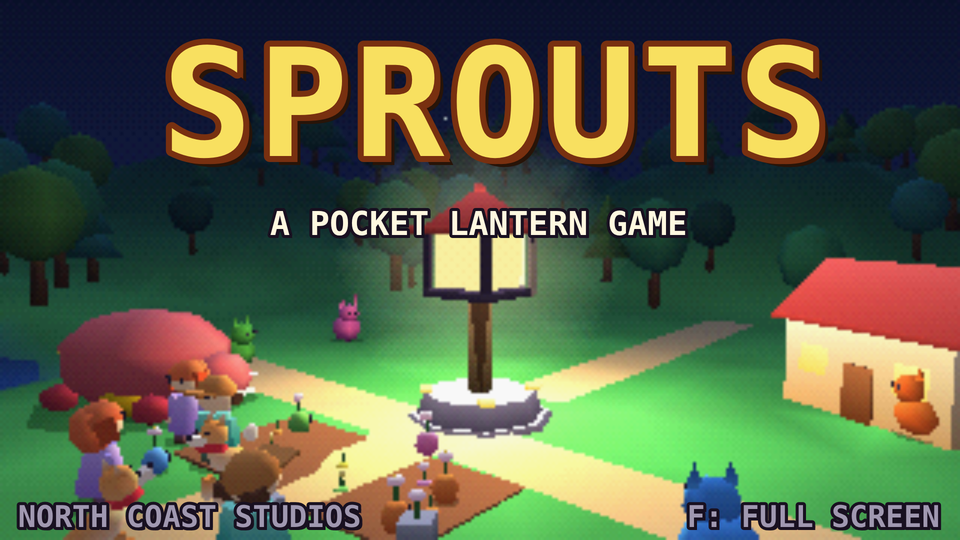

# Sprouts TV 2

Sprouts, finished: the standalone widescreen game, reworked from the review of Nov 18 ("Sprouts: State of the Game").
Also builds as a phone version from the same source.

**Play on a television:** open `games/sprouts-tv2.html` in Chrome or Edge on the PC, press **F** for full screen.
**Play on a phone:** open `games/sprouts-pocket.html`.

## This is a separate copy

`sprouts-tv2/` started as a copy of `sprouts-tv/` on Nov 19 2026. `sprouts-tv/`, `alt/` and the frozen folders were not
changed. Its saves are stored under `sprouts-tv2:`. Settings has IMPORT A SAVE, which reads (never writes) a Sprouts
TV or Pocket Lantern save in the same browser.

## What changed from Sprouts TV

- **The story has one ending, after the second light.** Four shards make the Lantern whole, and it still skips: that
  is the midpoint. Then the call, the coast, the pier, a flooded lamp room, the Flow Pros job, the lens, and the
  relight at night with everyone there.
- **Marcus on day one.** Flow Pros are locked out of their own job site, so the van is by the west path.
- **Ranger and Scout are people.** Each has a story ask, a line for every turn of the story, and Scout's notebook is a
  page of the Collection that fills in with what the valley finds out.
- **Every story scene is 3D.** 34 scenes, 152 shots (22 story, 12 hidden). Ranger and Scout each get a scene the
  first time Will meets them, and the van drives nose first with Derek at the wheel.
- **Calmer.** Rank-ups, baskets, daily asks and rewards are read out in the evening report, not popped up all day.
- **Things to do after the ending.** The wedding book, expeditions, the notebook, night grubs, rain days.
- **New ways to play.** Photo mode, a second controller as Louie, Louie's morning.
- **Small fixes.** Hints stay in a bottom strip, Erase Everything is in Settings, a VIEW setting, gardeners capped.
- **Played start to finish with the buttons.** A bot that only presses the controller's buttons finishes the whole
  game: all thirty asks, both lights, the wedding book. See "The honest run" below.
- **Finishing touches.** A CONTROLS page and CREDITS in Settings, credits after the last scene, and each build is
  4.8 MB (it was 13.8: songs for other games were riding along).

The full list, set against the review item by item, is in [CHANGELOG.md](CHANGELOG.md). Everything invented for the
story is in [STORY-NOTES.md](STORY-NOTES.md), marked as Claude's.

## Controls

| | Controller | Keyboard | Phone |
|---|---|---|---|
| Move | left stick or d-pad | arrows or WASD | pad |
| Act (pluck, throw, talk) | A | Z, J or Space | A |
| Call the crew back | B | X or K | B |
| Swap sprout kind | X, shoulders, Back | Shift, Q or E | Select |
| Photo mode | Y | V or I | Photo |
| Pause | Start | Enter or P | Start |
| Louie (player two) | a second controller: stick, A barks, B digs | number pad: 8 4 2 6, 0 barks, + digs | |
| Full screen | (keyboard) | F, or double click | |

## Files

- `build.py` writes both builds. `src/game.js` is the game, `src/sprouts3d.js` the 3D scenes, house, title and photo
  mode, `src/buddies.js` the wild buddies' art. `src/shell.html` is the television page, `src/shell-pocket.html` the
  phone page. One line in `game.js` (`POCKET`) is the only difference between the builds.
- `tests/tv2.js` (63 checks) covers what this copy adds. `tests/scenes.js` (36) the second round of cutscenes.
  `tests/tv.js` (34) the television screen and controller. `tests/pocket.js` (16) the phone build.
  `tests/sprouts_coast.js` (189), `sprouts_valley.js` (50) and `sprouts_story.js` (17) the game itself. The stepped
  suites hold the game's own clock still (`HOLD`), so a run is the same every time. `tests/sprouts_playthrough.js` plays the whole story and prints it in order;
  the last run is `playtest/story-run.txt`.
- `tests/honest.js` and `tests/honest_bot.js` are the honest run (below). `tests/saves.js` (25 checks) loads a save
  from every stage of the story (`tests/saves/`, written by the honest run) through CONTINUE and plays on.

## The honest run

`node sprouts-tv2/tests/honest.js --days 16 --stop end` plays a new game to the end with the controller's buttons
only: no item is carried for it, no gate opened, no sprout made, no ask counted. It reads the game the way a player
reads the screen (where things are, what the arrow says) and it never writes to it. The last run is
`playtest/honest-run.txt`.

What it proves: every step of the story, and every ask, can be done with the controls the game has. What it does
not prove: that a person finds it clear or fun. The bot never misreads the screen, never gets lost and never gets
bored, so its times are a floor, not a guess at yours.

## Not done, and not tested

- Not played by a person: not on a television, a phone or a real controller, and not listened to. The honest run
  presses real buttons but it is a bot. Controllers and touch were simulated in the tests.
- `sprouts_story.js` is driven by an autopilot that plays with the game's own dice. It failed one run in four on
  Nov 19 and passed the next three.
- The older copies (`alt/` and `sprouts-tv/`) still exist and do not get these changes.
