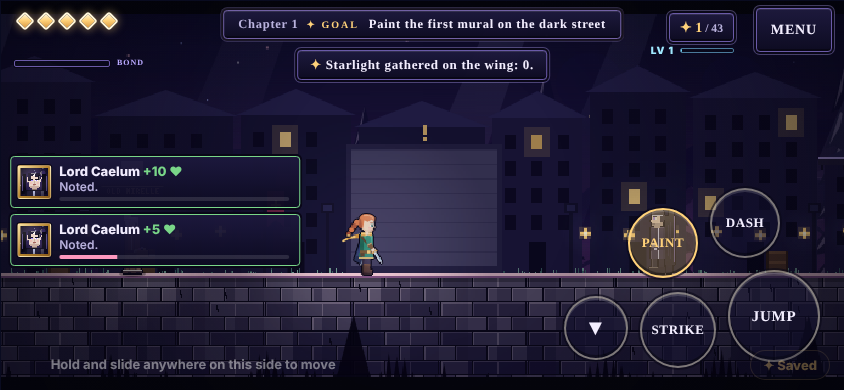

# Starhaven

**A North Coast Studios game, with E Concepts.** A 2D side-scrolling action RPG with a fae-court romance, played in
landscape on a phone (touch or a Bluetooth controller) or in any browser. All characters and places are original.

> A mortal huntress kills a white stag that belonged to the fae and is taken across the Wall as payment. She survives
> the Thorn Queen's trials, dies on the last one, and wakes up fae with the High Lord of the Court of Dusk's blood in her
> veins and a bond to him she can finally feel. Now Spring is at war with Dusk over her, the Iron King is coming from
> across the sea, and the stolen powers of seven courts are waking up inside her.

**Play it:** from the North Coast Arcade page ([`arcade/`](../arcade/README.md)), or download [`game/starhaven.html`](game/starhaven.html) and open it in a browser, or use the shared Claude
link Will has. Hold your phone either way up.

> **New here?** Read this page, then [`STORY.md`](STORY.md) (what happens, chapter by chapter) and
> [`CHANGELOG.md`](CHANGELOG.md) (what changed in each build). The design source of truth is [`DESIGN.md`](DESIGN.md).

## Status: concept build, Prologue through Chapter 3

| # | Chapter | What you do | Status |
|---|---------|-------------|--------|
| P1 | **The Winter Woods** | Mortal Wren (one jump, a bow) hunts with her sisters' hopes on her. The white stag. Rowan at the door. The Wall. | Playable |
| P2 | **Under the Mountain** | The Thorn Queen's three trials: a riddle, a maze (Caelum lends his speed through the bargain), a beast. Death, Caelum's blood, the bond. | Playable |
| 1 | **Ashes** | Caelum steals Wren out of Spring. Walk to Starhaven, paint the first mural, the street lights up. The rooftop: they're mates. Rowan declares war. | Playable |
| 2 | **The Five** | Bram's Training Ring (daggers, the thorn pit), Iris, the Iron King's thorn sprites, Iris's vision of Wren's sisters. | Playable |
| 3 | **First Light** | Thane explains the fire in Wren's hand. Flame: braziers, the queen's thorns, wyrmlings, the Old Wyrm. Rowan on the peak. | Playable (new) |
| 4 | The Spy in the Library | Winged spies, a defense mission inside the city, the bow. | Teased at the end; next in the design doc |
| 5 to 9 | The Weaver's Cottage, Starfall, The Sisters, Siege of Starhaven, High Lady | See [`DESIGN.md`](DESIGN.md) | Not started |

Between chapters there are **evenings**: choose who to spend the night with (Caelum, Bram, Iris or Thane) for scenes,
gifts and bond hearts.

## Playtest build: v0.1.8 (Nov 18, 2026)

The newest build: [`releases/v0.1.8/`](releases/v0.1.8/RELEASE-NOTES.md), with `starhaven-v0.1.8-share.zip` to send.
The Deep is two storeys with cells to explore below the trial road; Ashes has four street lamps to light and a
proper climb to the roof; Bram's rings no longer look like bow targets; Iris's vision is repainted.

Before it, v0.1.7 ([notes](releases/v0.1.7/RELEASE-NOTES.md)):
It fixes Wren's choppy movement: poses ease into each other, she no longer jitters against the camera or blinks out
after a hit, and she has a proper run and jump.

Before it, v0.1.6 ([notes](releases/v0.1.6/RELEASE-NOTES.md)):
It redraws the Lamp Square in depth with three things to read, puts Caelum, Rowan and a first fight in the Deep,
adds the ride to the Wall as a second into-the-screen scene, and makes the cast breathe and talk.

Before it, v0.1.5 ([notes](releases/v0.1.5/RELEASE-NOTES.md)):
It adds a guard and parry, an up-strike button, four lessons in the Ring, thorns sunk into the floor, a victory
sequence after the Old Wyrm, upright narration and four repainted story scenes.

Before it, v0.1.4 ([notes](releases/v0.1.4/RELEASE-NOTES.md)):
It adds what the bonds are for (each heart gives a real boon and the journal shows where each bond is heading) and
40 journal pages of lore that are written as you play. It includes everything in v0.1.3
([notes](releases/v0.1.3/RELEASE-NOTES.md)), the build after the first playtest by people. It answers that playtest: the first trial is three altars you walk to, the thorn
pit has places to land, and the Old Wyrm is weaker, slower, readable and can be down-struck.
The build that was played is kept in [`releases/v0.1.2/`](releases/v0.1.2/RELEASE-NOTES.md).

## Release: v0.1 (Nov 18, 2026)

The first release of the slice: [`releases/v0.1/`](releases/v0.1/RELEASE-NOTES.md) (frozen game file, notes, and
`starhaven-v0.1-share.zip` to send). Tested by scripts only; not yet played by hand or on a phone.

## Latest update (Nov 18, 2026)

- **Play it upright or sideways.** Held upright, the picture is on top and the controls and text are below it.
  Light shafts and a foreground layer in every level; each system explains itself the first time it matters.
- **Decisions that matter, and a fuller hunt:** every choice shows who it touched, by how much and why; some are
  remembered and the story answers them later. The Winter Woods now has firewood, snares, archery targets,
  wintergreen and a starving wolf before the stag. New title and pause screens; finer portraits.
- **Other perspectives:** a flight into the screen on Caelum's wings, the first mural traced face to the wall, and
  the Lamp Square seen from above for choosing your evening. The missions stay side-on.
- **A camera, weight and memories:** the camera now zooms, frames conversations and goes to the boss; hits punch it;
  Bond Arts are choreographed attacks that cut to a memory; a hit counter; an opening film before the title.
- **Reimagined** with the techniques from the studio's newer games (Sootborn, Lightswarm, lil Bottie, Knockout): the
  cast redrawn as shaded pixel sprites that blink, breathe and react; talking portraits; **Bond Arts** (supers with a
  cut-in: STARFALL and FIRST LIGHT); finisher bands; openings after a perfect dodge; **whispers down the bond** during
  play; **Wren's Constellation** (spend Starlight on upgrades); laid-stone ground; plate-framed menus. The table of
  what came from where is in the changelog.
- **The previous build is kept:** [`backups/rebuild-8/`](backups/rebuild-8/README.md), frozen.

- **Fighting and light:** Wren redrawn with an outline and proper attack poses; three new moves (dash strike, rising
  strike, charged flame wave); hit sparks; the **Old Wyrm** rebuilt as a three-phase boss (charge, leap slam, frost
  breath, roar); lighting in every level; Starlight no longer cut off by scene endings; dialogue clear of the Skip button.
- **Polish round:** every level dressed with props, Starlight motes to collect along the jump paths, chapter results
  (time, hits, Starlight), five music themes, a Skip button for scenes, a casting pose for Wren.
- **Chapter 3, First Light:** Wren's first court gift, **Flame** (fireballs, moon pips that refill over time and from
  dagger hits), braziers, the Thorn Queen's thorns burning off the mountain road, **mountain wyrmlings** (armored heads:
  jump the charge, hit them from behind), and a boss, **the Old Wyrm** (rocks fall when it hits the cliff). Thane joins
  the cast. Rowan confronts Wren on the peak. A new evening with Caelum or Thane.
- **Boots like a game:** North Coast Studios and E Concepts splashes, "Press any button", main menu, **3 save slots**
  with autosave, settings, credits, sound effects.

Full history: [`CHANGELOG.md`](CHANGELOG.md).

## What's in the game

- **Story first:** every chapter opens with a card (what's happening, your goals) and closes with what changed. A GOAL
  line is always on screen. Dialogue has portraits and types out; big moments are animated cinematics (the stag, Rowan
  at the door, the Wall, the cell, the trials, Caelum's blood, and more). Menu > **Story & goals** has the goal
  checklist, the story so far, bonds and everyone you've met.
- **Bonds** (from the design doc): 5 hearts each for Caelum, Bram, Iris and Thane. Hearts come from evenings, gifts they
  love and the choices you make in conversations. Every new heart plays its own scene.
- **Movement and combat:** run, jump, double jump, dash (with a perfect dodge that slows time), a 3-hit dagger combo,
  an air combo, a downward pogo strike, and Flame. Knocked out? Back to the last lantern, no penalty.
- **Saves:** 3 slots, autosave at every chapter start and end and every bond change. Quit mid-evening and the evening
  replays when you load.
- **Settings:** sound volume, text speed, touch "strike down for me", screen shake, and live sliders for the movement feel.

## Controls

| Action | Touch (phone sideways) | Controller | Keyboard |
|---|---|---|---|
| Move | Hold and slide on the left half | Stick / D-pad | A / D or arrows |
| Jump | JUMP | A | Space |
| Strike (daggers) / Shoot (bow) | STRIKE / SHOOT | X | J |
| Strike down (in the air) | ▼ button (or it aims itself over a bud) | Hold down + X | Hold S + J |
| Dash | DASH | B | Shift |
| Flame | FLAME | LB | F or Q |
| Talk / paint | TALK / PAINT (appears when needed) | Y | W |
| Menu | MENU | Start | Esc |

A Bluetooth controller works once it's paired with the phone: open the game and press any button. Inside the Claude app
you may need to tap the screen once first; Safari or Chrome don't need that.

## Where things are

| You want... | Go to |
|---|---|
| The game (one file) | [`game/starhaven.html`](game/starhaven.html) |
| What happens, chapter by chapter | [`STORY.md`](STORY.md) |
| What changed in each build | [`CHANGELOG.md`](CHANGELOG.md) |
| The design (source of truth) and Will's story changes | [`DESIGN.md`](DESIGN.md) |
| The build plan and quality bar | [`BUILD-PLAN.md`](BUILD-PLAN.md) |
| Screenshots | [`game/shots/`](game/shots/) |

## For developers

- **Source:** `game/src/`, small files with one job each. Content is data: all story, dialogue, choices, chapters,
  goals and bonds in `story.js`; levels in `rooms.js`; feel numbers, enemies and gifts in `tuning.js`. Code: `input.js`,
  `sfx.js`, `save.js`, `physics.js`, `fx.js`, `player.js` (Wren), `enemies.js`, `art.js` (portraits, scene panels,
  people), `cine.js` (animated cinematics), `draw.js`, `game.js` (chapters, story runner, loop), `hud.js`, `front.js`
  (boot and menus).
- **Build:** `python3 starhaven/game/build.py` writes `game/starhaven.html` (one file, no dependencies).
- **Tests:** `node starhaven/game/tests/feel.js` (movement, combat, Flame, wyrms, and every chapter played start to
  finish with its story), `node starhaven/game/tests/front.js` (boot, menus and saves with a simulated controller),
  `node starhaven/game/tests/smoke.js [outDir]` (every screen on a landscape phone, with screenshots).
- **Engine:** Godot 4 is the long-term target in `DESIGN.md`. For now Starhaven is a browser concept so Will can play
  it on his phone; everything is data-driven so it ports cleanly.
- **Art and sound are placeholders** drawn and synthesized in code, waiting for real art and Will's own music.

## A note on branches

Starhaven lives in this `starhaven/` folder and is unrelated to Pocket Lantern. Work happens on a working branch
(right now `claude/cool-davinci-c0m3nl`); it shows on GitHub's front page only after it is merged into `main`.
