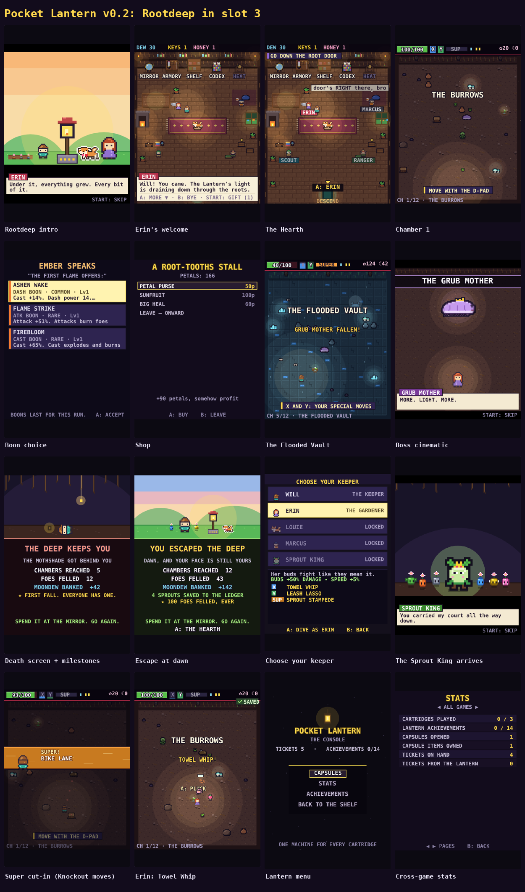
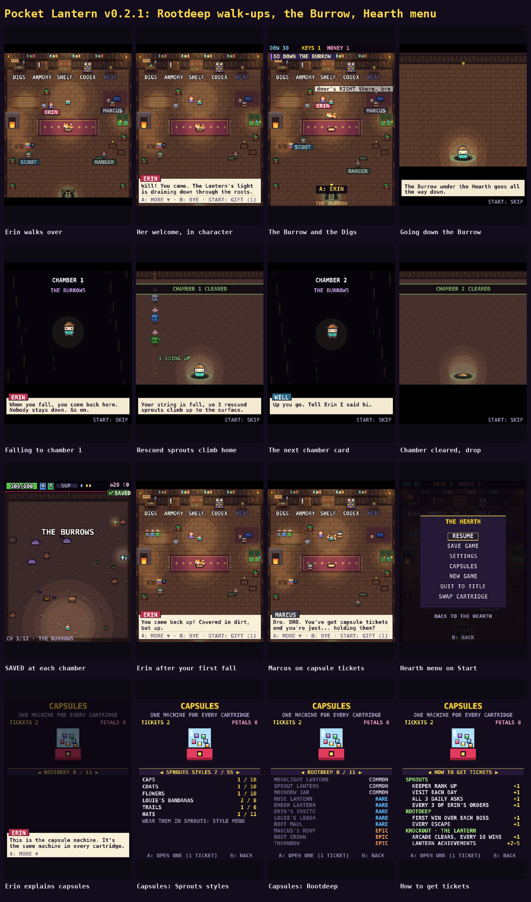

# Pocket Lantern v0.2 changelog

v0.2 put **Rootdeep** (a roguelite under the Sprouts valley) in cartridge slot 3 and overhauled it. v0.2.1 added the
Burrow scenes, characters who walk over to explain things, and a Hearth menu. Everything was built and tested on Nov 14 2026.

## v0.2.1, Nov 14 2026

| | |
| --- | --- |
| Send this | `share/pocket-lantern-v0.2.1-share.zip` |
| Frozen copy | `backups/pocket-lantern_2026-11-14_v0.2.1_BACKUP.html` |
| Tests | `tests/` (11 scripts), results in `playtest/TEST_REPORT.md` |

**The Burrow and the levels** (`68de12b`)
- The door at the bottom of the Hearth is now **the Burrow**. The upgrade station (once the Mirror) is now **the Sprout Digs**.
- Every trip down plays a short keeper-specific scene: walk to the hole, drop in, fall, then the chamber card.
  On the very first run, Erin gives you a push instead.
- Between every chamber: CHAMBER N CLEARED, any rescued sprouts climbing home (when your string is full),
  the drop, and the next chamber's card. 2.6 seconds when nothing needs saying; A and Start skip.

**Characters explain things** (`68de12b`)
- When there's something to learn, someone walks across the Hearth to you with letterbox bars, then talks. Each happens once:
  Erin's welcome; Erin after your first fall (Moondew, the Digs); keeper unlocks; Erin on the Ledger (taking 3 down,
  the string, overflow, the Exchange); the Ranger after your first escape (the Pact); Marcus once you hold capsule tickets.

**Menus and saving** (`68de12b`)
- Capsules: left and right page through what's inside for each cartridge, plus how to get tickets in every game.
  Erin explains the machine the first time.
- Start in the Hearth: Resume, Save Game, Settings, Capsules, New Game (three presses), Quit to Title, Swap Cartridge.
- A green SAVED mark when it saves (by hand, entering the Hearth, every chamber).

## v0.2, Nov 14 2026: the patch log

Each line is one commit. Screenshots from each pass are in `playtest/dev-photos/`.

| # | Commit | Pass | Photos |
| --- | --- | --- | --- |
| 1 | `1d0447e` | Rootdeep (lil Bottie's v2.9) imported into slot 3, merged with the newest Sprouts | `01_first_tour_after_import` |
| 2 | `48ae8f8` | Keepers get their Knockout moves on X, Y and super; piercing-shot fix; text fixes | `03_knockout_moves_on_xy` |
| 3 | `c03950d` | Graphics overhaul in Sprouts' style (true-size pixels, lantern lighting); the Sprout King (invented, approved) | `02_sprouts_style_reference`, `04_graphics_overhaul_sprout_king` |
| 4 | `0788155` | Text audit fixes at iPhone 16 Pro Max size; first cinematics; Rootdeep capsule unlocks; RESET PULLS in Sprouts | |
| 5 | `dfb7da0` | Cinematics in Sprouts' cutscene style: title scene, each boss, escape, end screens | `05_cinematics_pass` |
| 6 | `c73533e` | After Will's playtest: a roomier Hearth, sprouts that swarm foes, pots, berries, chests, boom bulbs; Marcus's voice | `07_swarm_and_interactables` |
| 7 | `bd6b086` | Animated attacks, a living Hearth, foe warnings, hit-stop | `06_attack_animations` |
| 8 | `70337dc` | Marcus only mentions Waterworks once it's built in Sprouts | |
| 9 | `396ba0c` | Saves and checkpoints, Continue / New Game, onboarding, death cinematic with milestones | `08_saves_onboarding_dialogue` |
| 10 | `5483596` | Text sits right in its boxes on iPhone (placed by cap height) | `09_text_in_boxes_fix` |
| 11 | `be5cb62` | Dialogue that grows with you (38 topics), keeper logs, a smoother start | `08_saves_onboarding_dialogue` |
| 12 | `c9a9bdc` | v0.2 release: share package, frozen backup, README | |
| 13 | `61e9314` | Playtest report, development snapshot, boon card fix | `../` (01 to 11) |
| 14 | `2358c50` | Lantern menu on the shelf: one capsule machine, cross-game stats, 14 Lantern achievements; the Burrow (station) | `10_lantern_menu_and_burrow` |
| 15 | `68de12b` | v0.2.1 work (above) | `11_v0.2.1_walkups_burrow_menus`, `12_v0.2.1_text_audit_sheets` |
| 16 | `b98014c` | v0.2.1 release: frozen backup and share package | |

Later, on the v0.3 line: `2641811` merged the v0.1 music backup in, and `626ef0c` restored the v0.2 share package
(it had been overwritten with later builds) and added an audit note to the handoff.

## Known issues (still open)

- Not confirmed on an iPhone yet: text placement, touch feel, frame rate.
- The Mothshade caused every death in the bot playtest; its blink-behind may feel unfair.
- Rooms are short (4 to 10 seconds). Difficulty is untouched on purpose until Will has played more.
- Rootdeep's music is a placeholder synth loop; it needs a William Cohen track.
- The two William Cohen Sprouts songs aren't embedded in the game file (they only stream on claude.ai). Full copies are in `v0.1/music/`.
- The "three little auto balls" Will dislikes are still unidentified.
