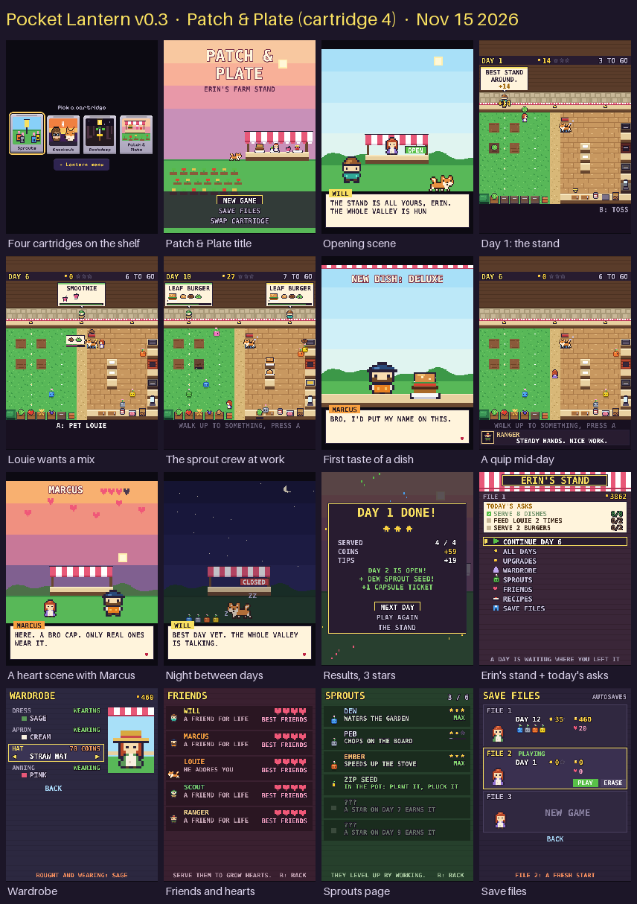

# Pocket Lantern changelog

## v0.3 (pre-alpha), Nov 15 2026: Patch & Plate

**New cartridge 4: Patch & Plate, Erin's farm stand.** Built from Erin's own wish list: a phone game for a couple of
minutes at a time, levels she can finish and put down, growing a farm and filling orders, no story to remember, and
saving without thinking about it.

### At a glance

| | |
| --- | --- |
| Days (levels) | 12, about 1 to 3 minutes each, 4 to 10 customers |
| Recipes | 9 (salad to the combo meal), plus Louie's 6 cravings |
| Crops / stations | 5 crops; chop board, oven, grill, fryer, juicer, pantry |
| Sprout crew | 6 helpers (Sprouts' canon types), 3 levels each |
| Friends | Will, Marcus, Louie, Scout, Ranger: 4 hearts each, 12 heart scenes |
| Wardrobe | 6 dresses, 4 aprons, 6 hats, 4 awning colours |
| Upgrades | 8 kinds, 14 levels in all |
| Save files | 3, plus autosave and pause-on-phone-down |
| Music | "Cook E" (dreamliketextures752), built in |
| Source | `v0.3/src/patchplate.js`, 982 lines |
| Build | 13.98 MB single HTML file (claude.ai page limit 16 MB) |
| Tests | 76 automated checks, all passing (`playtest/TEST_REPORT.md`) |

### Patch log

Each pass is one commit on `claude/optimistic-brown-0pt8kf`. Details live in `handoffs/HANDOFF_v0.3.md`.

**0. Repo audit before starting** (`2641811`, `626ef0c`)
- The v0.2 share folder and zip had been overwritten with later builds; restored to the true v0.2 (matches its backup).
- The v0.1 music backup (`v0.1/music/`, the only full copies of the two William Cohen songs) was missing from this
  line; merged back in. Notes appended to the v0.2 handoff and README.

**1. Patch & Plate** (`c465f7e`)
- Cartridge slot 4 on the shelf (four across), boot, update, draw, music and text-placement hooks.
- One-screen stand: garden, kitchen, three serving windows. D-pad walks tile by tile; A uses what Erin faces; B tosses.
- Plant, water, pick, chop, bake, grill, fry, juice, plate, serve. Order cards with patience bars and tips.
- 12 days with a one-line character card each; stars by coins; first 3 stars on a day pays a capsule ticket.
- Upgrades between days. Helper arrow on days 1 to 3. Recipe book on Select.
- Saves every few seconds, on pause and swap, and when the phone is put down (the day pauses too).
- `v0.3/build.py` builds from the live v0.2 build, so Rootdeep work in v0.2 keeps flowing in.

**2. The sprout crew** (`6f1405f`)
- Sprout seeds from new days grow in a clay pot's plot; plucked sprouts join the crew for good.
- Dew waters, Peb chops, Ember speeds the stove, Zip carries food to plates, Leaf replants, Lucky charms customers.
- Sprouts level up by working. SPROUTS page.
- Fix: Leaf filled the garden with unneeded crops and stalled late days; it now replants only what orders need.

**3. Scenes, quips and its own music** (`d980fe6`)
- Short skippable scenes in Sprouts' cutscene style: opening, night between days, first taste of every dish, a new sprout.
- Portrait quips at good moments (clutch serve, streaks, rush, first and last plate), never stopping play.
- "Cook E" embedded as Patch & Plate's music; confetti on 3-star days.
- Fix: food that fit no plate could stall the day while both plates were finished orders; it's now tossed.

**4. Engagement: save files, Louie, friends, asks, wardrobe** (`0cc5ab1`)
- Three save files with NEW GAME and ERASE (three presses); file 1 keeps the original save.
- The stand became a hub: one-press PLAY DAY N, today's three asks, wardrobe, friends, save files; fades and a cursor.
- Louie lives at the stand: kibble, loaf or fresh lettuce, sometimes a mix, sometimes he changes his mind. Pet him.
  A happy Louie adds 10% to tips. (He no longer orders at a window.)
- Friendship hearts with scenes for Will, Marcus and Louie; gifts unlock the flower crown and the bro cap.
- Erin's wardrobe and the stand's awning colour. Many more lines for Will, Erin, Louie and Marcus.
- Design notes from a short look at what keeps cozy and cooking games played (in the handoff).

**5. Release** (this commit)
- Frozen backup, share folder and zip, checksums, this changelog, the test report and the update gallery.

### Invented (flag to Will; he hands out canon)

The name Patch & Plate; Erin's farm stand; every line of dialogue except Marcus's reused Sprouts lines ("I've got a guy.
The guy is me.", "See one, send one"); Erin's apron and her back/side sprites; the sprouts' kitchen jobs; Louie's cravings,
bed and bowl; the hearts, scenes and gifts; the wardrobe items. Marcus never mentions Waterworks.

### Known and open

- Nobody has played it on a phone yet. Erin's verdict on pace, difficulty and the hints is the next step.
- The Lantern menu (in Rootdeep's code) still counts three cartridges.
- "Fresh let" in Louie's menu was read as fresh lettuce.
- Patch & Plate has no capsule items of its own yet.

## Earlier versions

- **v0.2.1** (Nov 14): Rootdeep's Burrow descent, between-chamber scenes, walk-ups, Hearth menu. See `v0.2/README.md`.
- **v0.2** (Nov 14): Rootdeep in cartridge slot 3. See `v0.2/handoffs/HANDOFF_2026-11-14_v0.2.md`.
- **v0.1** (Nov 14): Sprouts and North Coast Knockout; the rollback point. See `v0.1/`.
