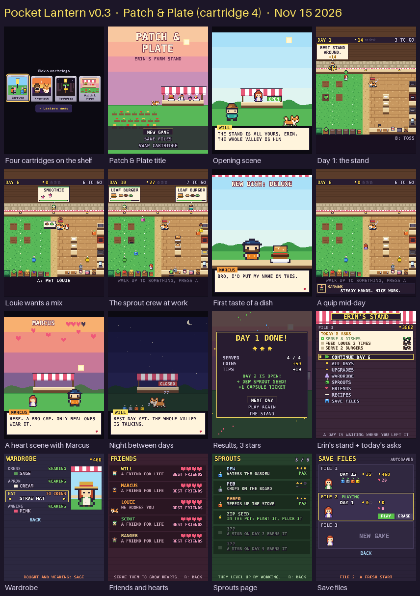

# Pocket Lantern v0.3 (pre-alpha)

v0.2.1 plus **Patch & Plate** in cartridge slot 4: Erin's farm stand. v0.2 and v0.1 are untouched.
**What's new:** `CHANGELOG.md` (with the patch log and a picture of every new screen).

## Get it

- **Send this:** `share/pocket-lantern-v0.3-share.zip` (the game plus HOW-TO-PLAY).
- **Frozen copy:** `backups/pocket-lantern_2026-11-15_v0.3_BACKUP.html`
- **Play online:** https://claude.ai/artifact/La2XdpyQ81qjXkUSs5ceLP (private until shared from its Share menu)

| File | SHA-256 |
| --- | --- |
| `backups/pocket-lantern_2026-11-15_v0.3_BACKUP.html` | `aafd16aced370bcccfce0bdcc93404afa3de140eae2f35f907fc29ae4489b9db` |
| `share/pocket-lantern-v0.3/pocket-lantern.html` | `aafd16aced370bcccfce0bdcc93404afa3de140eae2f35f907fc29ae4489b9db` (same file) |
| `share/pocket-lantern-v0.3/HOW-TO-PLAY.md` | `8cf6027bf1fa29f5115e786755144adfda24d11b5c307e9324e22dedb2ae66cb` |
| `share/pocket-lantern-v0.3-share.zip` | `91db5bd7d5230b528a94d84abdaee55278318a5a697c02d3fefdb494d0ba1c3b` |
| `music/cook-e.mp3` | `bf574b3a9b5a8fad6c49250b86e5d5de02a9a403a5e70a10795f6daf5e435591` |

## Folders

| Folder | What it is |
| --- | --- |
| `games/` | The working build: `pocket-lantern_2026-11-14_v21_wip.html`. Made by `build.py`; don't hand-edit it. |
| `src/` | `patchplate.js`, Patch & Plate's source. Edit this, then run `python3 v0.3/build.py`. |
| `build.py` | Builds `games/` from the **current v0.2 build** + `v0.2/src/rootdeep.js` + the slot-4 hooks + `src/patchplate.js` + the song. |
| `music/` | "Cook E", Patch & Plate's song, with its cover art and checksums. Embedded by `build.py`. |
| `backups/` | Frozen copies. Never edit or replace; add new dated copies. |
| `share/` | What you send to people: the game, its how-to, and a zip. |
| `tests/` | `pp_test.js`: 76 checks. `node v0.3/tests/pp_test.js` from the repo root. |
| `playtest/` | `TEST_REPORT.md`, the update gallery, and screenshots from the test run (iPhone 16 Pro Max size). |
| `handoffs/` | `HANDOFF_v0.3.md`: what Patch & Plate is, how it's wired in, every pass, what's invented, what's open. |

## Why v0.3 is built from v0.2 instead of copied

Another session works on Rootdeep in `v0.2/`. `build.py` reads v0.2 fresh every time, so that work arrives here by
running it again, and nothing in `v0.2/` is ever written. Each console hook must match exactly once; if v0.2 changes one
of those lines, the build stops and names it instead of guessing. When v0.2 is done for good, point `BASE` and `RD_SRC`
in `build.py` at files inside `v0.3/`.

## Saves (Patch & Plate)

`localStorage` keys: `patchplate-v1` (file 1, the original save), `patchplate-v1-s2`, `patchplate-v1-s3`, and
`patchplate-meta` (the last file played). Add new fields with defaults; never rename the keys or change their format.
