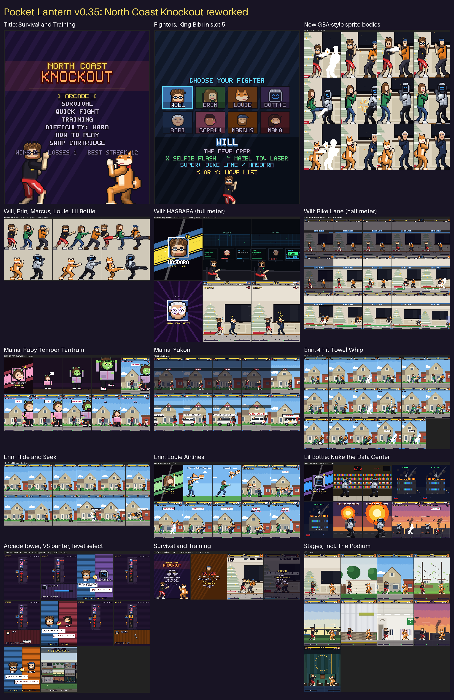
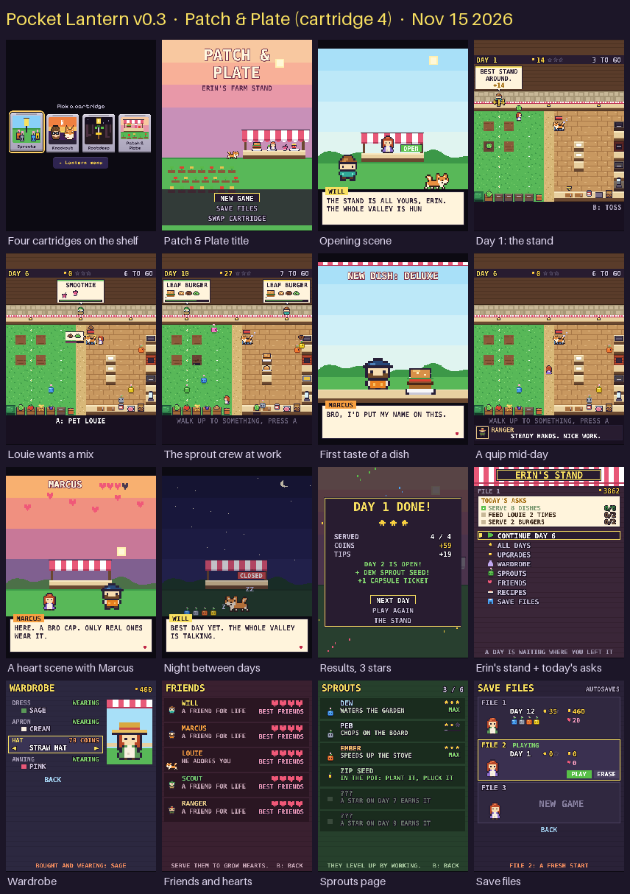

# Pocket Lantern changelog

## v0.35 (pre-alpha), Nov 15 2026: North Coast Knockout reworked

v0.3 with a reworked **North Coast Knockout** (cartridge 2). Sprouts, Rootdeep, Patch & Plate, the console and the Lantern
menu are exactly v0.3's (the build swaps only Knockout's script). Developed in `alt/` (see `alt/CHANGELOG.md` for every pass,
including the experiments that were rolled back) and brought into the main line here.

### At a glance

| | |
| --- | --- |
| Feel | snappier: jumps 26 frames (was 34), attack poses snap in 1 frame, shorter hit flash, faster get-up |
| Look | GBA-style sprite bodies (shaped limbs, one outline per layer, pixel-snapped), 5x7 pixel font, smears, hit bursts, closer camera |
| Fighters | 8; King Bibi replaces Gas Guy |
| Full-meter cinematic supers | 4: HASBARA (Will), RUBY TEMPER TANTRUM (Mama), LOUIE AIRLINES (Erin), NUKE THE DATA CENTER (Lil Bottie) |
| Half-meter supers | Bike Lane (Will), Yukon (Mama), Sprout Stampede (Erin), Air Support (Lil Bottie) |
| Modes | Arcade (tower between fights), Survival (new), Quick Fight (level select), Training (new) |
| Stages | 9 (new: The Podium) |
| Dialogue | VS-screen banter, more win quotes, in-fight barks for Will, Marcus, Lil Bottie |
| Music | `ko-bottie` / `ko-<fighter>` / `ko-stage-<n>` song slots (`music/`) |
| Build | 14.04 MB (page limit 16 MB) |
| Tests | Knockout lab (feel, supers, modes, text audit, frame sheets) plus every v0.2/v0.3 suite: all pass |

### Feel

- Gravity 1250 to 2100, jump speed 380 to 470, lighter fall multiplier: a neutral jump is 26 frames and 49 px (was 34 and 55).
- Attack, hit, block, dash, special, throw and super poses snap to their key pose (was eased over about 6 frames, so a 9-frame jab
  never fully reached its strike pose). Idle and walk step on held frames.
- Hit flash 2 or 4 frames (was 6). Knockdown to standing 0.64 s (was 0.83). Round intro 1.5 s (was 1.75). Landing squat.
- **Launcher chase:** down+A that connects can be cancelled into a jump by holding Up, so launcher, jump, air attack is a real
  juggle (the old launcher's recovery outlasted the victim's air time). The CPU uses it too.

### Look

- **Sprite bodies (rig v3):** every part is a shaped piece (tapered limbs with rounded joints, chest and shoulders, round fists,
  shaped shoes) with three tones lit from the front and above. Each fighter is drawn at 1x into three layers (back limbs / body /
  front arm), snapped to whole pixels, with one outline around each layer's silhouette: no stacked outlines where limbs cross.
  Outfits per fighter: Will's tee and red shorts, Erin's top, jeans and long hair, Marcus's hoodie and boots, Louie's fur,
  cream belly, paws and tail, Lil Bottie's puffer, robot joints and dreads, King Bibi's suit and tie, Corbin's cape, Mama's hair.
  Heads sit on a neck above the shoulders (they used to sink into the torso). Sprites are cached by pose (about 2.1 ms a frame).
- Guard up at the chin in idle and walk.
- Heads redrawn from Will's photos: Will (curls, round glasses, ginger beard), Lil Bottie (LED ^ ^ face, headphones), Louie's
  red plaid collar, Erin's eyes; King Bibi drawn new.
- 5x7 pixel font with outline and shadow on every Knockout screen (widths unchanged, so no layout moved).
- Motion smears on strikes, 8-ray hit bursts, closer camera, a stage grade (darker sky edge and floor).

### Fighters and moves

- **King Bibi** (replaces Gas Guy): X RED LINE (diagram, then a red line along the floor, a low), Y IRON DOME (invulnerable dome
  that destroys projectiles, plus a shove), super COALITION (five suited partners), finisher FILIBUSTER-ALITY. Stage: THE PODIUM.
- **Will:** half meter BIKE LANE (a lane paints itself, Will rides through with Louie in the basket, 14); full meter **HASBARA**:
  S-rank cut-in, Will at the IDF HASBARA DESK in a headset (TARGET, THREAD, TALKING PTS, POSTING..., SHIFTING, SENT!), the
  opponent's eyes go spiral (WHO IS THE BAD GUY? MIND: RECALIBRATED), then they punch themselves: 4 x 4.5 + 12 = 30, SELF OWN!
- **Mama:** half meter **YUKON** (the white Yukon reverses in, Mama yelling, MOTHERFUCKER!!! on impact, 15); full meter
  **RUBY TEMPER TANTRUM**: Ruby says NO., grows Hulk-green (RUBY SMASH!!), stomps twice (NO NAP!, MINE!), throws a toy car,
  WAAAAAAH! shockwave: 5 + 5 + 6 + 14 = 30, then shrinks back: hehe.
- **Erin:** X **TOWEL WHIP** is a four-hit string stepping in and out (lash, overhead crack, low snap, final crack that
  launches): about 19 (was one 8). Y **HIDE AND SEEK** (replaces Leash Lasso): she hides in a bush, 1... 2... 3..., then
  FOUND YOU! from behind, unblockable, 11. Half meter SPROUT STAMPEDE; full meter **LOUIE AIRLINES**: Louie folded into a paper
  airplane (ears for wings), thrown, loops the opponent with hearts, three passes and a dive (ZOOM!, ZOOM ZOOM!, BORK!!): 30,
  then GOOD BOY.
- **Lil Bottie:** half meter AIR SUPPORT; full meter **NUKE THE DATA CENTER**, staged from Will's three images: the bodega
  (I MIGHT JUST HIT MY RATE LIMIT, then RATE LIMIT REACHED), the data center on fire with him waving on the roof, walking away from
  the exploding tower, then the blast hits the stage: 5 + 5 + 20 = 30, DELETED.
- All full supers share one cut-in and hit system and can't be blocked; the clock stops during them.

### Modes and screens

- **Survival:** one-round fights back to back, health carries over (+30 per win), the CPU sharpens every 4 wins, best streak saved.
- **Training:** no clock, health and meter refill, combo damage readout, dummy STAND / BLOCK / CPU from pause.
- **Arcade tower** (Mortal Kombat style) before every arcade fight: your portrait climbs to the next opponent, then a short scene
  for them (Louie's ball, Marcus's wrench, Erin's flowers, Bottie's loading bar, King Bibi's podium, Corbin's hearts, Mama's Yukon,
  Will's commits). A skips.
- **Level select:** Quick Fight's stage screen is a 3x3 grid of stage thumbnails.
- **VS banter:** each fighter says a line before the fight; set exchanges for matchups (Marcus calls Will a J, Bottie wrote Will a
  handoff, and more). More win quotes, and barks on 4-hit combos and when low (Will, Marcus, Lil Bottie).
- Title and pause menus are built from labels; Will's and the others' move lists show both supers (SEL 1/2, SEL FULL).

### Music

- `music/tracks.json` + mp3s are embedded by `build.py`. Tag `ko-bottie` plays in fights with Lil Bottie (and on his VS screen
  and tower); `ko-<fighter id>` and `ko-stage-<n>` work the same way; `ko` replaces the default everywhere. About 2 MB of room left.

### Saves

- Knockout keeps `ncko-v1`. One new field, `surv` (Survival best streak); old saves load unchanged.

### Invented (flag to Will; he hands out canon)

Move and mode names: SURVIVAL, TRAINING, FORCE PUSH (dormant, see the handoff), King Bibi's whole kit (RED LINE, IRON DOME,
COALITION, FILIBUSTER-ALITY, his normals and lines), LOUIE AIRLINES (name), HIDE AND SEEK's staging, the HASBARA / RUBY / NUKE
staging details, every banter line, win quote and bark, the tower scenes. HASBARA, RUBY TEMPER TANTRUM, the Yukon and its
MOTHERFUCKER!!!, Louie as a paper airplane, Erin's towel whip and hide and seek, and NUKE THE DATA CENTER are Will's ideas.

### Known and open

- Nothing is phone-confirmed.
- Heads face the camera while bodies face the side; turning them toward the opponent is the next art step (Will to approve one first).
- The Lantern menu is v0.3's: it doesn't show the Survival streak or count it toward tickets (the ALT fork has that; see alt/).
- Rootdeep still calls Will's super BIKE LANE and has Erin's LEASH LASSO (separate game, unchanged).

## v0.3 (pre-alpha), Nov 15 2026: Patch & Plate

**New cartridge 4: Patch & Plate, Erin's farm stand.** Built from Erin's own wish list: a phone game for a couple of
minutes at a time, levels she can finish and put down, growing a farm and filling orders, no story to remember, and
saving without thinking about it.

### At a glance

| | |
| --- | --- |
| Days (levels) | 12, about 1 to 3 minutes each, 4 to 10 customers |
| Recipes | 9 (salad to the combo meal), plus Louie's 6 cravings |
| Crops / stations | 5 crops; chop board, oven, grill, fryer, juicer, pantry |
| Sprout crew | 6 helpers (Sprouts' canon types), 3 levels each |
| Friends | Will, Marcus, Louie, Scout, Ranger: 4 hearts each, 12 heart scenes |
| Wardrobe | 6 dresses, 4 aprons, 6 hats, 4 awning colours |
| Upgrades | 8 kinds, 14 levels in all |
| Save files | 3, plus autosave and pause-on-phone-down |
| Music | "Cook E" (dreamliketextures752), built in |
| Source | `v0.3/src/patchplate.js`, 982 lines |
| Build | 13.98 MB single HTML file (claude.ai page limit 16 MB) |
| Tests | 76 automated checks, all passing (`playtest/TEST_REPORT.md`) |

### Patch log

Each pass is one commit on `claude/optimistic-brown-0pt8kf`. Details live in `handoffs/HANDOFF_v0.3.md`.

**0. Repo audit before starting** (`2641811`, `626ef0c`)
- The v0.2 share folder and zip had been overwritten with later builds; restored to the true v0.2 (matches its backup).
- The v0.1 music backup (`v0.1/music/`, the only full copies of the two William Cohen songs) was missing from this
  line; merged back in. Notes appended to the v0.2 handoff and README.

**1. Patch & Plate** (`c465f7e`)
- Cartridge slot 4 on the shelf (four across), boot, update, draw, music and text-placement hooks.
- One-screen stand: garden, kitchen, three serving windows. D-pad walks tile by tile; A uses what Erin faces; B tosses.
- Plant, water, pick, chop, bake, grill, fry, juice, plate, serve. Order cards with patience bars and tips.
- 12 days with a one-line character card each; stars by coins; first 3 stars on a day pays a capsule ticket.
- Upgrades between days. Helper arrow on days 1 to 3. Recipe book on Select.
- Saves every few seconds, on pause and swap, and when the phone is put down (the day pauses too).
- `v0.3/build.py` builds from the live v0.2 build, so Rootdeep work in v0.2 keeps flowing in.

**2. The sprout crew** (`6f1405f`)
- Sprout seeds from new days grow in a clay pot's plot; plucked sprouts join the crew for good.
- Dew waters, Peb chops, Ember speeds the stove, Zip carries food to plates, Leaf replants, Lucky charms customers.
- Sprouts level up by working. SPROUTS page.
- Fix: Leaf filled the garden with unneeded crops and stalled late days; it now replants only what orders need.

**3. Scenes, quips and its own music** (`d980fe6`)
- Short skippable scenes in Sprouts' cutscene style: opening, night between days, first taste of every dish, a new sprout.
- Portrait quips at good moments (clutch serve, streaks, rush, first and last plate), never stopping play.
- "Cook E" embedded as Patch & Plate's music; confetti on 3-star days.
- Fix: food that fit no plate could stall the day while both plates were finished orders; it's now tossed.

**4. Engagement: save files, Louie, friends, asks, wardrobe** (`0cc5ab1`)
- Three save files with NEW GAME and ERASE (three presses); file 1 keeps the original save.
- The stand became a hub: one-press PLAY DAY N, today's three asks, wardrobe, friends, save files; fades and a cursor.
- Louie lives at the stand: kibble, loaf or fresh lettuce, sometimes a mix, sometimes he changes his mind. Pet him.
  A happy Louie adds 10% to tips. (He no longer orders at a window.)
- Friendship hearts with scenes for Will, Marcus and Louie; gifts unlock the flower crown and the bro cap.
- Erin's wardrobe and the stand's awning colour. Many more lines for Will, Erin, Louie and Marcus.
- Design notes from a short look at what keeps cozy and cooking games played (in the handoff).

**5. Release** (this commit)
- Frozen backup, share folder and zip, checksums, this changelog, the test report and the update gallery.

### Invented (flag to Will; he hands out canon)

The name Patch & Plate; Erin's farm stand; every line of dialogue except Marcus's reused Sprouts lines ("I've got a guy.
The guy is me.", "See one, send one"); Erin's apron and her back/side sprites; the sprouts' kitchen jobs; Louie's cravings,
bed and bowl; the hearts, scenes and gifts; the wardrobe items. Marcus never mentions Waterworks.

### Known and open

- Nobody has played it on a phone yet. Erin's verdict on pace, difficulty and the hints is the next step.
- The Lantern menu (in Rootdeep's code) still counts three cartridges.
- "Fresh let" in Louie's menu was read as fresh lettuce.
- Patch & Plate has no capsule items of its own yet.

## Earlier versions

- **v0.2.1** (Nov 14): Rootdeep's Burrow descent, between-chamber scenes, walk-ups, Hearth menu. See `v0.2/README.md`.
- **v0.2** (Nov 14): Rootdeep in cartridge slot 3. See `v0.2/handoffs/HANDOFF_2026-11-14_v0.2.md`.
- **v0.1** (Nov 14): Sprouts and North Coast Knockout; the rollback point. See `v0.1/`.
