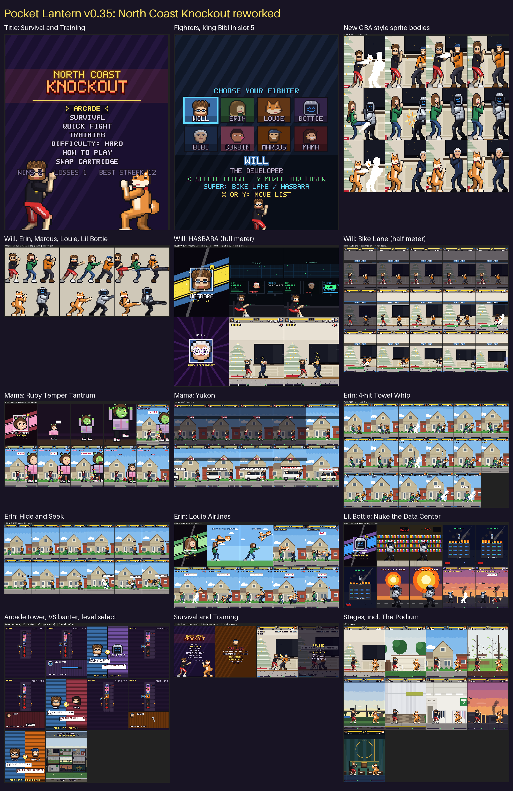

# Pocket Lantern v0.35 (pre-alpha)

v0.3 plus a reworked **North Coast Knockout** in cartridge slot 2. v0.3, v0.2 and v0.1 are untouched.
**What's new:** `CHANGELOG.md` (with the full v0.3 and earlier history below it). **Start here if you're working on it:**
`handoffs/HANDOFF_v0.35.md`.

## Get it

- **Send this:** `share/pocket-lantern-v0.35-share.zip` (the game plus HOW-TO-PLAY).
- **Frozen copy:** `backups/pocket-lantern_2026-11-15_v0.35_BACKUP.html`
- **Play online:** https://claude.ai/artifact/RWVyQkWDvLWhgivEukFzRv is the ALT test page (same Knockout, with separate saves).
  Private until shared from its Share menu.

| File | SHA-256 |
| --- | --- |
| `backups/pocket-lantern_2026-11-15_v0.35_BACKUP.html` | `1aadf52cc5d7e33955797a059339384272f15b7680d89905cf01bb9fc9633129` |
| `share/pocket-lantern-v0.35/pocket-lantern.html` | `1aadf52cc5d7e33955797a059339384272f15b7680d89905cf01bb9fc9633129` (same file) |
| `share/pocket-lantern-v0.35/HOW-TO-PLAY.md` | `949c37006aa20ed84dbebba94a7c2d1471de1291ecac56c0b1ce7818b93de28e` |
| `share/pocket-lantern-v0.35-share.zip` | `404c8a42681dfaae56cc20048f16a6b562b569ddb89dcf9ac527174955ab1109` |
| `src/knockout.js` | `08b17dfc45e745a2fe7dd7b2199ead09fdd47f984c061dcd775b639cdf0821e1` |

## Folders

| Folder | What it is |
| --- | --- |
| `games/` | The working build: `pocket-lantern_2026-11-15_v22.html`. Made by `build.py`; don't hand-edit it. |
| `src/` | `knockout.js`, Knockout's source. Edit this, then run `python3 v0.35/build.py`. |
| `build.py` | Builds `games/` from the **frozen v0.3 backup** (read-only) with Knockout's script swapped for `src/knockout.js`, plus any songs in `music/`. |
| `music/` | Empty for now: drop mp3s here and list them in `tracks.json` (see `music/README.md`) for Lil Bottie's songs and others. |
| `backups/` | Frozen copies. Never edit or replace; add new dated copies. |
| `share/` | What you send to people: the game, its how-to, and a zip. |
| `tests/` | `ko_lab.js`: Knockout feel metrics, supers, modes, a text audit of every menu, and frame sheets. `node v0.35/tests/ko_lab.js`. |
| `playtest/` | `TEST_REPORT.md`, the update gallery, and `ko/` (frame sheets and screenshots from the test run, iPhone 16 Pro Max size). |
| `handoffs/` | `HANDOFF_v0.35.md`: what changed in Knockout, how it's built, what's invented, what's open, how to continue. |

## Why v0.35 is built from the v0.3 backup

Only Knockout changed. Building from v0.3's frozen backup means Sprouts, Rootdeep, Patch & Plate and the console are
byte-for-byte v0.3's, and nothing in `v0.3/` is ever written. Knockout's own development history lives in `alt/` (the
experimental fork), which this version was tested against.

## Saves

Same keys as v0.3. Knockout's `ncko-v1` gains one field, `surv` (Survival best streak). Old saves load unchanged.
